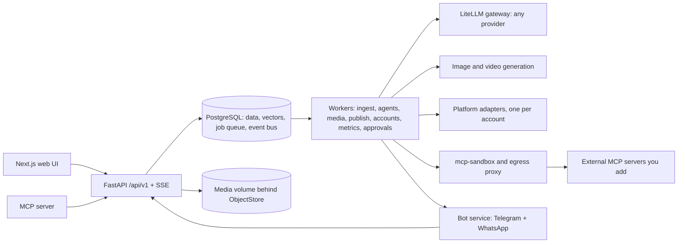

# Mera

An AI-powered, all-in-one social media manager. Mera discovers news from sources you
configure and uses a team of AI agents to draft posts — **one uniquely written post per
target account**, not one post cross-posted. Work is organized into workspaces, each
holding any number of accounts per platform, grouped into **account groups** so one story
can go to a whole group at once. Every post goes to you for approval through a Telegram or
WhatsApp bot, where you can approve the whole set or individual accounts, then publishes
staggered across them. It also triages comments, drafts replies, and reports on
performance per account, group, and workspace.

Everything is driven by one headless API, which is consumed equally by the web UI, the
approval bots, the app's own MCP server, and (later) mobile and desktop clients.

> **Status: Phase 1 built (Sprints 1–14); Phase 2 complete (P2-M1 to P2-M10).** On top of
> Phase 1 (ingestion, per-account drafting, approvals, Telegram, staggered publishing to
> LinkedIn, Facebook, Instagram, Threads and X, analytics), Phase 2 adds Bluesky and
> Mastodon, WhatsApp approvals, second factors and team features, generated images with
> budgets, a unified inbox with reply approval, a Scheduler agent and full orchestration,
> Mera's own MCP server for Claude, and a reviewed registry of external MCP servers for the
> agents. All of it is tested in sandbox mode. What still needs the outside world (live
> credentials, a real phone, a CI runner) is listed in [PROGRESS.md](PROGRESS.md); the
> settings are in [GUIDE.md](GUIDE.md) §10 and the decisions in
> [ADR-0016](docs/adr/0016-phase2-delivery-decisions.md).

## Documentation

Read in order for a full picture, or jump to what you need.

| Doc | What it covers |
| --- | --- |
| [00 - Overview](docs/00-overview.md) | Product scope, glossary, phase map, and open questions that still need your input |
| [01 - Architecture](docs/01-architecture.md) | Component diagram, service boundaries, deployment topology, stack rationale |
| [02 - Sequence Flows](docs/02-sequence-flows.md) | The five critical end-to-end flows as sequence diagrams |
| [03 - Data Model](docs/03-data-model.md) | ERD, entity dictionary, approval-integrity model, tenancy enforcement |
| [04 - API Contract](docs/04-api-contract.md) | REST endpoint list, auth, errors, SSE, inbound and outbound webhooks |
| [05 - MCP](docs/05-mcp.md) | Mera as an MCP server (tools, resources, prompts) and as an MCP client you add your own servers to; targets MCP `2026-07-28`, dual-era with `2025-11-25` |
| [06 - Agents](docs/06-agents.md) | Agent contracts, tools, handoffs, guardrails, prompts, cost accounting |
| [07 - Approval Bots](docs/07-approval-bots.md) | Telegram and WhatsApp design: messages, tokens, pairing, quorum, escalation |
| [08 - Platform Matrix](docs/08-platform-matrix.md) | What each social platform supports, what access costs, what is not possible |
| [09 - Security](docs/09-security.md) | Threat model, secrets, prompt-injection defenses, guardrails, GDPR, audit |
| [10 - Repo Structure](docs/10-repo-structure.md) | Monorepo layout, Compose services, sandbox mode, testing, CI |
| [11 - Phase 1 Plan](docs/11-phase1-plan.md) | Ordered Phase 1 task breakdown with acceptance criteria |
| [12 - Implementation Plan](docs/12-implementation-plan.md) | Spec fixes, the two build tracks, mockup-to-scope map, sprint order |
| [13 - Phase 2 Plan](docs/13-phase2-plan.md) | Go-live, then breadth: Bluesky/Mastodon, WhatsApp, team and second factors, media generation, inbox, MCP; sprints 15–26 |
| [14 - Phase 3 Plan](docs/14-phase3-plan.md) | Phase 2 go-live, then intelligence and autonomy: analytics loop, A/B tests, Assisted and Full Autopilot, digests, webhooks, cloning, MCP refinements, GDPR; sprints 27–36 |
| [ADRs](docs/adr/) | Architecture decision records for the load-bearing calls |
| [GUIDE.md](GUIDE.md) | **Start here to run it:** setup, Makefile targets, secrets, callback URLs, first real post, Telegram |
| [Runbooks](docs/runbooks/) | Telegram bot, connecting accounts, groups and staggering, kill switch, restore from backup |

## The shape of it in one diagram



One PostgreSQL instance is the entire data tier: relational data, `pgvector` embeddings,
the job queue, and the event bus. There is no Redis and no object-storage service. See
[ADR-0002](docs/adr/0002-single-postgres-datastore.md) for why, and for the limits that
choice imposes.

## The shape of a post

```
post_set          one story, one editorial unit
  └── post_variant     one per TARGET ACCOUNT — drafted, approved, scheduled, published
        └── post_version     immutable, hashed, the exact bytes an approval names
```

This is the structural consequence of multi-account posting, and most of the design
follows from it. See
[ADR-0011](docs/adr/0011-post-sets-and-per-account-variants.md).

## Core design commitments

These are the non-negotiables the whole design is built around.

1. **Nothing publishes without an approval bound to the exact bytes, for the exact
   account.** Post content is immutable and versioned per account. An approval references
   one `post_version` and its content hash, and the hash includes the target account. Edit
   the post and that approval is dead; a version approved for one account cannot publish
   to another. See [ADR-0004](docs/adr/0004-immutable-post-versions.md) and
   [ADR-0011](docs/adr/0011-post-sets-and-per-account-variants.md).
2. **The target account is the unit of everything.** Drafting, approval, scheduling,
   publishing, failure, and measurement all happen per account. Two accounts on one
   platform get genuinely different text, published minutes apart — a platform rule, not a
   preference.
3. **The API is the only way in.** The web UI, the bots, and the MCP server are all just
   clients. No business logic lives outside the API and workers.
4. **Fetched content is hostile.** Articles, comments, and inbound bot messages are
   untrusted data, never instructions. See [09 - Security](docs/09-security.md).
5. **Official platform APIs only.** No scraping, no browser automation that violates a
   platform's terms.
6. **Every action is attributable.** Human, agent, or bot channel, the audit log records
   who did what, when, through which surface, on which account, against which version.
7. **Any LLM key works.** Every model call routes through LiteLLM, selected per agent by a
   model string. See [ADR-0010](docs/adr/0010-litellm-as-llm-gateway.md).
8. **External MCP tools are default-deny.** A server you add starts with every tool off.
   Tools are enabled per tool, scoped per group and bound per agent. stdio servers run
   sandboxed, and write tools pause for approval with their exact arguments. See
   [ADR-0013](docs/adr/0013-external-mcp-default-deny-and-dual-era.md).

## Local setup

Prerequisites: Docker, Python 3.11 with [`uv`](https://docs.astral.sh/uv/), Node 24 with
pnpm 9 (`corepack enable pnpm`). On Windows without `make`, use `scripts/dev.ps1 <target>`.

```bash
make setup        # .env from the example, uv sync, pnpm install
make up           # postgres, migrate, api, worker, bots, web
make test         # backend unit + integration (integration needs Docker)
```

- `.env` is optional: Compose falls back to `.env.example`, which runs in sandbox mode.
- If port 5432 is already in use, set `POSTGRES_HOST_PORT` (for example 5433).
- To have the audit log mark actions taken in the web UI as `web`, set the same random
  `MERA_WEB_PROXY_SECRET` for the API and the web app (`openssl rand -base64 32`).
- Ingestion (M4) summarises and embeds with a deterministic offline fake by default
  (`SANDBOX_LLM=true`). To use real models, set `SANDBOX_LLM=false` and provide the
  provider keys LiteLLM reads (`ANTHROPIC_API_KEY`, `OPENAI_API_KEY`); models are set by
  `RESEARCH_MODEL`, `RESEARCH_FALLBACKS` and `EMBEDDING_MODEL`. Spend per workspace per
  UTC day is capped by `RESEARCH_DAILY_COST_CAP_USD` (default 2.00).
- Feeds are fetched with the operating system's trust store, so a corporate TLS proxy's
  CA works without extra setup (`HTTP_SYSTEM_TRUST_STORE=false` falls back to certifi).
- Behind a TLS-intercepting proxy, image builds need your organisation's CA bundle:
  `export CORP_CA_BUNDLE=/path/to/ca.pem` before `make up`.

The API serves `/healthz`, `/readyz` (reports the applied migration) and
`/api/v1/docs`. The web app runs at <http://localhost:3000>.

### Your first sandbox post set

`make up` also runs a one-shot **seed** (sandbox only): sign in at
<http://localhost:3000> as `demo@example.com` / `Mera demo password 2026!`. The **Acme**
workspace has five accounts in two overlapping groups, 90 days of history in Analytics,
and one post set waiting in the Approval Queue. To see the whole loop:

1. **Approval Channels → Get a pairing code.** With no `TELEGRAM_BOT_TOKEN`, the phone is
   simulated: open **Sandbox inspector** (`/w/acme/sandbox`) and send `/pair CODE`.
2. The waiting set's card arrives on the sandbox phone: every account's text, the source
   once, the stagger. Tap **Approve all**, or a number for one account's detail.
3. The worker publishes each account at its staggered time through the sandbox platform;
   the **Calendar** shows each slot, the inspector shows each simulated platform call, and
   the phone gets the per-account publish report.

To fail one account on purpose, connect a sandbox account whose handle contains `fail`
(or `flaky`, `ratelimit`, `lost`, `revoked`): its siblings still publish.

### Telegram and real platforms

- **Telegram:** set `TELEGRAM_BOT_TOKEN`, `TELEGRAM_BOT_USERNAME` and
  `TELEGRAM_WEBHOOK_SECRET` in `.env`. Locally, without public HTTPS, set
  `TELEGRAM_MODE=polling` and run `cd backend && uv run python -m mera.bots.poll`. See
  [the runbook](docs/runbooks/telegram-bot-setup.md).
- **Platforms:** turn sandbox off and set each platform's app credentials
  (`LINKEDIN_*`, `META_*`, `THREADS_*`, `X_*`). See
  [connecting social accounts](docs/runbooks/connecting-social-accounts.md).
- Seed again by hand: `docker compose run --rm seed` (idempotent).
