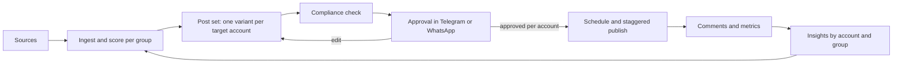

# 00 - Overview

This document frames what Mera is, what it is deliberately not, the vocabulary the rest
of the documentation set uses, and the questions that still need your answer before
Phase 1 implementation starts.

---

## 1. Product goal

Mera closes the loop between "something newsworthy happened in my field" and "a good post
about it went out on my accounts, with my approval, at a sensible time."

The loop:

Two commitments distinguish it.

**Step E.** Most tools in this space either require you to sit in a web app, or they
automate end to end and hope for the best. Mera's default is that a human approves from
their phone, in a messaging app they already have open, in under ten seconds, and the
system can prove afterwards exactly what was approved.

**Step C.** One story becomes a **post set**: one variant per target account, not one post
cross-posted. Two LinkedIn accounts in the same group get genuinely different wording, and
each is edited, approved, scheduled, and published on its own. This is partly an editorial
position and partly a hard requirement, since X suspends accounts that post substantially
similar content to each other.

---

## 2. Scope

### 2.1 In scope

| Area | Summary |
| --- | --- |
| Workspaces | Create, rename, clone, archive, delete. Members with roles, optionally narrowed to named groups or accounts. Nothing crosses a workspace boundary |
| Accounts and groups | Any number of accounts per platform per workspace. Named groups mixing platforms, an account in many groups, group-level voice, schedule, pillars, policy, and autopilot |
| Content sourcing | RSS/Atom, news APIs, Google News queries, Reddit, YouTube, Hacker News, blogs, newsletter email ingest, external MCP servers. Sources link to groups |
| Processing | Extraction, URL and semantic deduplication, summarization, topic classification, relevance scoring against each group's content pillars |
| Drafting | Post sets with one variant per **target account**, brand voice profiles at three levels, A/B variants, rewrite actions |
| Media | Upload your own images and video, or have the Media agent generate them from the post; regenerate on demand; per-platform resizing and re-encoding; AI alt text |
| Hashtags | A Hashtag agent that proposes tags per account from the post's content, each platform's conventions, and how your own past tags actually performed |
| Approval | Telegram and WhatsApp bots, pluggable channel adapters, whole-set or per-account decisions, quorum, expiry, escalation, quiet hours, bulk digests |
| Publishing | Adapter per platform, publish now, schedule, best-time slots, staggered publishing within a group, partial-failure handling, edit, delete, repost, retries, dead-letter queue |
| Engagement | Unified inbox across every account, filterable by group and account; sentiment and intent classification; AI replies sent as the correct account; auto-reply rules |
| Analytics | Metrics at post, post set, account, group, platform, and workspace level; dashboards; historical snapshots; AI insights; feedback into scoring and scheduling |
| Automation | Manual, Assisted, and Full Autopilot modes with guardrails, set per workspace, group, or account; kill switch at all three levels |
| Interfaces | Web UI, versioned REST API with OpenAPI 3.1, SSE real-time, MCP server (spec `2026-07-28`, dual-era with `2025-11-25`), MCP client with self-serve server registration (form, JSON import, MCP Registry catalog), outbound webhooks |
| Governance | Workspaces, RBAC with optional group scoping, audit log, encrypted secrets per account, usage tracking, GDPR export and deletion |

### 2.2 Explicitly out of scope

Recording these prevents scope drift later.

- **Scraping or browser automation of social platforms.** Official APIs only. Where an
  API cannot do something, Mera says so in the UI rather than working around it. This
  constraint is load-bearing and shapes [08 - Platform Matrix](08-platform-matrix.md).
- **Being a link shortener, CRM, or ad manager.** Mera reads analytics; it does not buy
  or manage paid placements.
- **Self-serve signup, subscription billing, and usage metering.** The near-term posture
  is self-hosted for yourself or a small team. The schema leaves room (see
  [03 - Data Model](03-data-model.md)), but no billing code is planned before Phase 4.
- **Hosted multi-tenant SaaS operations.** Tenant isolation is built correctly from day
  one so this stays possible, but the operational apparatus (per-tenant encryption keys
  in a KMS, noisy-neighbour controls, tenant-aware autoscaling) is a documented seam, not
  an implementation.
- **A visual workflow builder.** Custom agents and workflows are YAML-first. A visual
  builder is Phase 4 at the earliest.

### 2.3 Non-goals that are often assumed

- Mera does not guarantee a post is factually correct. The Editor/Compliance agent checks
  a draft *against its source article* and flags divergence. That catches fabrication, not
  a source that is itself wrong.
- Mera does not promise feature parity across platforms. The capability matrix drives
  what the UI offers per platform, and gaps are shown rather than faked.

---

## 3. Design posture

Five decisions set the tone for everything downstream.

**Approval integrity is the core invariant, not a feature.** The publishing path refuses
to run without a valid, unexpired, single-use approval that names an exact immutable
content version. Everything in the data model and the bot protocol exists to make that
check trustworthy. This is the one thing that must never have a bypass.

**The API is the product boundary.** The web UI, the Telegram bot, the WhatsApp bot, the
MCP server, and any future mobile app are peers. All of them authenticate, all of them
hit `/api/v1`, all of them obey the same RBAC. A feature that only works in the web UI is
a bug.

**One datastore.** PostgreSQL holds relational data, vectors, the job queue, and the event
bus. The practical payoff is a two-container local setup, one backup artifact, and
transactional enqueue (a job and the row it operates on commit together, so there is no
"enqueued but the write rolled back" class of bug). The cost is connection pressure and a
throughput ceiling, both quantified in [ADR-0002](adr/0002-single-postgres-datastore.md).

**The target account is the unit of everything.** Drafting, approval, scheduling,
publishing, failure, and measurement all happen per account, never per platform and never
per set. A set posting to five accounts is five independently moving parts that share a
source article and a headline state. This costs more rows and more moving pieces than
cross-posting one body everywhere, and it is the only shape in which "approve LinkedIn,
reject X, reword the second X account" is expressible without special cases. See
[ADR-0011](adr/0011-post-sets-and-per-account-variants.md).

**Everything fetched is untrusted.** An article body, a comment, and an inbound Telegram
message are all attacker-controlled text that will be fed to an LLM. They are structurally
separated from instructions, never concatenated into system prompts, and never permitted
to select a tool. See [09 - Security](09-security.md).

---

## 4. Glossary

The documentation set uses these terms precisely. Where a term maps to a database table,
the table name is given.

| Term | Meaning |
| --- | --- |
| **Workspace** (`workspace`) | The tenancy boundary. Every piece of data belongs to exactly one. A personal user has one; an agency has one per client brand. One user can belong to many, with a different role in each. |
| **Social account** (`social_account`) | One connected account on one platform. A workspace may hold several per platform: two LinkedIn, two X, one Facebook Page. Each has its own credentials, limits, voice, schedule, and automation settings. |
| **Account group** (`account_group`) | A named set of accounts that may mix platforms, such as "Tech News" = 2 LinkedIn + 2 X + 1 Facebook Page. An account may belong to several. Carries its own voice, schedule, pillars, policy, autopilot mode, and stagger settings. |
| **Member scope** (`member_scope`) | An optional narrowing of a member's role to named groups or accounts. A scoped Approver only ever sees and decides on what they are scoped to. |
| **Source** (`source`) | A configured origin of content: one feed, one subreddit, one query. Has its own filters and fetch schedule, and may be linked to specific groups. |
| **Content item** (`content_item`) | One deduplicated, extracted, summarized article or post pulled from a source. The raw material. |
| **Content pillar** (`content_pillar`) | A theme you want to be known for, defined for a workspace or for one group. Relevance scoring measures a content item against these, per group. |
| **Brand voice** (`brand_voice`) | A reusable profile: tone, banned words, emoji policy, CTA style, few-shot example posts, target audience. Defined at workspace, group, or account level. |
| **Post set** (`post_set`) | The mutable editorial container: one source item or idea, fanned out to one variant per target account. The thing you think of as "the post". |
| **Post variant** (`post_variant`) | The mutable per-**account** container inside a set. Holds that account's voice, schedule, stagger offset, enabled flag, state, and current version. The unit that is approved, scheduled, published, and measured. |
| **Post version** (`post_version`) | An immutable snapshot of one variant's content, identified by a `content_hash`. The exact bytes an approval binds to. Media is inside the hash, by checksum. |
| **Media asset** (`media_asset`) | One image or video, uploaded by you or generated by the Media agent, plus its per-platform renditions, checksum, and alt text. |
| **Media job** (`media_job`) | An asynchronous generation request. Video generation takes minutes, so it is a tracked job with its own state rather than a blocking call. |
| **Hashtag stat** (`hashtag_stat`) | Observed per-account performance of a tag you have used, which is what makes hashtag suggestions evidence-based rather than generic. |
| **MCP server registration** (`mcp_server_registration`) | An external MCP server you added, by form, pasted JSON, the catalog, or over MCP. Starts in `pending_review`; holds its transport, pinned package or URL, detected protocol era, group scope and egress allowlist. |
| **MCP tool** (`mcp_tool`) | One tool discovered on a registered server, with its reviewed risk class (`read`, `write`, `destructive`), approval policy, enabled flag, and the schema hash that detects redefinition. Bound to agents through `mcp_agent_binding`. |
| **MCP tool call** (`mcp_tool_call`) | The audit record of one external tool call. When the tool is write-gated, it links to the `approval_request` (subject type `mcp_tool_call`) that allowed it. |
| **`mcp-sandbox`** | The service that runs stdio MCP servers, one locked-down container each, with network access only through the egress proxy. |
| **Composite hash** | `post_set.composite_hash`, a hash over the enabled variants' hashes. What an "Approve all" button names. |
| **Stagger** | The per-account delay applied when publishing to a group, computed once at scheduling time and stored, so the calendar and the retry agree with what the approver saw. |
| **Approval policy** (`approval_policy`) | The rules at workspace, group, or account level: who must approve, how many, through which channel, how long before expiry, escalation chain, quiet hours. Resolves to the strictest applicable value. |
| **Approval request** (`approval_request`) | A live ask for a human decision on one post set (or comment reply, or deletion). Carries state, expiry, quorum progress, and one `approval_variant_state` row per target account. |
| **Approval decision** (`approval_decision`) | One approver's recorded answer: approve, reject, edit, reschedule, regenerate, optionally scoped to specific accounts. Immutable, attributed, timestamped. |
| **Approval channel** (`approval_channel`) | A configured delivery route: a Telegram bot, a WhatsApp number. Implements the `ApprovalChannel` interface. One bot serves every workspace. |
| **Approver binding** (`approver_binding`) | The verified link between a Mera user and their Telegram chat ID or WhatsApp number. Created by the pairing flow. |
| **Approval token** | A signed, single-use, expiring credential embedded in a bot button. Binds to a request, an action, an approver, a set of target accounts, and a content hash. |
| **Scheduled post** (`scheduled_post`) | One approved post version for one target account with a fire time, waiting in the queue. A set produces one per enabled account. |
| **Published post** (`published_post`) | The record of a successful publish on one account, holding the platform's own ID so metrics and comments can be linked back. |
| **Agent** | A specialized LLM-driven worker with a typed input contract, a typed output contract, its own tool allowlist, and its own prompt. |
| **Agent run** (`agent_run`) | One end-to-end execution of a workflow or a single agent, recorded with every step, prompt, output, tool call, and cost. |
| **Agent step** (`agent_step`) | One unit inside a run: an LLM call, a tool call, a guardrail evaluation, or a handoff. |
| **Guardrail** | A deterministic or model-based check that can block or downgrade an action: toxicity, PII, blocked topics, daily caps, duplicate detection, cross-account duplication, hallucination check. |
| **Autopilot mode** | Manual, Assisted, or Full Autopilot. Set per workspace, group, or account, resolving to the strictest applicable value. |
| **Kill switch** | An immediate halt of all automated activity at workspace, group, or account level, triggerable from the UI, API, MCP, or a bot command. |
| **LLM gateway** | LiteLLM, the single library every model call goes through. One `model` string selects the provider, so any provider key works without a Mera code change. See [ADR-0010](adr/0010-litellm-as-llm-gateway.md). |
| **Capability matrix** | The machine-readable description of what each platform adapter supports, consumed by both the UI and the agents. |
| **Sandbox mode** | A run mode where platform adapters and approval channels are replaced by fakes, so the full flow can be exercised without touching a real network. |

---

## 5. Phase map

Each phase is shippable on its own. The phase boundaries are drawn so that the risky
external dependency (platform API access) is isolated.

### Phase 1 - MVP

The vertical slice that proves the core invariant end to end, on more than one account.

Auth; **workspaces** with a switcher and RBAC; **multiple accounts per platform**;
**account groups and posting to a group**, with per-account variants, staggered
publishing, and partial-failure handling; RSS/Atom sources and the ingestion pipeline;
Research and Writer agents; the composer with per-account previews; the **Telegram
approval bot** with whole-set and per-account approve, reject, edit, and reschedule; the
web approval queue kept in sync with it; **media upload** with the source OG image and
per-platform resizing; the **Hashtag agent** using content and platform conventions;
publishing and scheduling for **LinkedIn and X**; basic analytics per account and group;
the REST API with OpenAPI docs and a generated TypeScript SDK; sandbox mode.

Detailed breakdown in [11 - Phase 1 Plan](11-phase1-plan.md).

### Phase 2 - Breadth

Facebook Pages, Threads, Instagram, Bluesky, and Mastodon adapters; the **WhatsApp
approval bot** including Business verification and template approval; team members, roles,
and **group-scoped permissions**; multiple approvers with quorum and escalation; the
unified inbox with AI-suggested replies sent as the correct account; the full multi-agent
orchestration including Editor/Compliance, Media, Scheduler, and Engagement agents;
**image and video generation** behind a pluggable provider, with regenerate from the
composer and the bot; the **MCP server** (stateless, dual-era, OAuth 2.1, with
second factors by URL elicitation); the **MCP client registry**, so you can add your own
MCP servers by form or by pasting a Claude Desktop config, review each tool's risk, scope
servers to groups and bind tools per agent, with stdio servers sandboxed and write tools
approval-gated through the bots.

### Phase 3 - Intelligence and autonomy

Content sources over MCP, the MCP Registry catalog, per-agent MCP budgets, circuit
breakers, tool-description screening and re-review on schema change; Assisted and Full Autopilot modes per
workspace, group, and account with the complete guardrail set; advanced analytics with
group-versus-group comparison and the insights feedback loop into scoring, scheduling, and
**hashtag selection**; outbound webhooks; A/B testing with variant attribution; daily
approval digests; **workspace cloning**.

### Phase 4 - Reach

Mobile and desktop clients with push-notification approval; the custom agent builder;
agency features for many client workspaces and white-label reports; billing driven by
workspace usage records; Slack and Teams approval channels; YouTube and Reddit adapters.

---

## 6. Assumptions

Recorded so that, if one turns out to be wrong, the blast radius is visible.

| # | Assumption | If wrong |
| --- | --- | --- |
| A1 | Scale is personal to small-team: a handful of workspaces, tens of social accounts across them, tens of posts per week, low thousands of content items per month. | The single-Postgres decision ([ADR-0002](adr/0002-single-postgres-datastore.md)) is the first thing to revisit. Note that account count multiplies agent runs and publish jobs, so this is the assumption most likely to move. |
| A2 | The deployment is a single machine or small VM running Docker Compose. | Kubernetes manifests become Phase 2 work rather than a documented seam. |
| A3 | You will supply at least one API key for a provider LiteLLM supports that offers function or tool calling. | Only the key changes, not the code. The agent layer's provider abstraction is LiteLLM's, so a different provider is a configuration edit. |
| A4 | A publicly reachable HTTPS URL can be arranged for bot webhooks (a cheap VPS, Cloudflare Tunnel, or ngrok for development). | The Telegram bot falls back to long polling, which is supported but changes the bot service's deployment shape. |
| A5 | Approval latency tolerance is minutes to hours, not seconds. | The periodic sweeper interval and the SSE design need tightening. |
| A6 | A single Mera instance serves one owner's set of workspaces; there is no hostile tenant. | Per-tenant encryption keys and noisy-neighbour controls move from "seam" to "required". |
| A7 | Platform API terms and pricing shift frequently, and any figures in this documentation are a snapshot to be re-verified at implementation time. | See [08 - Platform Matrix](08-platform-matrix.md), which carries this warning prominently. |

---

## 7. Questions

### 7.1 Answered

**Q1 - LLM provider and models. → LiteLLM, any key.**

Every model call goes through [LiteLLM](https://docs.litellm.ai), so the provider is a
`model` string in configuration rather than a code path. `anthropic/claude-sonnet-4-5`,
`openai/gpt-5`, `gemini/gemini-2.5-pro`, `groq/llama-3.3-70b`, `ollama/llama3.1`, or
anything else LiteLLM supports, selected **per agent**, with an ordered fallback list per
agent for rate limits and outages. Whatever key you have is the key it uses.

What this buys beyond convenience: one OpenAI-shaped request and response schema, one
usage and cost object across providers so the spend accounting in
[06 - Agents](06-agents.md) section 8 works identically everywhere, built-in retries and
fallbacks, and a local Ollama path that needs no separate adapter. What it costs is a
dependency sitting in the hottest part of the agent layer, and a lowest-common-denominator
surface where a provider-specific feature needs an escape hatch. Both are accepted, with
the reasoning and the exit path in
[ADR-0010](adr/0010-litellm-as-llm-gateway.md).

Mera still wraps it in the `LLMProvider` port rather than calling `litellm.acompletion`
from agent code, for one reason: the wrapper is where the `agent_step` row, the cost
record, and the untrusted-content discipline are enforced, and none of those are optional.

### 7.2 Still open

None of these block the documentation review. Q2 and Q4 block parts of Phase 1
implementation.

**Q2 - Platform API access you already hold.** Specifically:
- Do you have an X developer account, and at which tier?
- Do you have a LinkedIn developer app, and has it been approved for `w_member_social`?
  Do you need company-page posting, which requires partner approval?
- Do you have a Meta Business account, needed later for WhatsApp, Instagram, and Threads?

This matters because [08 - Platform Matrix](08-platform-matrix.md) will recommend building
a free, frictionless adapter (Bluesky or Mastodon) first so the end-to-end flow is
testable while approvals are pending.

**Q3 - Webhook hosting for the Telegram bot.** Public HTTPS endpoint from day one, or
long polling for local development with webhooks later? This changes the bot service's
deployment shape but not its internal design.

**Q4 - Your content pillars and brand voice.** Needed for realistic seed data and for the
relevance scorer to be demonstrably doing something. Three to five pillars and a few
example posts in your voice would be enough.

**Q5 - Timezone and posting windows.** The Scheduler agent and quiet hours need a default
workspace timezone and your rough acceptable posting window.

**Q6 - WhatsApp priority.** WhatsApp Business API requires business verification,
a dedicated number, and template pre-approval, which is a multi-day external process with
per-message costs. Telegram has none of that. Confirm WhatsApp stays in Phase 2 rather
than Phase 1.

**Q7 - Analytics expectations for LinkedIn personal profiles.** The LinkedIn API gives
organizations rich analytics and personal profiles almost nothing. If LinkedIn personal
posting is your main use case, "basic analytics" in Phase 1 may be limited to what Mera
can observe itself. Worth confirming you are comfortable with that before it surprises
you.

**Q8 - How many accounts, and which groups?** The multi-account design is sized for tens
of accounts per workspace, which is comfortable. The number that actually matters is **how
many accounts share a platform within one group**, because that is what drives the
cross-account differentiation work and the X duplicate-content risk. Two LinkedIn plus two
X in one group, per the brief's example, is the shape the seed data and the guardrails are
being built around. Tell me if it is materially larger.

**Q9 - Image and video generation provider.** Generation is pluggable, so this is a
configuration question, but it has cost and latency consequences worth settling before
Phase 2. Image generation is seconds and fractions of a cent; **video generation is
minutes and dollars per clip**, which is why it is modelled as a tracked asynchronous job
with its own cost cap rather than as a step inside a drafting run. Do you have a provider
in mind, and should video be enabled at all in the first pass, or image only?

**Q10 - Which MCP servers do you expect to add?** The registry is generic and the
controls that make it safe (default deny, sandboxing, approval-gated writes) ship with it
in Phase 2 either way. What the answer changes: whether a **stdio** server is in your
first set, which decides how early `mcp-sandbox` needs hardening on your host (gVisor
availability). Whether any are **third-party hosted** servers you don't control, which
argues for pulling re-review on schema change forward from Phase 3. And whether any need
**per-user** OAuth (an agent acting as the specific person who triggered it), which the
current design deliberately leaves out.

---

## 8. How to review this documentation set

Suggested order and what to look for:

1. [01 - Architecture](01-architecture.md) - does the service split make sense for how you
   intend to run this?
2. [03 - Data Model](03-data-model.md) sections 2 and 6 - the workspace → group → account →
   variant hierarchy and the post-set model. Everything about multi-account posting follows
   from these two sections, so an objection here is cheapest to raise now.
3. [02 - Sequence Flows](02-sequence-flows.md) - the approval flows are where the design
   earns its keep. Check whether the edit-and-re-approve and expiry-escalation paths match
   what you pictured.
4. [07 - Approval Bots](07-approval-bots.md) - the message layouts and button sets are the
   part you will actually touch every day. This is the highest-value thing to critique,
   particularly the multi-account card, which is the hardest layout in the product.
5. [08 - Platform Matrix](08-platform-matrix.md) - contains the uncomfortable facts about
   what the platforms will and will not let us do, including the multi-account rules. Read
   before committing to Phase 1 scope.
6. [11 - Phase 1 Plan](11-phase1-plan.md) - the concrete build order.

Everything else is reference.
