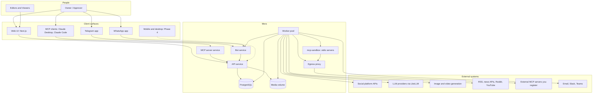
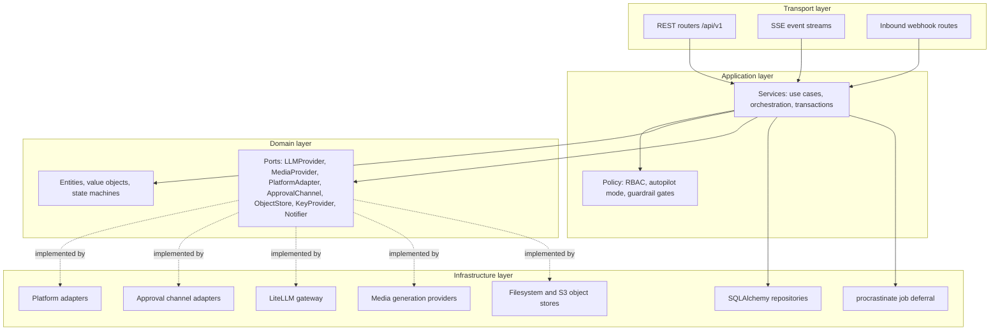
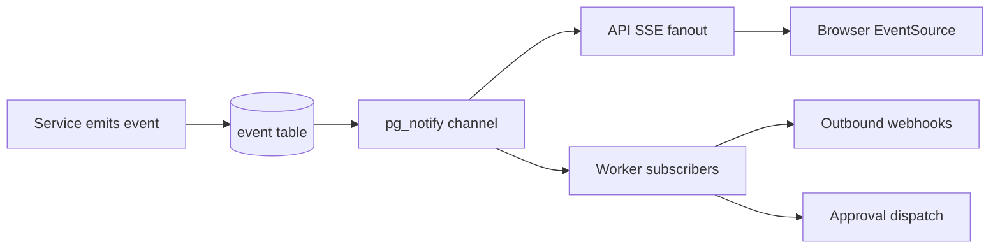
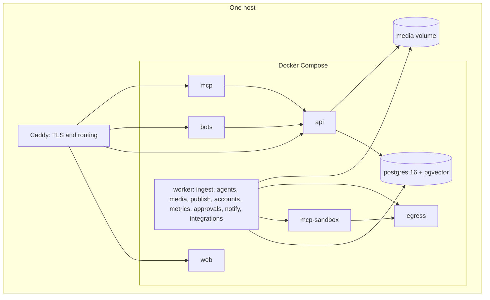

# 01 - Architecture

Component structure, service boundaries, runtime paths, deployment topology, and the
reasoning behind the stack. Sequence diagrams for specific flows live in
[02 - Sequence Flows](02-sequence-flows.md).

---

## 1. System context



Note the direction of the arrows around the bot service: it both receives webhooks from
the messaging platforms and is called by workers when an approval needs to go out. It
never touches the database.

---

## 2. Services

Seven deployable units plus the database. Each is a separate process with its own
lifecycle, scaling characteristics, and failure domain.

| Service | Runtime | Responsibility | Why it is separate |
| --- | --- | --- | --- |
| `api` | FastAPI under Uvicorn | All business logic, authorization, validation, persistence. Serves `/api/v1` and SSE streams. | It is the product boundary. Everything else is a client. |
| `worker` | procrastinate worker | Executes queued jobs: ingestion, agent runs, publishing, metrics sync, approval sweeping, notification delivery. | Long, slow, retryable work must not occupy request threads or be killed by an HTTP timeout. |
| `bots` | FastAPI (thin) | Terminates Telegram and WhatsApp webhooks, verifies signatures, translates platform payloads to API calls, renders outbound approval messages. | Different trust boundary (public internet, platform-controlled payloads), different scaling, and it must stay up even while the API is being redeployed so webhook deliveries are not lost. |
| `mcp` | MCP Python SDK, Streamable HTTP and stdio, dual-era (`2026-07-28` stateless and `2025-11-25` handshake) | Exposes Mera tools, resources, and prompts to MCP clients. | Different protocol. Also needs to run as a local stdio process for Claude Desktop, which the API cannot do. Stateless under the modern revision, so any replica serves any request. |
| `mcp-sandbox` | Container supervisor (gVisor `runsc` where available, otherwise rootless with seccomp) | Runs each registered **stdio** MCP server in its own locked-down container, started on demand, relaying JSON-RPC from workers. | It executes third-party code. It must not share a process, filesystem or network with anything that holds credentials or reaches Postgres. See [05 - MCP](05-mcp.md) section 2.4. |
| `egress` | Forward proxy (Smokescreen or Squid with a deny-list) | The only route from `mcp-sandbox`, and from worker calls to remote MCP servers, to the internet. Enforces each registration's hostname allowlist and the SSRF deny-list. | One enforcement point for outbound MCP traffic, which a Python-level check in each caller would not reliably be. |
| `web` | Next.js | The UI. Server components may proxy, but all data comes from the API. | Separate release cadence, separate language, and keeping it client-only guarantees the API stays complete. |
| `postgres` | PostgreSQL 16 + `pgvector`, `pg_trgm`, `pgcrypto` | Relational data, vectors, job queue, event bus. | See [ADR-0002](adr/0002-single-postgres-datastore.md). |

### 2.1 Worker specialization

`worker` is one image. Queue selection at startup decides what an instance picks up:

| Queue | Work | Concurrency profile |
| --- | --- | --- |
| `ingest` | Fetch feeds, extract article text, embed, dedupe, classify, score per group | IO-heavy, high concurrency, tolerant of lag |
| `agents` | LLM-driven agent runs, one fan-out per target account | Slow, token-metered, moderate concurrency, expensive to retry |
| `media` | Image and video generation, resizing, re-encoding, thumbnailing | Long-running (video runs to minutes), low concurrency, expensive per job |
| `publish` | Platform API writes | **Serialized per social account** via procrastinate queueing locks, so rate limits and ordering hold |
| `accounts` | Token refresh, health checks, capability refresh, rate-budget reads | Scheduled, short, must not be starved by publishing |
| `metrics` | Periodic metric pulls and snapshot writes, rollups by account and group | Scheduled, bursty, idempotent |
| `approvals` | Reminder, escalation, and expiry sweeps; outbound approval dispatch | Short, frequent, latency-sensitive |
| `notify` | Email, Slack, Teams, outbound webhooks | Short, retryable |
| `integrations` | External MCP discovery, health probes, OAuth refresh for MCP registrations, `subscriptions/listen` listeners, `tasks/get` polling | Scheduled plus a few long-lived listeners; isolated so a slow external server cannot starve ingestion |

On a single machine, one worker process subscribes to all queues. Under load, the `publish`
and `agents` queues get dedicated instances first, since they have the tightest
constraints: serialization and cost.

`media` is separate from `agents` for a reason that only becomes visible with video: a
single generation can occupy a slot for minutes, and sharing a pool with drafting would
let one video stall every post in the workspace. `accounts` is separate from `publish`
because a health check must still run while an account's publish lock is held by a long
retry — otherwise the system discovers a dead token only by failing to use it.

**Fan-out is per account.** A post set targeting five accounts defers five Writer jobs,
five Editor jobs, five publish jobs, and five metric syncs. Each is independently
retryable and independently attributable, which is what makes partial failure a normal
outcome rather than an error path.

### 2.2 What deliberately does not exist

- **No separate scheduler process.** procrastinate's periodic tasks run inside the worker,
  deferred through the database, so two worker instances will not double-fire a cron job.
- **No separate API gateway.** A reverse proxy (Caddy or nginx) terminates TLS and routes
  by path. It carries no logic.
- **No message broker.** See [ADR-0002](adr/0002-single-postgres-datastore.md).
- **No separate "approval service".** Approval is domain logic and lives in the API and
  the `approvals` queue. The bot service is only a transport.

---

## 3. Internal structure of the API service

Layered, with dependencies pointing inward. The layering is what makes the API reusable by
the bots, MCP, and workers without duplication.



The ports in the domain layer are the substitution points that make
[sandbox mode](10-repo-structure.md) and the test suite possible. Every one of them has a
fake implementation.

Workers import the application layer directly. A publishing job is not an HTTP call to the
API; it is the same `PublishPostService` invoked in-process. This keeps one implementation
of the approval check rather than two.

### 3.1 The one rule about the approval check

`PublishPostService` is the only code path that writes to a platform adapter, and its first
action is always:

```text
assert_publishable(post_variant_id) ->
  1. load post_variant and its current post_version
  2. recompute content_hash from the stored version and the target account,
     compare to the stored hash                                     (tamper check)
  3. load the approval_variant_state for this variant                (per-account, not per-set)
  4. state.state == APPROVED
  5. state.content_hash == post_version.content_hash                 (edit invalidation)
  6. state.post_version_id == post_variant.current_version_id        (no retargeted approval)
  7. request.approved_at + policy.validity_window > now              (staleness)
  8. quorum satisfied per the request's policy snapshot
  9. kill switch not engaged at workspace, group, or account level
 10. account.status == ACTIVE and credentials are not expired
 11. OR: the resolved autopilot mode permits unattended publish for this
     account and the variant cleared every guardrail at or above the
     configured threshold
```

The signature takes a **variant**, not a set. Publishing is always one account at a time,
so there is no call shape in which the check could be satisfied for one target and applied
to another. Checks 6 and 9 are the two the multi-account model added: the first stops an
approval granted for version 3 from publishing version 4 of the same variant, and the
second walks all three automation levels rather than only the workspace and the account.

Any failure raises and the job dead-letters rather than retrying, because none of these
conditions is resolved by waiting. The sibling variants in the same set are unaffected.
Full detail in [03 - Data Model](03-data-model.md) and
[07 - Approval Bots](07-approval-bots.md).

---

## 4. Runtime paths

### 4.1 Synchronous request path

```text
Client -> proxy -> api -> policy check -> service -> repository -> Postgres
                                       \-> defer job (same transaction)
```

Deferring a job inside the request transaction is the key property of the Postgres queue:
if the transaction rolls back, the job never existed. No compensating logic needed.

### 4.2 Asynchronous job path

```text
Postgres NOTIFY -> worker wakes -> SELECT ... FOR UPDATE SKIP LOCKED
   -> execute task -> write results -> emit domain event -> defer follow-on jobs
   -> commit
```

A job's effects and its follow-on jobs commit atomically. Partial progress is impossible
within one job; multi-step workflows are therefore modelled as chains of small jobs, each
individually atomic, with explicit state in the row they operate on.

### 4.3 Event and real-time path

Domain events are written to an append-only `event` table and announced with
`pg_notify`. Two consumers:



The table is the source of truth; `NOTIFY` is only a wakeup. A client that reconnects
replays from its last event ID out of the table, so a dropped notification costs latency,
not data. This is the main reason the event bus is a table rather than pure pub/sub.

`NOTIFY` payloads are capped at 8000 bytes by PostgreSQL, so payloads carry only
`{event_id, workspace_id, type}`. Consumers read the body from the table.

### 4.4 Real-time transport choice

SSE over WebSockets. Mera's real-time needs are server-to-client only: agent run progress,
inbox arrivals, approval state changes, notifications. SSE gives automatic reconnection
with `Last-Event-ID` replay for free, works through every proxy, and needs no separate
protocol handling. Client-to-server actions are ordinary HTTP. See
[ADR-0009](adr/0009-sse-over-websockets.md).

---

## 5. Key abstractions

Six ports carry most of the system's flexibility.

### 5.1 `PlatformAdapter`

One implementation per social platform. The interface is deliberately narrow; anything a
platform cannot do is reported through its capability descriptor rather than raising at
call time.

```python
class PlatformAdapter(Protocol):
    platform: Platform
    capabilities: PlatformCapabilities   # drives UI affordances and agent behaviour

    async def validate(self, variant: PostVariant) -> list[ValidationIssue]: ...
    async def publish(self, req: PublishRequest) -> PublishResult: ...
    async def edit(self, ref: PlatformPostRef, variant: PostVariant) -> PublishResult: ...
    async def delete(self, ref: PlatformPostRef) -> None: ...
    async def fetch_comments(self, ref: PlatformPostRef, since: datetime) -> list[RawComment]: ...
    async def reply_to_comment(self, ref: PlatformCommentRef, text: str) -> PlatformCommentRef: ...
    async def fetch_metrics(self, refs: list[PlatformPostRef]) -> list[RawMetrics]: ...
    async def refresh_credentials(self, account: SocialAccount) -> Credentials: ...
```

`PublishRequest` carries an `idempotency_key` derived from
`(social_account_id, post_version_id)`. Adapters pass it to platforms that support one
natively and otherwise use it to detect and reconcile duplicate attempts after a timeout.

`capabilities` is the machine-readable capability matrix from
[08 - Platform Matrix](08-platform-matrix.md). The UI greys out an Edit button because the
adapter says `supports_edit: false`, not because of a hardcoded platform check.

### 5.2 `ApprovalChannel`

One implementation per approval transport. Telegram and WhatsApp in Phases 1 and 2; Slack,
Teams, email, and push are later additions behind the same interface.

```python
class ApprovalChannel(Protocol):
    channel_type: ChannelType
    constraints: ChannelConstraints   # max buttons, template requirements, session windows

    async def send_approval_request(self, req: ApprovalRequest, binding: ApproverBinding) -> ChannelMessageRef: ...
    async def send_digest(self, reqs: list[ApprovalRequest], binding: ApproverBinding) -> ChannelMessageRef: ...
    async def update_message(self, ref: ChannelMessageRef, state: ApprovalRequestState) -> None: ...
    async def send_notice(self, binding: ApproverBinding, notice: Notice) -> ChannelMessageRef: ...
    async def verify_inbound(self, headers: Mapping[str, str], body: bytes) -> InboundEvent: ...
```

`constraints` exists because WhatsApp allows at most three reply buttons and requires
pre-approved templates outside a 24-hour window, while Telegram has neither limit. The
Approval agent reads the constraints and lays out the message accordingly instead of the
channel silently truncating. Detail in [07 - Approval Bots](07-approval-bots.md).

`update_message` is what keeps surfaces in sync: approve in the web UI and the Telegram
message is edited in place to show "Approved by you at 09:14 via web".

### 5.3 `LLMProvider`, backed by LiteLLM

```python
class LLMProvider(Protocol):
    async def complete(self, req: LLMRequest) -> LLMResponse: ...          # returns usage and cost
    async def complete_structured(self, req: LLMRequest, schema: type[BaseModel]) -> tuple[BaseModel, Usage]: ...
    async def embed(self, texts: list[str]) -> tuple[list[Vector], Usage]: ...
```

**One implementation**, `LiteLLMProvider`, wrapping
[LiteLLM](https://docs.litellm.ai). The provider is a `model` string resolved per agent
from `agent_definition.model`: `anthropic/claude-sonnet-4-5`, `openai/gpt-5`,
`gemini/gemini-2.5-pro`, `groq/...`, `ollama/llama3.1`, or anything else LiteLLM routes.
Any key you hold works, and adding a provider is a configuration change rather than a new
adapter.

```python
class LLMRequest(BaseModel):
    model: str                      # LiteLLM model id
    fallback_models: list[str] = []
    system: str
    untrusted_blocks: dict[str, str]   # delimited, never concatenated into system
    messages: list[Message]
    temperature: float
    max_tokens: int | None
    response_schema: type[BaseModel] | None
    timeout_s: float
    workspace_id: UUID              # for the cost cap check and usage record
    agent_run_id: UUID
    post_variant_id: UUID | None    # per-account cost attribution
```

Why the port still exists rather than calling `litellm.acompletion` from agent code: the
wrapper is where four non-optional things happen — the `agent_step` row is written before
the result is used, the cost cap is checked against today's spend, `Usage` is normalized
and persisted, and `untrusted_blocks` are rendered into the prompt inside their delimiters
so no caller can accidentally concatenate hostile text into a system message. A library
call in the agents would make all four someone's responsibility to remember.

Selection is per agent, so classification can run on a cheap model while drafting and
compliance run on a strong one, and the two can sit with different vendors. Fallbacks are
an ordered list per agent; a substitution is recorded on the step so a quality drop is
traceable rather than mysterious. Full configuration in
[06 - Agents](06-agents.md) section 7, and the trade-offs in
[ADR-0010](adr/0010-litellm-as-llm-gateway.md).

### 5.4 `MediaProvider`

Image and video generation, pluggable for the same reason the LLM is.

```python
class MediaProvider(Protocol):
    kind: Literal["image", "video"]
    model: str
    capabilities: MediaProviderCapabilities   # sizes, aspect ratios, max duration, cost

    async def generate(self, req: MediaGenerationRequest) -> MediaJobRef: ...
    async def poll(self, ref: MediaJobRef) -> MediaJobStatus: ...          # queued | running | done | failed
    async def fetch(self, ref: MediaJobRef) -> GeneratedMedia: ...         # bytes plus provenance
    async def estimate_cost(self, req: MediaGenerationRequest) -> Decimal: ...
```

The interface is **asynchronous by construction**, with `generate`, `poll`, and `fetch`
separated, because video generation takes minutes. Modelling it as a blocking call would
either hold a worker slot for the duration or time out in a way that loses an expensive
result that the provider did in fact produce. A `media_job` row tracks the request across
process restarts, so a redeploy mid-generation costs nothing.

Resizing, cropping, and re-encoding for each platform are **deterministic code**, not
provider calls, driven by the `PlatformCapabilities` media spec. The provider produces one
master asset; Mera derives the renditions. This matters because the same generated image
goes to five accounts across three platforms with different dimension requirements, and
paying a generation fee per platform would be absurd.

Uploaded media enters the identical pipeline from the second step: checksum, store, derive
renditions, generate alt text. Nothing downstream can tell whether an asset was uploaded
or generated, except by reading `media_asset.origin`.

An external MCP image-generation server registered through the UI is exposed as one more
`MediaProvider` implementation, so "use my own image service" needs no Mera change. See
[05 - MCP](05-mcp.md) section 2.10.

### 5.5 `ObjectStore`

```python
class ObjectStore(Protocol):
    async def put(self, key: str, data: bytes, content_type: str) -> StoredObject: ...
    async def get(self, key: str) -> bytes: ...
    async def delete(self, key: str) -> None: ...
    async def presigned_url(self, key: str, ttl: timedelta) -> str: ...
```

The default implementation writes to a mounted volume and serves `presigned_url` as a
short-lived HMAC-signed path through the API. An S3 implementation is written and tested
but unused, so production switches by configuration.

### 5.6 `KeyProvider`

```python
class KeyProvider(Protocol):
    async def encrypt(self, plaintext: bytes, context: dict[str, str]) -> Ciphertext: ...
    async def decrypt(self, ct: Ciphertext, context: dict[str, str]) -> bytes: ...
```

Envelope encryption for OAuth tokens, bot tokens, and external MCP credentials. The
default derives data keys from a master key in the environment; the interface matches AWS
KMS and HashiCorp Vault closely enough to drop either in. `context` carries the workspace
ID as additional authenticated data, so a ciphertext stolen from one workspace cannot be
decrypted in another. See [09 - Security](09-security.md).

---

## 6. Deployment topology

### 6.1 Local and single-host



Eight containers. `docker compose up` brings up everything, runs migrations, and seeds a demo
workspace. Routing: `/` to `web`, `/api` to `api`, `/webhooks` to `bots`, `/mcp` to `mcp`.
`mcp-sandbox` and `egress` are never routed from the proxy. They sit on an internal
network of their own. `mcp-sandbox` can reach only `egress`, and `egress` reaches only
the internet, never the Compose network.

Development without a public hostname: Cloudflare Tunnel or ngrok in front of `/webhooks`,
or Telegram long polling mode in the bot service.

### 6.2 Kubernetes-ready, not Kubernetes-now

Nothing in the design blocks a Kubernetes move, and the following properties exist
specifically to keep it open:

- Every service is stateless apart from `postgres` and the media volume.
- Configuration is environment variables only; no config files baked into images.
- `api`, `bots`, and `mcp` expose `/healthz` (liveness) and `/readyz` (readiness, which
  checks database connectivity and migration version).
- Workers terminate gracefully: on `SIGTERM` they stop accepting jobs, finish the current
  one, and exit, so a rolling update does not abandon work.
- Migrations run as a separate one-shot command, suitable for an init container or a Job.

What a Kubernetes move would need to add: a `StatefulSet` or managed Postgres, an
S3-backed `ObjectStore` instead of the volume, `HorizontalPodAutoscaler` definitions per
worker queue, and sealed secrets or external-secrets wiring to the `KeyProvider`. Called
out explicitly so nobody assumes manifests exist.

### 6.3 Connection budget

The single-Postgres decision makes connections a real constraint, so it is budgeted
rather than discovered in production.

| Consumer | Pooled connections | Notes |
| --- | --- | --- |
| `api` | 10 per process | SQLAlchemy async pool |
| `api` SSE listener | 1 per process | A single `LISTEN` connection fans out to all local SSE clients in-process |
| `worker` | 5 per process | Plus 1 dedicated `LISTEN` connection for job wakeups |
| Migrations, admin | 5 | Transient |

A single-host deployment with one of each service sits near 30 connections against a
default `max_connections` of 100. Documented here because the obvious scaling move,
PgBouncer in transaction mode, **breaks `LISTEN/NOTIFY`**. If connection pressure becomes
real, the correct order is: raise `max_connections`, then PgBouncer in transaction mode for
the API pool only while leaving listener connections direct, then reconsider
[ADR-0002](adr/0002-single-postgres-datastore.md).

---

## 7. Stack decisions and what was rejected

### 7.1 Backend: Python 3.11 + FastAPI

**Chosen** at your direction. It is a good fit regardless: the ingestion pipeline leans on
mature Python libraries (`feedparser`, `trafilatura` for article extraction, `langdetect`),
the AI and embedding ecosystem is Python-first, and FastAPI's Pydantic models generate the
OpenAPI 3.1 spec that the TypeScript SDK is built from, so the contract cannot drift from
the implementation.

**Rejected: Node/NestJS.** Would have given one language across the monorepo and shared
types without a generation step. Lost on the ingestion and AI library depth. See
[ADR-0001](adr/0001-python-fastapi-backend.md).

**Rejected: a Python/TypeScript hybrid.** Two deployment stories and a cross-language RPC
boundary in the middle of the agent layer, for no benefit once the backend is Python.

### 7.2 Persistence: PostgreSQL 16 only

**Chosen.** One datastore for relational data, `pgvector` embeddings, `pg_trgm` and
`tsvector` search, the job queue, and the event bus.

**Rejected: Postgres + Redis.** The conventional split. Redis would give cheaper rate-limit
primitives and pub/sub, at the cost of a second service to run, back up, and reason about,
plus the loss of transactional enqueue. At this scale the trade is not worth it.

**Rejected: a dedicated vector database.** Qdrant or pgvector-as-a-service would win at
millions of vectors. Mera deals in thousands, always filtered by `workspace_id` first, and
pgvector with an HNSW index handles that comfortably while keeping joins to `content_item`
possible. See [ADR-0007](adr/0007-pgvector-over-dedicated-vector-store.md).

### 7.3 Job queue: procrastinate

**Chosen.** Postgres-native, async-first, built on `LISTEN/NOTIFY` for wakeups and
`SELECT ... FOR UPDATE SKIP LOCKED` for dispatch. Gives retries with configurable
exponential backoff, periodic tasks, and **queueing locks**, which serialize jobs sharing a
lock key. Setting the lock to the social account ID makes per-account publish serialization
a property of the queue rather than hand-rolled coordination.

**Rejected: Celery with a SQLAlchemy broker.** Celery's non-Redis, non-AMQP brokers are
experimental and poorly maintained. Running Celery properly means running Redis.

**Rejected: Temporal.** The honest best fit for approval lifecycles, which are exactly the
long-running, timer-driven, signal-receiving workflows Temporal was built for. Rejected for
now on operational weight: a Temporal cluster is several more services and its own
datastore, which contradicts the single-datastore direction. The mitigation is that
approval state is an **explicit state machine in Postgres**, not implicit in queue
internals, so a Temporal migration later rewrites the drivers without touching the state
model. See [ADR-0003](adr/0003-procrastinate-over-celery-and-temporal.md).

**Rejected: `pgqueuer`.** Same architectural idea, newer and smaller. Kept as the documented
fallback if procrastinate proves limiting.

### 7.4 LLM access: LiteLLM as the only gateway

**Chosen.** One library routes every model call, selected per agent by a `model` string.
Any provider key works without a Mera code change, usage and cost come back in one shape
across vendors, and retries and fallbacks are handled below the application layer.

**Rejected: hand-written adapters per provider.** The original plan, and the obvious one.
It means writing and maintaining an adapter per vendor, each with its own structured-output
quirks, its own token-usage field names, and its own error taxonomy, purely to arrive at
the abstraction LiteLLM already is. The only real argument for it is avoiding a dependency
in a sensitive place, which the thin `LLMProvider` wrapper already addresses.

**Rejected: a self-hosted LiteLLM proxy server.** The same project also ships as a
standalone gateway process with a key-management UI and spend dashboards. That is the
right answer for a team sharing keys across many applications. Here it would be a seventh
container duplicating cost accounting that Mera already does per `agent_step`, against the
single-datastore, few-containers posture. The library stays in-process; the proxy is the
documented upgrade if key management ever outgrows environment variables.

**Rejected: a framework's built-in model abstraction** (LangChain, the Claude Agent SDK).
Adopting a model router by way of an agent framework means taking the framework too. See
section 7.5 and [ADR-0005](adr/0005-in-house-agent-orchestrator.md).

Accepted costs, stated plainly in [ADR-0010](adr/0010-litellm-as-llm-gateway.md): a
fast-moving dependency sits in the hottest path of the agent layer, provider-specific
features surface late or not at all, and a routing bug would look like a model bug. The
mitigations are a pinned version, a contract test suite run against each supported
provider, and an escape hatch that lets one agent bypass the router for a native SDK call
if a feature ever justifies it.

### 7.5 Agent orchestration: in-house over LangGraph

**Chosen:** a small orchestrator with explicit `agent_run` and `agent_step` rows, typed
Pydantic contracts per agent, and handoffs expressed as queued jobs.

**Rejected: LangGraph.** Good at graph-shaped reasoning, but Mera's hard requirements are
a complete audit trail, per-step cost attribution, human-in-the-loop pauses measured in
hours, and resumability across process restarts. Those want state in our own tables
anyway. Adopting LangGraph would mean maintaining the audit layer *and* the framework's
state, with two sources of truth about where a run is. See
[ADR-0005](adr/0005-in-house-agent-orchestrator.md).

### 7.6 Frontend: Next.js + TypeScript + Tailwind + shadcn/ui

**Chosen** per the brief. Charts via Recharts. The non-obvious constraint: the web app
consumes a **generated** TypeScript SDK built from the OpenAPI spec in CI, and calling
`fetch` against the API directly is a lint error. This is what guarantees the API stays
complete enough for the mobile and desktop clients in Phase 4.

### 7.7 Observability

Structured JSON logs with a `workspace_id`, `request_id`, `agent_run_id`, and `actor`
on every line. OpenTelemetry traces spanning HTTP request, job execution, LLM call, and
platform API call, so one trace covers "approval tapped in Telegram" through "published on
LinkedIn". Metrics exported in Prometheus format. Error tracking via Sentry, configured but
optional.

The domain-specific measurement that matters more than the generic ones: **approval
turnaround time**, **publish success rate per platform**, and **LLM spend per workspace per
day**. All three come off tables the system already writes.

---

## 8. Failure behaviour

| Failure | Behaviour |
| --- | --- |
| Postgres unavailable | Everything stops. `api` and `bots` return 503 from `/readyz`; the proxy stops routing. Telegram retries webhook delivery, so taps are not lost. |
| LLM provider down or rate-limited | LiteLLM retries, then falls over to the agent's next configured model, recording the substitution on the step. If every fallback fails, the run enters `FAILED` with the partial trace preserved, the post set stays in its prior state, and nothing publishes. |
| One account's draft fails to generate | That variant enters `BLOCKED` or `FAILED`; the rest of the set continues to approval. A set is never held hostage by its weakest target. |
| Media generation fails or times out | The `media_job` row records the failure and its cost. The variant falls back to the source OG image, or to no media where the platform allows it, and the approval card says which. Instagram, which requires media, blocks the variant instead. |
| Platform API down | The publish job for **that account** retries with exponential backoff up to the configured ceiling, then dead-letters, visible in the UI and the bot with the full error and a manual retry action. The approval stays valid. Sibling accounts in the same set publish normally. |
| Bot service down | Approval dispatch jobs retry. Inbound taps are retried by Telegram and WhatsApp per their own policies. Approvals can still be made in the web UI, which is the designed redundancy. |
| Approver unreachable | The sweeper reminds, escalates to the backup approver, then expires the request. **Expiry never publishes.** |
| Worker killed mid-job | The job's transaction rolls back and it returns to the queue. Publishing is additionally protected by the idempotency key, so a retry after a platform write that succeeded but whose response was lost reconciles instead of double-posting. |
| Approval token replayed | Rejected at the `jti` ledger. Logged as a security event. |
| Credentials expired | Jobs for that account pause rather than fail-loop, the account is flagged in the UI and the bot, and a notification goes out. The `accounts` queue refreshes ahead of expiry and health-checks on a schedule to make this rare, and other accounts are unaffected. |
| External MCP server unreachable or slow | The call times out, the step records it, and the agent continues without that tool. Repeated failures open the server's circuit breaker and mark the registration `degraded`, alerting Admins. Calls then fail fast instead of each waiting out its timeout. |
| External MCP OAuth token expired or revoked | The registration moves to `auth_required`, its tools drop out of every agent's effective tool list, and Admins are notified in the web app and the bot. Drafting continues without those tools. |
| `mcp-sandbox` down | Only stdio-backed tools are affected. They drop out of effective tool lists until it recovers. Remote MCP servers and the rest of the system are unaffected. |

---

## 9. Where to go next

- [02 - Sequence Flows](02-sequence-flows.md) - the components above, in motion.
- [03 - Data Model](03-data-model.md) - the tables behind them.
- [ADR index](adr/) - the decisions summarized here, with full context.
