# 03 - Data Model

The schema, the reasoning behind its unusual parts, and the entity dictionary.

The ERD is split by domain because a single diagram covering every table is unreadable.
Section 2 is the map; sections 3 through 9 are the detail.

---

## 1. Conventions

These hold for every table unless explicitly noted.

| Convention | Rule |
| --- | --- |
| Naming | `snake_case`, singular nouns. `post_version`, not `PostVersions`. |
| Primary keys | `uuid` populated with UUIDv7, so keys are time-sortable and index locality is good without exposing a sequence count. |
| Tenancy | Every tenant-scoped table carries a non-null `workspace_id` with a foreign key, even when it is reachable through a parent. Denormalized deliberately, see section 10. |
| Timestamps | `created_at` and `updated_at`, both `timestamptz`, always UTC. Display timezone is a workspace setting. |
| Soft delete | Only where a legal or audit need exists (`user`, `workspace`, `published_post`). Everything else deletes for real; the audit log is the history. |
| Enums | Postgres native `enum` types for closed sets that change rarely, `text` with a check constraint for sets expected to grow. |
| JSON | `jsonb`, always with a Pydantic model governing its shape in the application. Never a dumping ground. |
| Money | `numeric(12,6)` for LLM costs. Floats are not acceptable for spend accounting. |
| Vectors | `vector(1536)` via `pgvector`, dimension pinned per embedding model in config. |

---

## 2. Domain map

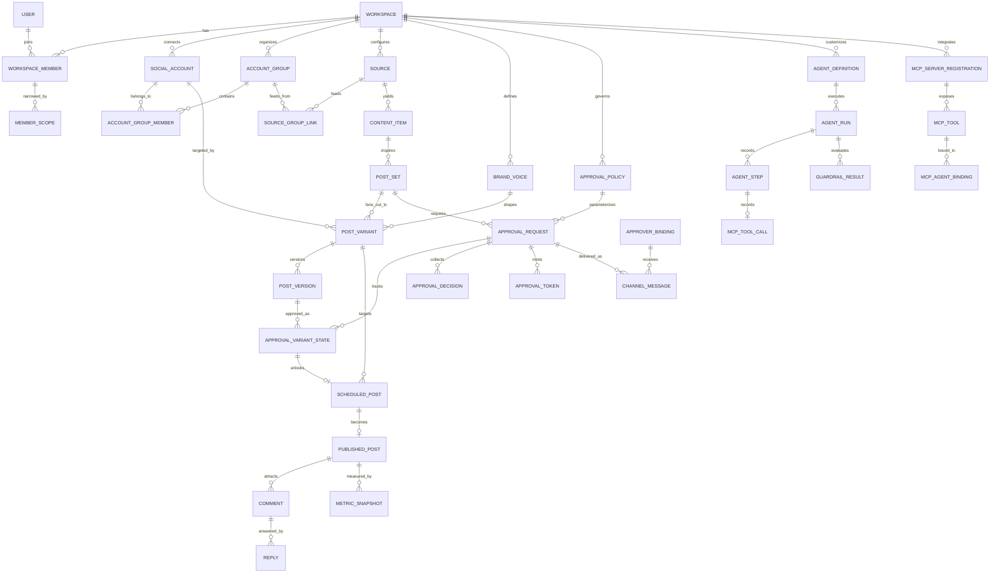

Read the spine left to right: a source produces a content item, which inspires a **post
set**, which fans out into one **variant per target account**, each of which freezes into
its own immutable version, is approved in its own right, schedules, publishes, and
attracts comments and metrics that roll back up to the account, the group, and the
workspace.

### 2.1 The four-level hierarchy

Everything tenant-scoped resolves through the same chain, and this chain is the single
most important structural fact in the schema:

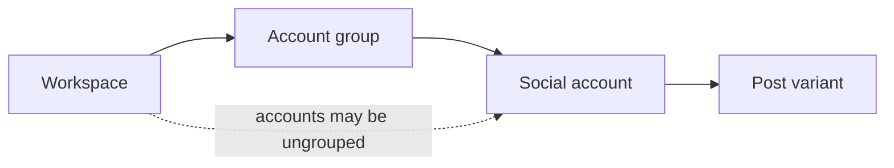

An account may belong to **several** groups, so `account_group_member` is a true join
table rather than a foreign key on `social_account`. An account may also belong to none
and still be posted to directly.

### 2.2 Settings resolution

Brand voice, approval policy, autopilot mode, posting slots, content pillars, and daily
caps all exist at more than one level. They resolve **most-specific-first**:

```text
post-level override  →  social_account  →  account_group  →  workspace  →  system default
```

Two rules keep this from becoming guesswork:

1. **Resolution is one function**, `resolve_setting(key, workspace, group?, account?, override?)`,
   used by the API, the agents, and the bots alike. There is no second implementation.
2. **Resolution is explainable.** It returns the value *and* the level it came from, which
   the UI renders as "Brand voice: Technical, inherited from group Tech News". A user who
   cannot see where a setting came from will eventually be surprised by it.

Where an account belongs to several groups and a post targets it through one of them, the
**targeting group** supplies the group-level value. The group is recorded on the variant
(`post_variant.via_account_group_id`) precisely so this stays deterministic rather than
depending on an arbitrary pick among the account's groups.

One deliberate exception: **approval policy and autopilot mode resolve to the strictest
value, not the most specific one.** A company page set to Manual stays Manual even when
posted to through a group running Full Autopilot. Permissiveness never inherits downward;
only restriction does. This is what makes "the company page always requires approval" a
property of the system rather than a configuration everyone must remember.

---

## 3. Tenancy, identity and access scope

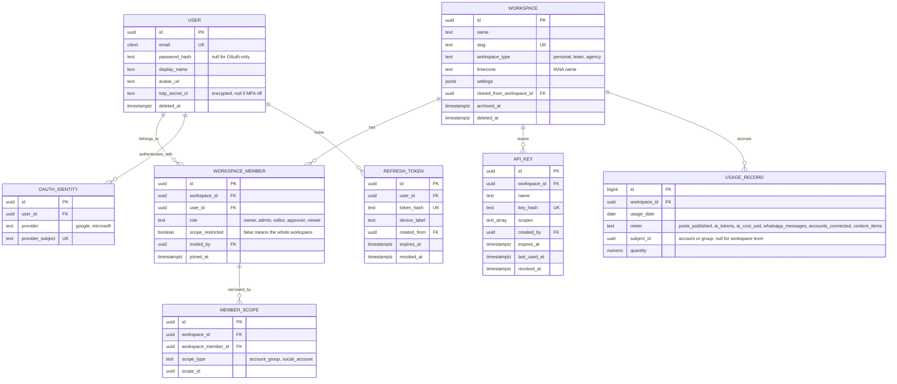

**Roles.** `workspace_member.role` is a single role per user per workspace, ordered
`viewer < approver < editor < admin < owner`. The ordering matters: a check is
"at least approver", not a set-membership test, which keeps authorization readable.

Note the deliberate oddity that `approver` sits *below* `editor`. An approver can approve
and reject but not create or edit drafts; an editor inherits approval rights. This models
the real case of a reviewing stakeholder who should never be drafting.

**One user, many workspaces, different roles.** `workspace_member` is the only place a
role exists. A user who owns their personal workspace and is an Approver in a client's
workspace holds two rows, and nothing about the first grants anything in the second.

### 3.1 Member scopes

`member_scope` narrows a membership to named groups or accounts. The rules:

- No `member_scope` rows and `scope_restricted = false` means the role applies to the
  whole workspace. This is the default and covers the common case.
- With scopes present, the role applies **only** within them. An Approver scoped to the
  group "Company Official" never receives approval requests for other accounts, cannot
  see them in the inbox, and cannot act on them through the API, MCP, or a bot.
- Scope is checked in the same `policy.require(...)` call as the role, so there is no
  surface where it can be forgotten. The permission check takes the subject's account and
  group, not just the workspace.
- Scoping is **narrowing only**. There is no scope that grants more than the role does,
  which keeps the reasoning one-directional: effective permission is
  `role ∩ token_scopes ∩ member_scope`.

A scoped Viewer is the realistic agency case: a client who is allowed to watch their own
brand's queue and nothing else, inside a workspace that also serves other brands.

### 3.2 Workspace lifecycle

`archived_at` is distinct from `deleted_at`. An archived workspace stops all automation,
stops ingesting, holds its scheduled posts, and becomes read-only, while remaining fully
visible for reporting. A deleted one begins the erasure walk in
[09 - Security](09-security.md) section 9.4 after a grace period. The distinction matters
for an agency that finishes with a client but must retain the record.

`cloned_from_workspace_id` records provenance for workspace cloning. A clone copies
settings — brand voices, content pillars, sources, approval policies, automation
defaults, agent definitions, and group *shapes* — and deliberately copies **no connected
accounts, no credentials, no content, and no history**. Carrying a social account into a
clone would mean two workspaces holding authority over one account, which breaks both
the audit trail and the kill switch.

**Refresh token rotation.** `rotated_from` makes reuse detection possible: presenting a
refresh token that has already been rotated indicates theft, and the whole chain is
revoked.

### 3.3 Usage records

`usage_record` is a daily rollup per workspace and meter, written by the same jobs that
do the work. It exists now, before billing does, for three reasons that are useful
immediately: workspace-level limits (accounts connected, posts per day), the WhatsApp
message-cost display, and per-workspace AI spend. Phase 4 billing reads these rows rather
than inventing a new measurement path, which is the usual way usage and invoices come to
disagree.

---

## 4. Accounts and account groups

The structural heart of multi-account posting.

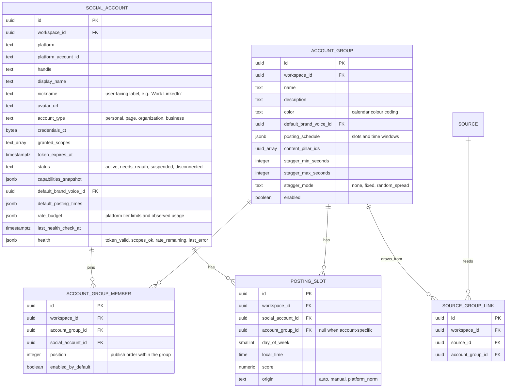

### 4.1 Why groups are a join table

An account belongs to **zero or more** groups. "LinkedIn (company)" realistically sits in
both "Tech News" and "Company Official", and a post through one group must not imply the
other. Modelling group membership as a column on `social_account` would force a single
group per account and collapse exactly the case that motivates the feature.

`UNIQUE (account_group_id, social_account_id)` prevents duplicate membership.
`position` gives the group a deterministic publish order, which matters once staggering
exists: "LinkedIn first, then X ten minutes later" is a real editorial preference and not
something to leave to queue scheduling order.

### 4.2 Staggering

Group-level stagger settings answer the platform-policy problem as much as the editorial
one. `stagger_mode` is:

| Mode | Behaviour |
| --- | --- |
| `none` | All accounts fire at the scheduled time. Permitted, but blocked by the cross-account guardrail when two accounts on the same platform are involved |
| `fixed` | Each account offset by `stagger_min_seconds × position` |
| `random_spread` | Each account offset by a value drawn uniformly from `[stagger_min_seconds, stagger_max_seconds]`, recorded on the variant so it is reproducible and auditable |

The offset is **computed once, at scheduling time, and stored** on
`scheduled_post.stagger_offset_seconds`. Computing it at publish time would make the
calendar lie about when a post goes out, and would make a retried job land at a different
minute than the one the approver saw.

### 4.3 Account health

`health` and `last_health_check_at` are written by a periodic job on the `accounts`
queue: it verifies the token is live, confirms the granted scopes still cover what the
adapter needs, and reads remaining rate budget where the platform exposes it. The reason
this is a scheduled check rather than a lazily discovered failure: the moment you find out
a token died should not be the moment a post was due.

Health transitions raise notifications through the normal path, so a dead LinkedIn token
reaches you in Telegram, where you already are.

---

## 5. Sources and content

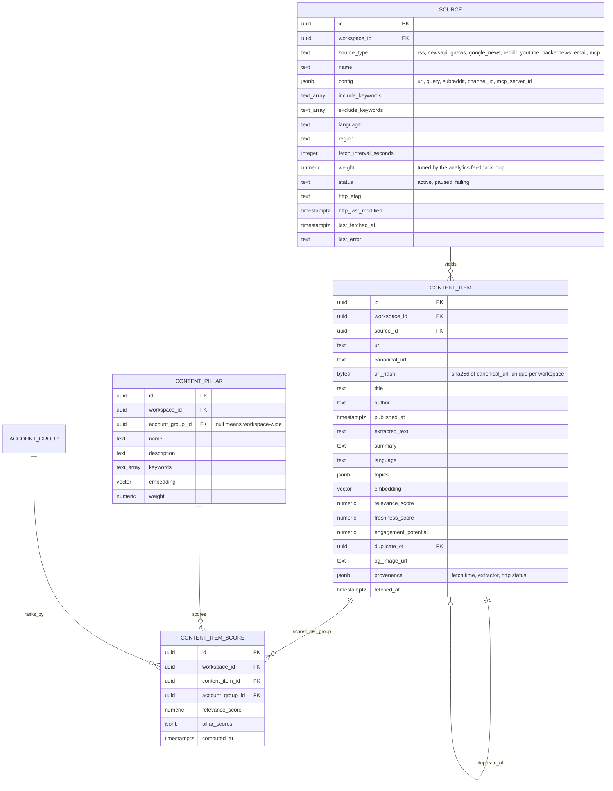

### Sources belong to a workspace, and feed groups

A source is configured once per workspace and linked to any number of account groups
through `source_group_link`. A feed with no links feeds the whole workspace; a feed linked
to "Tech News" only ever produces drafts for that group's accounts.

This is why relevance is **per group**, in `content_item_score`, rather than a single
column. The same article is a 0.9 for the group whose pillars are Postgres and
infrastructure and a 0.2 for the group whose pillars are hiring and culture. A single
workspace-wide score would make the Trending view wrong for every group but one.
`content_item.relevance_score` remains as the workspace-wide maximum across groups, which
is what the unfiltered Trending view sorts on.

### Deduplication, in two passes

1. **Exact.** `UNIQUE (workspace_id, url_hash)` on the canonicalized URL, with tracking
   parameters (`utm_*`, `fbclid`, `ref`) stripped before hashing. Free, and it catches the
   common case of the same article arriving through three feeds.
2. **Semantic.** Cosine distance against recent items in the same workspace:

```sql
SELECT id, 1 - (embedding <=> :new_embedding) AS similarity
FROM content_item
WHERE workspace_id = :ws
  AND fetched_at > now() - interval '14 days'
  AND duplicate_of IS NULL
ORDER BY embedding <=> :new_embedding
LIMIT 5;
```

Above the configured threshold (starting at 0.92, tuned against real data), the new item
gets `duplicate_of` set and is not drafted. It is kept rather than discarded so the
Trending view can say "covered by 4 sources", which is itself a relevance signal.

**Index:** HNSW on `embedding` with `vector_cosine_ops`. The 14-day and `workspace_id`
predicates run first, so the vector scan operates on hundreds of rows, not the whole
table. See [ADR-0007](adr/0007-pgvector-over-dedicated-vector-store.md).

**Relevance score** is computed, not generated: cosine similarity to the workspace's pillar
embeddings, weighted by `content_pillar.weight`, combined with `source.weight` and a
freshness decay. Deterministic and explainable, which matters when you ask why something
surfaced.

---

## 6. Post sets, variants, versions, and the approval anchor

This is the part of the schema that carries the system's core guarantee, and the part the
multi-account requirement reshaped most.

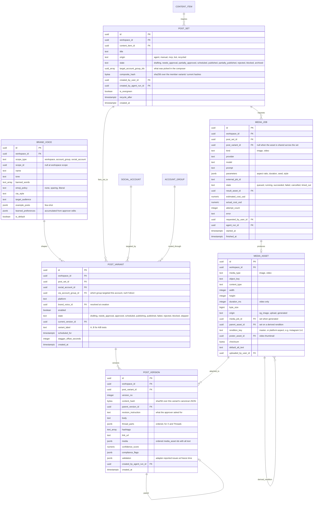

### Media: uploaded or generated, one pipeline

`media_asset.origin` is the only thing that distinguishes an image you dragged into the
composer from one the Media agent produced. Everything after the first step is identical:
checksum, store, derive per-platform renditions, write alt text, attach to a version.

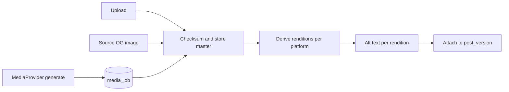

Three decisions in that diagram are load-bearing.

**One master, many renditions.** `parent_asset_id` and `rendition_key` make the derived
crops first-class rows rather than files conjured at publish time. A set going to five
accounts across three platforms needs an Instagram square, an X 16:9, and a LinkedIn
1200×627 from one source image. Generating three times would triple the cost; cropping at
publish time would mean the approver approved an image nobody had actually seen.

**Generation is a tracked job, not a function call.** `media_job` exists because video
generation runs to minutes and costs real money. A row that survives a worker restart,
records its cost whether or not it succeeded, and can be polled is the difference between
a redeploy being free and a redeploy losing a paid result. Image generation uses the same
path; it simply finishes faster.

**Media is inside the content hash, by checksum.** Replacing the image after approval
changes the hash and invalidates the approval, exactly as replacing the text would. This
is why `media_asset.checksum` exists and why the hash never references an asset by ID.
"Approve the post, then swap the image" is otherwise the easiest way to defeat the entire
guarantee.

Regeneration from the composer or the bot creates a new `media_job`, and on success a new
`post_version` for the affected variants. There is no in-place image swap, for the reason
immediately above.

### Three levels, and why each exists

| Level | Mutability | One per | Carries |
| --- | --- | --- | --- |
| `post_set` | Mutable | Source item or idea | The editorial unit: what story this is, which groups were targeted, combined state |
| `post_variant` | Mutable | **Target account** | Per-account lifecycle: enabled, brand voice, schedule, stagger, current version |
| `post_version` | **Immutable** | Edit of one variant | The exact bytes, with the `content_hash` that approval binds to |

The shape follows from a single requirement: *approve LinkedIn, reject X, edit the second
X account.* That is only expressible if the approvable, schedulable, editable unit is the
**per-account variant**, not the set. A version covering all platforms at once, as a
single-account design would use, makes every per-account action either impossible or a
special case that erodes the hash guarantee.

The cost is that a set posting to five accounts has five independently moving parts. The
`post_set.state` column is a derived summary of its variants (`partially_approved`,
`partially_published`) so the UI and the bot have one thing to show without recomputing,
and the per-variant truth stays where decisions are made.

### The composite hash

`post_set.composite_hash` is `sha256` over the sorted list of its **enabled** variants'
current `content_hash` values, plus each variant's `social_account_id`. It exists for
exactly one purpose: an "Approve all" button in a bot needs to name what it is approving
in a single value.

```python
def compute_composite_hash(variants: Sequence[PostVariant]) -> bytes:
    payload = sorted(
        (str(v.social_account_id), v.current_version.content_hash.hex())
        for v in variants
        if v.enabled
    )
    canonical = json.dumps(payload, separators=(",", ":"))
    return hashlib.sha256(canonical.encode("utf-8")).digest()
```

Two properties follow, and both are wanted. Editing any one variant changes the composite,
so a pending "Approve all" is superseded — approving a set you have not seen in its current
form should not be possible. And **disabling a variant also changes the composite**, which
is why toggling an account off invalidates a set-level approval but leaves the per-variant
approvals of the remaining accounts intact.

### Cross-account differentiation

`post_variant` carries `social_account_id` rather than only `platform` because two accounts
on the same platform must receive **different text**. This is not a nicety: X's automation
rules prohibit posting identical or substantially similar content across accounts, and
enforcement is account suspension rather than an API error. See
[08 - Platform Matrix](08-platform-matrix.md) section 3.3.

The schema supports enforcement rather than merely allowing it: the `cross_account_duplicate`
guardrail compares the embeddings of all enabled variants within a set that share a
platform and blocks the set when similarity exceeds the threshold. Because each variant
has its own version and hash, regenerating just the offending one is a normal operation
and not a rebuild of the set.

### Why versions are immutable

An approval must mean "I approved *this text*". If the text can change underneath the
approval, the approval means nothing, and every subsequent guarantee in the system is
decorative.

So:

- `post_version` rows are **insert-only**. No `UPDATE` is permitted; this is enforced by a
  database trigger, not just by convention in the repository layer, because the repository
  layer is the thing most likely to acquire a well-meaning bug.
- `post_variant` is the mutable per-account container. `post_variant.current_version_id`
  moves; versions do not.
- Editing one account's text produces a new `post_version` for **that variant only**, with
  `parent_version_id` set and `version_no` incremented. The other accounts' variants, their
  versions, and their approvals are untouched.

### The content hash

```python
def compute_content_hash(version: PostVersion, account_id: UUID, platform: str) -> bytes:
    payload = {
        "platform": platform,
        "social_account_id": str(account_id),
        "body": version.body,
        "thread_parts": version.thread_parts,
        "hashtags": sorted(version.hashtags),
        "link_url": version.link_url,
        "media": [
            {"checksum": m.checksum.hex(), "alt": m.alt_text}
            for m in version.media
        ],
    }
    canonical = json.dumps(payload, sort_keys=True, separators=(",", ":"), ensure_ascii=False)
    return hashlib.sha256(canonical.encode("utf-8")).digest()
```

Four properties this needs and has:

1. **Deterministic.** Sorted keys, sorted hashtags, fixed separators. The same content
   always hashes identically regardless of row order or dict iteration order.
2. **Covers media by content, not by reference.** Media is hashed by its checksum, so
   swapping the bytes behind a `media_asset` without changing its ID still changes the
   post's hash. Hashing the ID alone would leave an image-substitution hole.
3. **Binds to the target account.** `social_account_id` is inside the hash, so a version
   approved for `@main` cannot be retargeted at `@tech` while keeping its approval. Without
   this, "approve for the personal account" and "publish to the company page" would be the
   same hash, which is the most expensive mistake this model can prevent.
4. **Excludes everything non-semantic.** No timestamps, no version IDs, no confidence
   scores, no schedule. Re-saving an unchanged variant, or rescheduling it, must not
   invalidate a live approval. Rescheduling is a `post_variant` change, not a content
   change, and is deliberately outside the hash.

The hash is stored on `post_version` at insert and **recomputed and compared** in
`assert_publishable`. That comparison is what catches direct database tampering, not just
application-level edits.

---

## 7. Approval

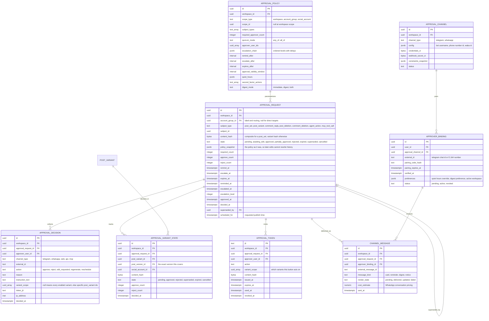

### State machine

Two machines that run together: one per variant, and a request-level summary derived from
them.

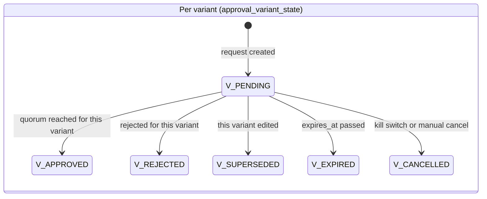

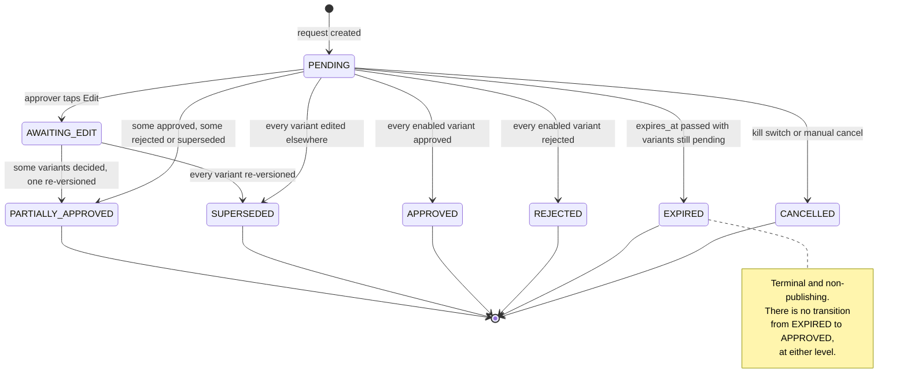

`PARTIALLY_APPROVED` is terminal and is the normal outcome of "approve LinkedIn, reject X".
It is a resolution, not a pending state: the approved variants schedule, the rejected ones
do not, and nothing is left waiting.

**Expiry is per variant.** A request that expires with two variants approved and one
pending publishes the two and expires the one. The alternative — expiring the whole
request and discarding decisions a human already made — would make approvers repeat work
for no safety gain, and repeated work is what pushes people toward Full Autopilot.

### Why `policy_snapshot` exists

An `approval_request` copies the governing policy into `policy_snapshot` at creation. If
someone lowers the quorum from two approvers to one while a request is in flight, the live
request still needs two. Without the snapshot, changing a setting would retroactively
approve things, which is an obvious attack and a non-obvious bug.

### Why `approval_token` is a table

The `jti` ledger makes single-use enforcement a database constraint rather than a cache
TTL. `used_at IS NULL` plus a `SELECT ... FOR UPDATE` on the row is the burn. A replayed
button tap from a screenshotted message hits a row with `used_at` set and is rejected with
a specific, logged reason. Tokens also carry `content_hash`, so a token minted for v1 is
structurally incapable of approving v2.

`variant_scope` on the token is what makes per-account buttons safe. "Approve LinkedIn
only" mints a token whose scope is that one `post_variant_id` and whose hash is that
variant's hash; "Approve all" mints one scoped to every enabled variant and carrying the
composite hash. A tap can therefore only ever act on what its button said it would, and
the scope cannot be widened by editing the callback payload, because the payload is an
opaque `jti` and the scope lives in the row.

Expired rows are swept nightly, retained for 30 days first so that a late replay still
produces an informative audit entry rather than a confusing "unknown token".

### Quorum

`approve_count` and `reject_count` are maintained **per variant**, on
`approval_variant_state`, under a row lock on the parent `approval_request`, so concurrent
taps from two approvers serialize across the whole set. `quorum_mode` is `any_of`
(`approve_count >= 1`) or `all_of` (`approve_count >= required_count`), evaluated per
variant. A reject terminates the variants in its scope regardless of mode, on the
principle that a veto is cheaper to recover from than an unwanted post. A reject scoped to
one account does not touch the others.

---

## 8. Scheduling, publishing, engagement

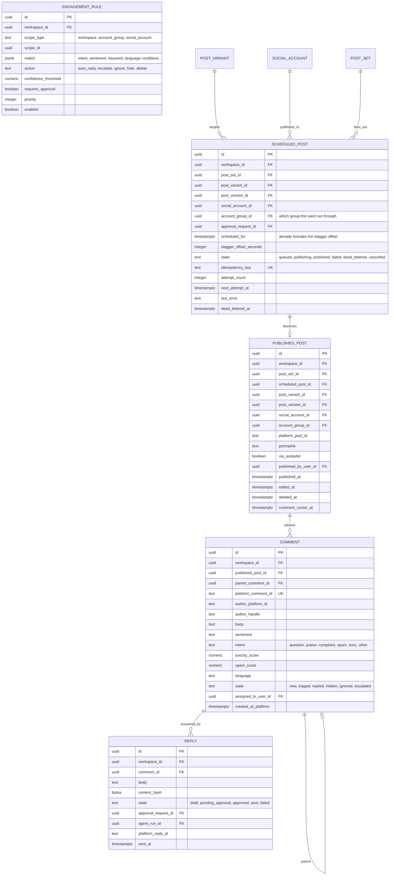

**`scheduled_post.idempotency_key`** is `sha256(social_account_id || post_version_id)`,
unique across the table. It makes "approve twice, schedule twice" impossible at the
database level, and it is the key handed to platform adapters so a retried publish after a
lost response reconciles instead of duplicating. Because `post_version` is now per variant
and the hash already binds the account, the key is unique per target by construction.

**Partial failure is the normal case, not an error path.** One `scheduled_post` per target
account means a failing LinkedIn publish has no bearing on the X publish queued beside it:
separate rows, separate jobs, separate queueing locks, separate retry schedules. The set
lands in `partially_published` and the failed variant retries or dead-letters on its own.
Any design where a set published as one unit would have to choose between rolling back
successful posts, which the platforms do not support, and leaving the operator with an
opaque half-failure.

**`scheduled_post.account_group_id` is denormalized** off the variant so the calendar,
the queue, and group analytics filter without a join through `post_variant`. The group a
post went out through is also a historical fact: moving an account between groups next
month must not rewrite what happened.

**`published_post.comment_cursor_at`** drives the tapering comment poll from
[flow 5](02-sequence-flows.md).

**`reply` carries its own `content_hash`** so the approval machinery works on replies
unchanged. This is the payoff of making `approval_request` polymorphic over
`subject_type`.

---

## 9. Agents, guardrails, cost

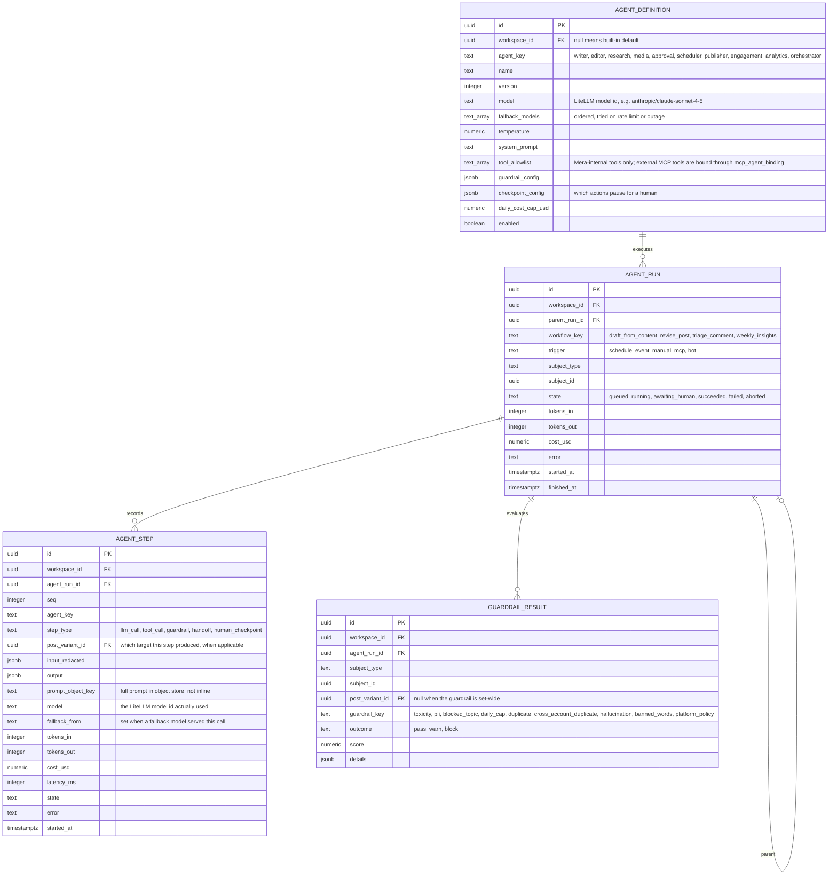

**Prompts are not stored inline.** `agent_step.prompt_object_key` points at the object
store. A full prompt with few-shot examples and an article body runs to tens of kilobytes;
multiplied by every step of every run it would dominate the database and make routine
queries slow. `input_redacted` keeps a summarized, PII-scrubbed version inline for the run
viewer, and the full prompt is one fetch away.

**Cost rolls up, it is not recomputed.** `agent_step.cost_usd` is written from LiteLLM's
reported usage at call time with the then-current price. `agent_run.cost_usd` is the sum
of its steps, and a daily total per workspace lands in `usage_record`. A price change next
month does not silently rewrite last month's spend.

**`agent_step.post_variant_id`** is what makes per-account cost attribution possible. A
set targeting five accounts runs the Writer five times, and "this set cost $0.18, of which
the two X variants were $0.07" is the number that tells you whether posting to a sixth
account is worth it.

**`daily_cost_cap_usd`** is checked before each LLM call against the sum of today's steps
for that agent in that workspace. Exceeding it fails the run with a specific error and
notifies, rather than quietly degrading.

### 9.1 External MCP integrations

These tables back the MCP client described in [05 - MCP](05-mcp.md) section 2. They
replace the earlier single `mcp_server_registration` row that held tools as JSON. Tools
need their own rows because each has a reviewed state, a schema hash to detect
redefinition, and bindings to individual agents.

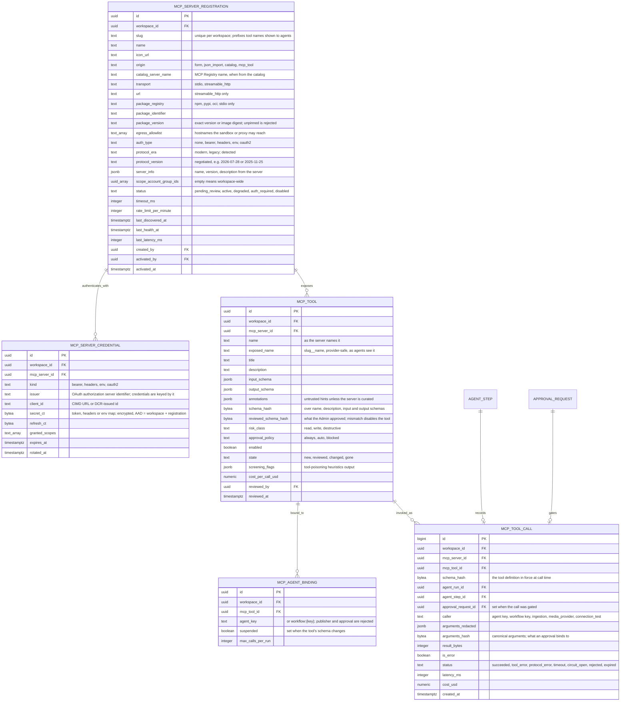

**An `mcp_tool_call` approval binds to bytes, like a post.** For
`approval_request.subject_type = mcp_tool_call`, `content_hash` is
`H(mcp_server_id ‖ tool name ‖ schema_hash ‖ arguments_hash)`. The worker recomputes it
just before the call. Changed arguments, or a tool the server redefined while the request
was pending, mean no call. This is the post-version invariant applied to external
writes.

**`reviewed_schema_hash` is the rug-pull detector.** Discovery always updates
`schema_hash`. If it no longer equals `reviewed_schema_hash` on an enabled tool, the
tool's `state` becomes `changed`, `enabled` becomes false, and its bindings are
`suspended` until an Admin reviews the diff.

**Credentials are keyed by issuer**, because the MCP authorization spec forbids reusing
OAuth client credentials with a different authorization server. A server that moves to a
new authorization server gets a new `mcp_server_credential` row and a fresh consent, not
a silent token reuse.

**Scope is an array on the registration, not a join table.** Group scoping is rare and
read on every agent step, and a GIN index on `scope_account_group_ids` answers "which
servers can this run see" in one lookup. Account groups are deleted rarely, and a
deletion trigger strips the group ID from these arrays.

---

## 10. Analytics, automation, operations

```mermaid
erDiagram
  METRIC_SNAPSHOT {
    bigint id PK
    uuid workspace_id FK
    text subject_type "post, account"
    uuid published_post_id FK
    uuid social_account_id FK
    uuid post_set_id FK "denormalized for set-level rollups"
    uuid account_group_id FK "denormalized for group-level rollups"
    text metric_key "impressions, reach, likes, comments, shares, saves, clicks, ctr, engagement_rate, followers"
    numeric value
    text platform_field "the raw field this came from"
    timestamptz captured_at
  }
  INSIGHT {
    uuid id PK
    uuid workspace_id FK
    uuid account_group_id FK "null means workspace-wide"
    uuid social_account_id FK "null unless account-specific"
    timestamptz period_start
    timestamptz period_end
    text kind "timing, topic, format, platform, variant, approval, account_comparison, group_comparison"
    text title
    text body
    jsonb evidence "the aggregate query and its result"
    numeric confidence
    uuid agent_run_id FK
    timestamptz acknowledged_at
  }
  PERFORMANCE_WEIGHT {
    uuid id PK
    uuid workspace_id FK
    text subject_type "source, pillar, slot, variant_label, hashtag"
    uuid subject_id
    numeric weight
    uuid derived_from_insight_id FK
    timestamptz updated_at
  }
  HASHTAG {
    uuid id PK
    uuid workspace_id FK
    citext tag UK "normalized, without the leading hash"
    text status "allowed, banned, preferred"
    text_array aliases
    timestamptz first_used_at
  }
  HASHTAG_STAT {
    uuid id PK
    uuid workspace_id FK
    uuid hashtag_id FK
    uuid social_account_id FK
    text platform
    integer post_count
    numeric avg_engagement_rate
    numeric avg_impressions
    numeric lift_vs_account_median "the number that actually drives suggestions"
    integer sample_size
    timestamptz window_start
    timestamptz window_end
    timestamptz computed_at
  }
  POST_VERSION_HASHTAG {
    uuid id PK
    uuid workspace_id FK
    uuid post_version_id FK
    uuid hashtag_id FK
    smallint position
    text origin "agent, user, template"
  }
  AUTOMATION_STATE {
    uuid id PK
    uuid workspace_id FK
    text scope_type "workspace, account_group, social_account"
    uuid scope_id "null at workspace scope"
    text autopilot_mode "manual, assisted, full"
    numeric assisted_confidence_threshold
    boolean kill_switch_engaged
    uuid kill_switch_by_user_id FK
    text kill_switch_surface
    timestamptz kill_switch_at
    integer daily_post_cap
    jsonb quiet_hours
    text_array blocked_keywords
    text_array allowed_topics
  }
  AUDIT_LOG {
    bigint id PK
    uuid workspace_id FK
    text actor_type "user, agent, bot, system, api_key"
    uuid actor_id
    text actor_label
    text surface "web, api, mcp, telegram, whatsapp, worker"
    text action
    text subject_type
    uuid subject_id
    uuid social_account_id FK "which account the action touched"
    uuid account_group_id FK
    bytea subject_content_hash
    jsonb before
    jsonb after
    inet ip_address
    timestamptz created_at
  }
  EVENT {
    bigint id PK
    uuid workspace_id FK
    text event_type
    text subject_type
    uuid subject_id
    jsonb payload
    timestamptz created_at
  }
  WEBHOOK {
    uuid id PK
    uuid workspace_id FK
    text url
    text_array event_types
    bytea secret_ct
    text status
  }
  WEBHOOK_DELIVERY {
    bigint id PK
    uuid webhook_id FK
    bigint event_id FK
    integer attempt
    integer status_code
    text response_excerpt
    timestamptz next_attempt_at
    timestamptz delivered_at
  }
  DEAD_LETTER {
    uuid id PK
    uuid workspace_id FK
    text queue
    bigint job_id
    text task_name
    jsonb task_args
    text error
    timestamptz failed_at
    timestamptz resolved_at
  }
  NOTIFICATION {
    uuid id PK
    uuid workspace_id FK
    uuid user_id FK
    text notification_type
    text severity
    text title
    text body
    text link
    timestamptz read_at
  }

  WEBHOOK ||--o{ WEBHOOK_DELIVERY : attempts
  EVENT ||--o{ WEBHOOK_DELIVERY : triggers
  INSIGHT ||--o{ PERFORMANCE_WEIGHT : adjusts
  HASHTAG ||--o{ HASHTAG_STAT : measured_by
  HASHTAG ||--o{ POST_VERSION_HASHTAG : used_in
  SOCIAL_ACCOUNT ||--o{ HASHTAG_STAT : per_account
```

### Hashtags are a measured entity, not a string array

`post_version.hashtags` remains on the version as the denormalized list that goes inside
the content hash. `post_version_hashtag` is the normalized join that makes the question
"how do my tags actually perform" answerable.

`hashtag_stat.lift_vs_account_median` is the field the Hashtag agent ranks on: the
engagement rate of posts carrying this tag on this account, relative to that account's own
median. Absolute engagement would mostly measure which posts happened to be good.
Per-account is essential, because `#hiring` performing on the company page says nothing
about `#hiring` on a personal profile with a different audience.

`sample_size` is carried everywhere and surfaced in the UI. A tag used three times has no
usable signal, and a suggestion engine that hides that distinction will confidently
recommend noise. Below the configured minimum, the agent falls back to platform
convention and content relevance and says so.

`hashtag.status` gives explicit control: `banned` tags are blocked by the same guardrail
as banned words, and `preferred` tags are offered first regardless of sample size, which
is how a brand tag stays in rotation before it has history.

**`audit_log.subject_content_hash`** is the detail that makes the audit log answer the
question you will actually ask: not "who approved post X" but "who approved *which text*".
`social_account_id` answers the second question you will ask, which is "on which account".

**`automation_state`** exists at workspace, group, and account level. Unlike most settings
it resolves to the **strictest** value rather than the most specific one, per section 2.2:
a company page pinned to Manual stays Manual inside a group running Full Autopilot. The
kill switch follows the same rule in the obvious direction — engaged at any level above an
account stops that account, and an account-level switch stops only itself.

**Operational tables not shown:** `idempotency_key` (key, workspace, endpoint, request
hash, cached response, expiry), `rate_limit_bucket` (key, tokens, refilled_at), and
procrastinate's own `procrastinate_jobs` and related tables. They are infrastructure, not
domain, and are swept by a nightly periodic task.

---

## 11. Tenancy enforcement

Two independent layers, because one of them will eventually have a bug.

### Layer 1: the repository

Every repository method takes a `WorkspaceContext` and injects `workspace_id` into the
`WHERE` clause. A base class provides this; a repository that bypasses it fails a dedicated
test that inspects generated SQL.

### Layer 2: row-level security

```sql
ALTER TABLE content_item ENABLE ROW LEVEL SECURITY;
ALTER TABLE content_item FORCE ROW LEVEL SECURITY;

CREATE POLICY tenant_isolation ON content_item
  USING (workspace_id = current_setting('mera.workspace_id')::uuid);
```

The application connects as a non-superuser role and sets `mera.workspace_id` as a
transaction-local setting at the start of every request or job. A query that forgets its
tenant filter returns zero rows instead of another tenant's data.

`FORCE ROW LEVEL SECURITY` matters: without it, the table owner bypasses its own policies,
which silently defeats the whole mechanism in exactly the environment where you set it up.

**Why `workspace_id` is denormalized onto every table.** RLS policies must be
self-contained to stay fast; a policy that joins to a parent to discover the tenant turns
every query into a nested loop. Carrying the column costs 16 bytes per row and makes the
policy a single index-backed predicate. Consistency is maintained by a trigger that
verifies the child's `workspace_id` matches its parent's on insert.

**Cross-workspace operations** (an agency owner listing work across clients) go through an
explicit service that iterates workspaces with the context set per iteration. There is no
"superuser query" path.

### Layer 3 is not RLS: member scopes

Workspace isolation is a database-enforced boundary. **Member scoping is not**, and the
distinction is deliberate. Scopes narrow access *within* a workspace, where RLS has
nothing to key on: every row already belongs to the tenant.

Scopes are therefore enforced in the application, in `policy.require(...)`, which takes
the subject's `social_account_id` and `account_group_id` alongside the workspace. The
compensating control is that the check is in one function, is called by the same service
layer the API, MCP, bots, and workers all use, and has a test fixture that enumerates
every service method and fails CI if one accepts a scoped principal without consulting its
scopes.

Stated plainly so nobody assumes otherwise: a bug in the scope check leaks data *within*
one workspace, between groups. A bug in the tenancy check cannot leak between workspaces,
because the database stops it. The two risks are not of the same severity and are not
defended to the same depth.

See [ADR-0006](adr/0006-rls-plus-repository-tenancy.md).

---

## 12. Indexing

Beyond primary and foreign keys:

| Table | Index | Reason |
| --- | --- | --- |
| `content_item` | `UNIQUE (workspace_id, url_hash)` | Exact dedupe |
| `content_item` | HNSW on `embedding` `vector_cosine_ops` | Semantic dedupe and pillar scoring |
| `content_item` | `(workspace_id, relevance_score DESC, published_at DESC)` | Trending view |
| `content_item` | GIN on the title and body `tsvector` | Search |
| `content_item_score` | `UNIQUE (content_item_id, account_group_id)`, plus `(account_group_id, relevance_score DESC)` | Per-group trending |
| `account_group_member` | `UNIQUE (account_group_id, social_account_id)`, plus `(social_account_id)` | Membership, and "which groups is this account in" |
| `post_variant` | `(post_set_id)`, `(workspace_id, social_account_id, state)` | Set fan-out and per-account queues |
| `post_variant` | `(workspace_id, account_group_id, scheduled_for)` | Calendar filtered by group |
| `approval_request` | `(state, remind_at)`, `(state, escalate_at)`, `(state, expires_at)`, partial on `state = 'pending'` | The sweeper runs every minute and must touch almost nothing |
| `approval_variant_state` | `(approval_request_id)`, `(post_variant_id)` partial on `state = 'pending'` | Per-variant resolution and supersession |
| `approval_token` | `(approval_request_id)`, partial on `used_at IS NULL` | Burn lookup |
| `scheduled_post` | `(state, scheduled_for)` partial on `state = 'queued'` | Publish dispatch |
| `scheduled_post` | `UNIQUE (idempotency_key)` | Duplicate publish prevention |
| `scheduled_post` | `(workspace_id, account_group_id, scheduled_for)` | Group queue and calendar |
| `metric_snapshot` | `UNIQUE (published_post_id, metric_key, captured_at)` | Idempotent sync |
| `metric_snapshot` | BRIN on `(workspace_id, captured_at)` | Time-range dashboard scans on an append-only table |
| `metric_snapshot` | `(account_group_id, metric_key, captured_at)` and `(post_set_id, metric_key)` | Group and set rollups without a join |
| `comment` | `UNIQUE (platform_comment_id, social_account_id)` | Poll idempotency |
| `audit_log` | `(workspace_id, created_at DESC)`, `(subject_type, subject_id)`, `(social_account_id, created_at DESC)` | The three ways anyone reads it |
| `agent_step` | `(agent_run_id, seq)` | Run viewer ordering |
| `usage_record` | `UNIQUE (workspace_id, usage_date, meter, subject_id)` | Idempotent daily accrual |
| `media_asset` | `(workspace_id, checksum)`, `(parent_asset_id, rendition_key)` | Deduplicate uploads, find a platform rendition |
| `media_job` | `(state, started_at)` partial on `state IN ('queued','running')` | The poller touches only live jobs |
| `hashtag` | `UNIQUE (workspace_id, tag)` | Normalized lookup |
| `hashtag_stat` | `UNIQUE (hashtag_id, social_account_id, window_start)` | Idempotent recomputation |
| `post_version_hashtag` | `(hashtag_id)`, `(post_version_id)` | Attribution in both directions |
| `mcp_server_registration` | `UNIQUE (workspace_id, slug)`, GIN on `scope_account_group_ids` | Tool-name prefixes, and "which servers can this run see" |
| `mcp_tool` | `UNIQUE (mcp_server_id, name)`, `(workspace_id, enabled)` partial on `enabled` | Discovery upsert, and the per-step effective tool list |
| `mcp_agent_binding` | `UNIQUE (mcp_tool_id, agent_key)`, `(workspace_id, agent_key)` partial on `NOT suspended` | Binding lookup at step start |
| `mcp_tool_call` | `(workspace_id, created_at DESC)`, `(mcp_server_id, created_at DESC)`, `(agent_run_id)` | Call history per workspace, per server, per run |

The partial indexes on `approval_request` are the ones that matter most for a system that
sweeps every minute forever: they keep the sweep proportional to pending work rather than
to total history.

---

## 13. Retention

| Data | Retention | Mechanism |
| --- | --- | --- |
| `event` | 90 days | Nightly delete, partitioned monthly |
| `agent_step` prompts in object store | 90 days | Lifecycle sweep, run metadata kept |
| `approval_token` | 30 days past expiry | Nightly sweep |
| `metric_snapshot` | Hourly for 30 days, then downsampled to daily | Rollup job |
| `audit_log` | 2 years minimum | Partitioned monthly, never auto-deleted inside the window |
| `content_item.extracted_text` | 180 days | Summary and embedding retained, body dropped |
| `idempotency_key` | 24 hours | Nightly sweep |
| `usage_record` | 2 years | Kept as long as the audit log, since billing disputes outlive everything else |
| `mcp_tool_call` | 1 year, arguments already redacted | Partitioned monthly. Rows referenced by an `approval_request` are kept as long as the audit log |
| Superseded `post_version` rows | 180 days if never approved | Approved versions are kept for the life of their `published_post`, because the audit log points at them |

GDPR export and erasure walk the `workspace_id` graph; the procedure is in
[09 - Security](09-security.md).

---

## 14. Migrations

Alembic, one migration per logical change, reviewed as code. Rules:

- Forward-only in production. A rollback is a new migration.
- Expand then contract for anything renaming or re-typing: add the new column, backfill,
  dual-write, switch reads, drop the old column in a later release.
- Indexes created `CONCURRENTLY`, outside a transaction.
- Every migration is tested against a seeded database in CI, and the `/readyz` endpoint
  reports the applied revision so a half-migrated deployment is visible rather than
  mysterious.
