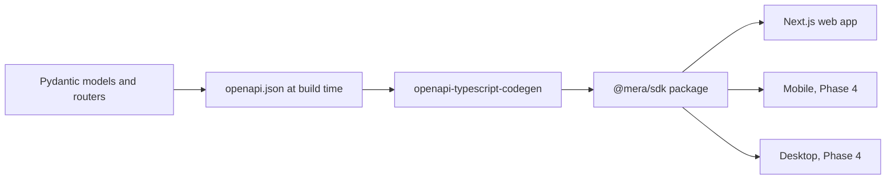

# 04 - API Contract

The public REST API. This is the product boundary: the web UI, the approval bots, the MCP
server, and future mobile and desktop clients are all peers that consume it.

A machine-readable skeleton lives at
[`api/openapi-v1-outline.yaml`](api/openapi-v1-outline.yaml). The authoritative spec will
be generated from FastAPI's Pydantic models at build time; the outline exists to agree on
shape before any code is written.

---

## 1. Ground rules

| Aspect | Rule |
| --- | --- |
| Base path | `/api/v1`. The version is in the path, never in a header. |
| Versioning | Additive changes ship in `v1`. Breaking changes mean `v2` alongside `v1`, with `v1` supported for at least six months. |
| Resource naming | Plural, kebab-case: `/approval-requests`, `/social-accounts`. |
| Workspace scoping | Every tenant-scoped resource is nested under `/workspaces/{workspace_id}`. No implicit "current workspace" from a session, because bots and MCP clients have no session. |
| Content type | `application/json`, UTF-8. Media upload uses `multipart/form-data`. |
| Casing | `snake_case` in JSON, matching the database and Python. The generated TypeScript SDK exposes it unchanged rather than translating, so a field name means one thing everywhere. |
| Time | RFC 3339 with offset, always UTC on the wire. |
| IDs | UUID strings. |
| Statelessness | No server-side session. Every request carries its own credential. |

---

## 2. Authentication

Four credential types, all resolving to the same internal `Principal`.

### 2.1 JWT access and refresh tokens

For human users in the web, mobile, and desktop clients.

```
POST /api/v1/auth/login            { email, password, totp_code? } -> { access_token, refresh_token, expires_in }
POST /api/v1/auth/refresh          { refresh_token }               -> { access_token, refresh_token, expires_in }
POST /api/v1/auth/logout           { refresh_token }               -> 204
GET  /api/v1/auth/me                                               -> Principal with workspace memberships
```

Access tokens are short-lived (15 minutes) and carry `sub`, `workspace_memberships`, and
`token_version`. Refresh tokens are long-lived (30 days), rotated on every use, and stored
hashed. Presenting a rotated token revokes the entire chain, which is how theft is
detected.

### 2.2 OAuth login

```
GET  /api/v1/auth/oauth/{provider}/authorize   -> 302 to Google or Microsoft
GET  /api/v1/auth/oauth/{provider}/callback    -> 302 back to the client with a one-time code
POST /api/v1/auth/oauth/exchange               { code, code_verifier } -> token pair
```

Authorization Code with PKCE. The exchange step exists so native clients never handle a
token in a URL fragment.

### 2.3 Device authorization

For desktop and CLI clients that cannot host a redirect.

```
POST /api/v1/auth/device/authorize   { client_id, scopes } -> { device_code, user_code, verification_uri, interval }
POST /api/v1/auth/device/token       { device_code }       -> token pair, or 400 authorization_pending
```

### 2.4 API keys

For integrations, CI, and the MCP server's service-to-service path.

```
Authorization: Bearer mera_sk_live_<random>
```

Keys are workspace-scoped, carry an explicit scope list, are stored only as a hash, and
are shown exactly once at creation. The prefix is deliberately greppable so a leaked key
is findable in secret scanners.

### 2.5 Scopes

Scopes apply to API keys and MCP tokens. Users get role-based permissions instead.
Effective permission is the **intersection** of scope and role, so a key created by an
editor cannot be used to approve even if it carries `approvals:decide`.

| Scope | Grants |
| --- | --- |
| `sources:read`, `sources:write` | Source configuration |
| `content:read` | Content items and trending |
| `accounts:read` | Connected accounts, health, capabilities |
| `accounts:write` | Connect, disconnect, reauthorize, account settings |
| `groups:read`, `groups:write` | Account groups and their membership |
| `drafts:read`, `drafts:write` | Post sets, variants, and version management |
| `media:write` | Upload media, request generation |
| `approvals:read` | View approval requests |
| `approvals:decide` | Approve, reject, edit, reschedule |
| `publishing:read`, `publishing:write` | Schedule, publish, delete |
| `engagement:read`, `engagement:write` | Inbox and replies |
| `analytics:read` | Metrics and insights |
| `automation:write` | Autopilot mode, kill switch |
| `agents:read`, `agents:write` | Agent config, runs, MCP bindings |
| `admin` | Workspace settings, members, keys, channels, MCP registrations |

Scopes are workspace-bound. A key issued in one workspace is meaningless in another, and
a key issued by a member with a `member_scope` inherits that narrowing: effective
permission is `role ∩ token_scopes ∩ member_scope`.

### 2.6 Role to permission mapping

| Capability | Viewer | Approver | Editor | Admin | Owner |
| --- | --- | --- | --- | --- | --- |
| Read content, post sets, analytics | yes | yes | yes | yes | yes |
| Create and edit post sets and variants | no | no | yes | yes | yes |
| Upload media, request generation | no | no | yes | yes | yes |
| Approve and reject | no | yes | yes | yes | yes |
| Schedule and publish | no | no | yes | yes | yes |
| Reply to comments | no | no | yes | yes | yes |
| Configure sources, brand voice, hashtags, agents | no | no | yes | yes | yes |
| Create and edit account groups | no | no | yes | yes | yes |
| Connect social accounts, approval channels | no | no | no | yes | yes |
| Register MCP servers, set tool allowlists | no | no | no | yes | yes |
| Manage members, member scopes, API keys, webhooks | no | no | no | yes | yes |
| Engage kill switch | no | yes | yes | yes | yes |
| Change autopilot mode | no | no | no | yes | yes |
| Clone, archive, or delete a workspace | no | no | no | archive | yes |

The kill switch is deliberately available to approvers: the person watching the output is
the person who needs to stop it, and a stop is always safe.

**Every row is further narrowed by member scope.** An Editor scoped to one group can do
all of the above within that group and nothing outside it. Scopes never widen a role, so
the table remains the ceiling.

Note that **creating groups is an Editor capability while connecting accounts is an Admin
one**. Grouping is an editorial act and is reversible; granting Mera authority to speak as
a new account is neither.

---

## 3. Conventions

### 3.1 Errors

One schema for every non-2xx response.

```json
{
  "error": {
    "code": "approval_content_mismatch",
    "message": "This approval was issued for a different version of the post.",
    "detail": "Token was minted for content_hash a1b2c3..., current version is d4e5f6...",
    "field_errors": [{ "field": "body", "code": "too_long", "message": "Exceeds 3000 characters for LinkedIn." }],
    "request_id": "01JABC...",
    "docs_url": "https://docs.mera.app/errors/approval_content_mismatch"
  }
}
```

`code` is a stable machine-readable string and is the thing clients branch on. `message` is
safe to show a user. `detail` is for logs and may be omitted in production for sensitive
failures. `request_id` matches the log and trace ID.

| Status | Used for |
| --- | --- |
| 400 | Malformed request |
| 401 | Missing or invalid credential |
| 403 | Authenticated but not permitted, including scope and role failures |
| 404 | Not found, or found in another workspace (deliberately indistinguishable) |
| 409 | State conflict: already approved, already published, version superseded |
| 410 | Gone: approval expired, token revoked |
| 422 | Semantically invalid: body exceeds a platform limit, guardrail block |
| 429 | Rate limited, with `Retry-After` |
| 503 | Dependency unavailable, with `Retry-After` |

Approval-specific codes, because clients need to distinguish them:
`approval_expired`, `approval_already_decided`, `approval_content_mismatch`,
`approval_token_used`, `approval_token_revoked`, `approver_not_authorized`,
`approval_quorum_not_met`, `kill_switch_engaged`, `second_factor_required`.

### 3.2 Pagination

Cursor-based. Offset pagination is not offered, because the lists that matter here are
append-heavy and offsets drift.

```
GET /api/v1/workspaces/{id}/content-items?limit=50&cursor=eyJpZCI6...
```

```json
{
  "data": [ ... ],
  "page": { "next_cursor": "eyJpZCI6...", "has_more": true, "limit": 50 }
}
```

The cursor is an opaque base64 of the sort key plus ID. `limit` defaults to 50, caps at
200.

### 3.3 Filtering and sorting

```
?filter[state]=pending&filter[platform]=linkedin&filter[created_at][gte]=2026-01-01
&filter[account_group_id]=grp_tech_news&filter[social_account_id][in]=acc_a,acc_b
&sort=-relevance_score,published_at
```

`account_group_id` and `social_account_id` are filterable on every list endpoint that
returns per-account data, because with a dozen accounts the unfiltered list is rarely the
one anyone wants. Filtering by a group the principal is not scoped to returns an empty
page rather than 403: a scoped member should not be able to probe for the existence of
groups they cannot see.

Operators: `eq` (implicit), `ne`, `gt`, `gte`, `lt`, `lte`, `in`, `contains`. Only
explicitly allowlisted fields per endpoint are filterable, documented in the OpenAPI spec,
so a filter cannot be used to probe an index that does not exist.

### 3.4 Idempotency

Required on every `POST` that causes an external side effect: publishing, replying,
deleting, and approval decisions.

```
Idempotency-Key: 01JABCDEF...
```

The server stores the key with a hash of the request body for 24 hours. A replay with a
matching body returns the original response and `Idempotency-Replayed: true`. A replay with
a *different* body returns 409 `idempotency_key_reuse`, which catches client bugs rather
than silently doing the wrong thing.

### 3.5 Rate limiting

Token bucket in Postgres, keyed by principal and endpoint class.

```
X-RateLimit-Limit: 600
X-RateLimit-Remaining: 594
X-RateLimit-Reset: 1762567890
```

| Class | Limit |
| --- | --- |
| Read | 600 per minute per principal |
| Write | 120 per minute per principal |
| Agent-triggering (draft, regenerate) | 30 per minute, and subject to the agent cost cap |
| Auth | 10 per minute per IP, with exponential lockout on repeated failure |
| Inbound bot webhooks | Not limited by principal; validated by signature and bounded by the platform's own delivery rate |

This is separate from and in addition to **per-social-account** platform rate budgets,
which are enforced in the publish worker via queueing locks, not here.

### 3.6 Concurrency control

Mutable resources return `ETag` and accept `If-Match`. A mismatch is 409
`stale_write`. This is what stops two editors silently overwriting each other in the Draft
Studio.

---

## 4. Endpoints

Abbreviated. `{ws}` stands for `/api/v1/workspaces/{workspace_id}`.

### 4.1 Workspaces, members, keys

```
GET    /api/v1/workspaces                      every workspace the principal belongs to
POST   /api/v1/workspaces
GET    {ws}
PATCH  {ws}
POST   {ws}/clone                              { name } -> settings only, no accounts or content
POST   {ws}/archive                            read-only, automation stopped, data retained
POST   {ws}/unarchive
DELETE {ws}                                    owner only, soft delete with grace period
GET    {ws}/usage?from=&to=                    accounts, posts, AI spend, WhatsApp messages

GET    {ws}/members
POST   {ws}/members/invitations
PATCH  {ws}/members/{user_id}                  change role
GET    {ws}/members/{user_id}/scopes
PUT    {ws}/members/{user_id}/scopes           restrict to named groups or accounts
DELETE {ws}/members/{user_id}

GET    {ws}/api-keys
POST   {ws}/api-keys                           returns the secret exactly once
DELETE {ws}/api-keys/{id}

GET    {ws}/audit-log                          filter by actor, action, subject, account, date
GET    {ws}/notifications
POST   {ws}/notifications/{id}/read
```

`POST {ws}/clone` copies brand voices, pillars, sources, approval policies, automation
defaults, agent definitions, and group *shapes*. It deliberately copies no connected
accounts, credentials, content, or history: two workspaces holding authority over one
social account would break both the audit trail and the kill switch.

### 4.2 Social accounts

Several per platform per workspace is the normal case, so every response is designed to be
read in a list of twelve rather than a page of one.

```
GET    {ws}/social-accounts                     filter by platform, status, group, health
POST   {ws}/social-accounts/connect/{platform}  -> 302 to the platform's OAuth consent
GET    {ws}/social-accounts/oauth/callback      -> 409 if this account is already connected
GET    {ws}/social-accounts/{id}
PATCH  {ws}/social-accounts/{id}                nickname, default voice, posting times
DELETE {ws}/social-accounts/{id}                revokes at the platform first
POST   {ws}/social-accounts/{id}/reauthorize
GET    {ws}/social-accounts/{id}/capabilities   the capability matrix for this account
GET    {ws}/social-accounts/{id}/health         token, scopes, rate budget, last check
POST   {ws}/social-accounts/{id}/health/check   force a check now
GET    {ws}/social-accounts/{id}/rate-budget    remaining platform quota, for the UI
GET    {ws}/social-accounts/{id}/settings       resolved settings with their source level
GET    {ws}/social-accounts/{id}/groups         which groups this account belongs to
```

Connecting a platform account that is already connected in this workspace returns 409
`account_already_connected` with the existing account's ID, rather than creating a second
row. Two credential sets for one account would race each other for its rate limits.

### 4.3 Account groups

```
GET    {ws}/account-groups
POST   {ws}/account-groups
GET    {ws}/account-groups/{id}                 includes members with their platforms
PATCH  {ws}/account-groups/{id}                 name, colour, voice, pillars, stagger
DELETE {ws}/account-groups/{id}                 accounts survive; only the grouping goes
PUT    {ws}/account-groups/{id}/members         replace membership wholesale
POST   {ws}/account-groups/{id}/members         { social_account_ids[] } add
DELETE {ws}/account-groups/{id}/members/{account_id}
PATCH  {ws}/account-groups/{id}/members/{account_id}   publish order, enabled by default
GET    {ws}/account-groups/{id}/settings        resolved settings, each showing its source level
GET    {ws}/account-groups/{id}/queue           pending and scheduled posts for this group
GET    {ws}/account-groups/{id}/calendar?from=&to=
```

`GET .../settings` returns both the effective value and the level it was inherited from,
because a user who cannot see where a setting came from will eventually be surprised by
it. The same shape is available on a single account.

### 4.4 Sources and content

```
GET    {ws}/sources                             filter by group, type, status
POST   {ws}/sources
PATCH  {ws}/sources/{id}
DELETE {ws}/sources/{id}
PUT    {ws}/sources/{id}/groups                 which groups this source feeds
POST   {ws}/sources/{id}/fetch                  trigger an immediate fetch
GET    {ws}/sources/{id}/health                 last fetch, error, item yield

GET    {ws}/content-items                       filter by topic, source, score, date, group
GET    {ws}/content-items/{id}                  includes per-group relevance scores
GET    {ws}/content-items/trending?group_id=    ranked for that group's pillars
POST   {ws}/content-items/{id}/dismiss
POST   {ws}/content-items/{id}/post-sets        create a post set from this item

GET    {ws}/content-pillars?group_id=
POST   {ws}/content-pillars                     workspace-wide, or scoped to a group
PATCH  {ws}/content-pillars/{id}
DELETE {ws}/content-pillars/{id}
```

Trending without `group_id` ranks by the workspace-wide maximum score across groups.
With it, the ranking is that group's own pillar scoring, which is usually what you want
and always what the group's queue shows.

### 4.5 Brand voice and templates

```
GET    {ws}/brand-voices?scope_type=&scope_id=
POST   {ws}/brand-voices                        scoped to workspace, group, or account
PATCH  {ws}/brand-voices/{id}
DELETE {ws}/brand-voices/{id}

GET    {ws}/post-templates
POST   {ws}/post-templates
PATCH  {ws}/post-templates/{id}
DELETE {ws}/post-templates/{id}
```

### 4.6 Post sets, variants, versions

The composer's resource. A post set holds one variant per target account; the variant is
the unit that is edited, approved, scheduled, and published.

```
GET    {ws}/post-sets                           filter by state, group, account, date
POST   {ws}/post-sets                           { content_item_id?, topic?, targets }
GET    {ws}/post-sets/{id}                      includes every variant and its current version
PATCH  {ws}/post-sets/{id}                      metadata only, never content
DELETE {ws}/post-sets/{id}

POST   {ws}/post-sets/{id}/generate             run the Writer per target -> 202
POST   {ws}/post-sets/{id}/rewrite              { instruction, variant_ids? } -> 202
POST   {ws}/post-sets/{id}/validate             adapter validation for every variant
POST   {ws}/post-sets/{id}/request-approval     { approver_ids?, scheduled_for? }
GET    {ws}/post-sets/{id}/results              per-account outcome and combined performance

GET    {ws}/post-sets/{id}/variants
POST   {ws}/post-sets/{id}/variants             add a target account to an existing set
GET    {ws}/post-sets/{id}/variants/{vid}
PATCH  {ws}/post-sets/{id}/variants/{vid}       enable, disable, reschedule, change voice
DELETE {ws}/post-sets/{id}/variants/{vid}
POST   {ws}/post-sets/{id}/variants/{vid}/versions      new immutable version from supplied content
GET    {ws}/post-sets/{id}/variants/{vid}/versions      history for this account
GET    {ws}/post-sets/{id}/variants/{vid}/versions/{a}/diff/{b}
POST   {ws}/post-sets/{id}/variants/{vid}/rewrite       { instruction } -> 202
POST   {ws}/post-sets/{id}/variants/{vid}/ab            generate an A/B counterpart
```

The target selector on `POST /post-sets` accepts groups, accounts, or both, and is
expanded server-side into variants:

```json
{
  "content_item_id": "...",
  "targets": {
    "account_group_ids": ["grp_tech_news"],
    "social_account_ids": ["acc_extra_mastodon"],
    "exclude_social_account_ids": ["acc_fb_page"]
  }
}
```

Expansion is deduplicated, so an account reachable through two selected groups still
produces one variant. The response names the resulting variants and, for each, the group
it was routed through, because that determines which group-level settings apply.

Three separations here are load-bearing:

- `PATCH /post-sets/{id}` touches metadata. `PATCH .../variants/{vid}` touches scheduling
  and enablement. **Neither touches content.** Content changes only through
  `POST .../versions`, and no endpoint anywhere mutates an existing version.
- Rewriting at the set level fans the instruction out to every enabled variant, each
  producing its own version. Rewriting at the variant level touches one account. The
  narrow form is what the bot's Edit button uses.
- Disabling a variant is not deleting it. A disabled variant keeps its history, drops out
  of the composite hash, and will not publish.

### 4.7 Media

Upload your own, or have one generated. Both end up in the same pipeline.

```
POST   {ws}/media                               multipart upload, image or video
GET    {ws}/media/{id}                          master plus its per-platform renditions
DELETE {ws}/media/{id}
GET    {ws}/media/{id}/renditions
POST   {ws}/media/{id}/renditions               force a rendition for a platform or aspect
PATCH  {ws}/media/{id}/alt-text                 { alt_text } per rendition

POST   {ws}/media/generate                      { kind, prompt, parameters, post_set_id? } -> 202
GET    {ws}/media/jobs                          filter by state
GET    {ws}/media/jobs/{job_id}                 state, cost estimate, result asset
POST   {ws}/media/jobs/{job_id}/cancel
POST   {ws}/media/generate/estimate             cost and expected duration before committing

POST   {ws}/post-sets/{id}/variants/{vid}/media       attach an asset -> new version
DELETE {ws}/post-sets/{id}/variants/{vid}/media/{aid} detach -> new version
POST   {ws}/post-sets/{id}/variants/{vid}/media/regenerate   { instruction? } -> 202
```

`POST /media/generate` returns 202 with a `media_job_id` and an SSE stream URL. Image
generation resolves in seconds; **video generation takes minutes and costs dollars**,
which is why the job is a tracked resource with a cancel endpoint and a pre-commit cost
estimate rather than a blocking call.

Attaching, detaching, or regenerating media on a variant **creates a new post version**,
because media is inside the content hash. There is no in-place image swap, and that is
deliberate: swapping the image under an approved post is otherwise the easiest way to
defeat the approval guarantee.

### 4.8 Hashtags

```
GET    {ws}/hashtags                            every tag used, with status
POST   {ws}/hashtags                            add with status allowed, banned, preferred
PATCH  {ws}/hashtags/{id}                       change status
GET    {ws}/hashtags/stats?account_id=&platform=&since=
GET    {ws}/hashtags/{id}/performance           lift vs account median, sample size
POST   {ws}/post-sets/{id}/variants/{vid}/hashtags/suggest   run the Hashtag agent -> 202
PUT    {ws}/post-sets/{id}/variants/{vid}/hashtags           set them explicitly -> new version
```

Every suggestion response carries `sample_size` and the basis it used (`history`,
`platform_convention`, or `content_only`). A tag recommended from three prior posts and
one recommended from sixty are not the same claim, and the UI says so.

### 4.9 Approvals

The heart of the API.

```
GET    {ws}/approval-requests                   filter by state, subject_type, approver, group, account
GET    {ws}/approval-requests/{id}              includes per-account preview, flags, confidence, timers
GET    {ws}/approval-requests/{id}/variants     per-account decision state
POST   {ws}/approval-requests/{id}/decisions    the single decision endpoint
POST   {ws}/approval-requests/{id}/edit         { instruction | replacement_text, variant_ids? }
POST   {ws}/approval-requests/{id}/cancel
GET    {ws}/approval-requests/{id}/preview      rendered per-account preview payload

GET    {ws}/approval-policies?scope_type=&scope_id=
POST   {ws}/approval-policies                   workspace, group, or account scope
PATCH  {ws}/approval-policies/{id}
DELETE {ws}/approval-policies/{id}

GET    {ws}/approval-channels
POST   {ws}/approval-channels                   register a Telegram bot or WhatsApp number
PATCH  {ws}/approval-channels/{id}
DELETE {ws}/approval-channels/{id}
POST   {ws}/approval-channels/{id}/test         send a test message

GET    {ws}/approver-bindings
POST   {ws}/approver-bindings/pairing-codes     mint a one-time pairing code
POST   {ws}/approver-bindings/{id}/revoke
```

**The decision endpoint** accepts either an authenticated user acting from the web or MCP,
or a signed approval token from a bot. Both paths converge on the same service.

```http
POST /api/v1/workspaces/{ws}/approval-requests/{id}/decisions
Idempotency-Key: 01JABC...
Content-Type: application/json

{
  "action": "approve",
  "approval_token": "eyJ...",          // required when acting via a bot, absent for web
  "variant_scope": ["var_li_personal", "var_li_company"],  // null means every enabled variant
  "scheduled_for": "2026-11-09T09:00:00Z",
  "reason": null,
  "second_factor": { "type": "pin", "value": "..." }  // when the policy demands it
}
```

Responses: 200 with the updated request, 403 `approver_not_authorized` (including when the
approver's member scope excludes one of the named accounts), 409
`approval_already_decided`, 410 `approval_expired`, 422 `approval_content_mismatch`.

**Partial approval** via `variant_scope` is how "approve both LinkedIn accounts, reject
X `@tech`" works. The scope names **post variant IDs**, not platforms, because two
accounts on the same platform must be separately decidable. The request stays `PENDING`
until every enabled variant has a decision, then resolves to `APPROVED` if all were
approved or `PARTIALLY_APPROVED` if the outcome was mixed. Only approved variants
schedule.

A decision whose scope names a variant the approver is not scoped to fails whole, rather
than silently applying to the subset they can act on. Partial application of an explicit
instruction is worse than a clear refusal.

### 4.10 Scheduling and publishing

```
GET    {ws}/scheduled-posts                     filter by state, account, group, window
POST   {ws}/scheduled-posts                     requires a valid approval for that variant
PATCH  {ws}/scheduled-posts/{id}                reschedule only
DELETE {ws}/scheduled-posts/{id}
POST   {ws}/scheduled-posts/{id}/publish-now
POST   {ws}/scheduled-posts/{id}/retry          retry from the dead-letter queue
POST   {ws}/post-sets/{id}/schedule             schedule every approved variant, staggered
POST   {ws}/post-sets/{id}/publish-now          same, immediately, honouring the stagger
GET    {ws}/post-sets/{id}/status               per-account publish state and errors

GET    {ws}/published-posts                     filter by account, group, post set
GET    {ws}/published-posts/{id}
PATCH  {ws}/published-posts/{id}                edit, only where the platform supports it
DELETE {ws}/published-posts/{id}                one account; may require approval and a second factor
DELETE {ws}/post-sets/{id}/published            every account in the set, approval-gated
POST   {ws}/published-posts/{id}/repost

GET    {ws}/calendar?from=&to=&group_id=&account_id=   colour-coded by group
PATCH  {ws}/calendar/{scheduled_post_id}/move   drag and drop target
GET    {ws}/posting-slots?account_id=&group_id=
POST   {ws}/posting-slots/recompute

GET    {ws}/dead-letters                        filter by account
POST   {ws}/dead-letters/{id}/resolve
```

`POST /scheduled-posts` returning 403 `approval_required` rather than silently queueing is
the API-level expression of the core invariant.

`POST /post-sets/{id}/schedule` is a convenience that creates one `scheduled_post` per
approved variant with the group's stagger offsets applied. It is **not** a transaction
across accounts: each target is scheduled and published independently, and a 207-style
per-variant result tells you what landed. Deleting a whole set's published posts is the
one place where a set-wide destructive action exists, and it is approval-gated and
second-factored by default.

### 4.11 Engagement

```
GET    {ws}/comments                            the unified inbox: filter by account, group, platform, intent, sentiment, state
GET    {ws}/comments/{id}
POST   {ws}/comments/{id}/replies               create a reply, may create an approval request
POST   {ws}/comments/{id}/suggest-reply         run the Engagement agent -> 202
POST   {ws}/comments/{id}/like
POST   {ws}/comments/{id}/hide
DELETE {ws}/comments/{id}
POST   {ws}/comments/{id}/assign
POST   {ws}/comments/{id}/escalate

GET    {ws}/engagement-rules?scope_type=&scope_id=
POST   {ws}/engagement-rules                    workspace, group, or account scope
PATCH  {ws}/engagement-rules/{id}
DELETE {ws}/engagement-rules/{id}
```

Replying always uses the credentials of the account that owns the post. There is no
parameter for choosing which account replies, and the omission is deliberate: replying
from the wrong account is the most embarrassing failure available in a multi-account tool,
so the API offers no way to express it.

### 4.12 Analytics

Every endpoint takes an optional scope. Omitting it means the whole workspace.

```
GET    {ws}/analytics/posts/{published_post_id}
GET    {ws}/analytics/post-sets/{post_set_id}         combined across its accounts
GET    {ws}/analytics/accounts/{social_account_id}
GET    {ws}/analytics/groups/{account_group_id}
GET    {ws}/analytics/overview?from=&to=&group_id=&account_id=
GET    {ws}/analytics/timeseries?metric=&granularity=&from=&to=&group_id=&account_id=
GET    {ws}/analytics/top-posts?group_id=&account_id=
GET    {ws}/analytics/best-times?account_id=
GET    {ws}/analytics/platform-comparison?group_id=
GET    {ws}/analytics/account-comparison?group_id=     account against account
GET    {ws}/analytics/group-comparison                 group against group
GET    {ws}/analytics/hashtags?account_id=             lift vs median, with sample sizes
GET    {ws}/analytics/ab-results
GET    {ws}/analytics/approval-turnaround?group_id=
GET    /api/v1/analytics/cross-workspace?from=&to=     every workspace the principal can see
GET    {ws}/insights?group_id=
POST   {ws}/insights/{id}/acknowledge
POST   {ws}/analytics/export                    { format: csv | pdf, scope } -> 202, link when ready
GET    {ws}/analytics/scheduled-reports
POST   {ws}/analytics/scheduled-reports
```

`/analytics/cross-workspace` is the one endpoint outside `{ws}`. It iterates the
principal's workspaces with the tenant context set per iteration and returns headline
figures only; there is no query path that reads across tenants in a single statement. See
[03 - Data Model](03-data-model.md) section 11.

### 4.13 Agents and automation

```
GET    {ws}/agents                              definitions, built-in and custom
POST   {ws}/agents                              create a custom agent from YAML
PATCH  {ws}/agents/{id}
POST   {ws}/agents/{id}/test                    dry run against a sample input

GET    {ws}/agent-runs                          filter by workflow, state, subject
GET    {ws}/agent-runs/{id}                     full timeline with steps
GET    {ws}/agent-runs/{id}/steps/{step_id}     includes the full prompt
POST   {ws}/agent-runs/{id}/retry
POST   {ws}/agent-runs/{id}/abort
POST   {ws}/agent-runs/{id}/resume              continue past a human checkpoint
GET    {ws}/agent-runs/costs?from=&to=&account_id=   spend by agent, model, workflow, account

GET    {ws}/automation?scope_type=&scope_id=
PUT    {ws}/automation                          set mode, caps, quiet hours, blocked keywords
POST   {ws}/automation/kill-switch              { engaged, scope_type, scope_id?, reason }
GET    {ws}/automation/guardrails               configured thresholds
GET    {ws}/automation/resolved?account_id=     the effective mode for one account, and why
```

`scope_type` is `workspace`, `account_group`, or `social_account`. Autopilot mode resolves
to the **strictest** applicable value rather than the most specific, so a company page
pinned to Manual stays Manual inside a group running Full Autopilot. The kill switch
resolves the obvious way: engaged at any level above an account stops that account.
`/automation/resolved` exists so the UI can explain the outcome rather than leaving a user
to work out why their post is waiting.

### 4.14 MCP registrations and webhooks

Adding an MCP server is self-serve for Admins. Nothing about it requires a Mera code
change or a redeploy. The design is in [05 - MCP](05-mcp.md) section 2.

```
GET    {ws}/mcp-servers                         filter by status, era, scope
POST   {ws}/mcp-servers                         register one server (form) -> pending_review
POST   {ws}/mcp-servers/import                  { mcpServers: {...} } Claude Desktop / Code JSON -> drafts, pins shown for confirmation
GET    {ws}/mcp-catalog?q=                      search the MCP Registry plus the curated list
POST   {ws}/mcp-catalog/{server_name}/install   create a pending_review registration from a catalog entry
GET    {ws}/mcp-servers/{id}
PATCH  {ws}/mcp-servers/{id}                    name, icon, url or package version, timeout, rate limit, egress allowlist, scope
PUT    {ws}/mcp-servers/{id}/credentials        write-only; never readable afterwards
POST   {ws}/mcp-servers/{id}/oauth/start        -> authorization URL (CIMD client, PKCE, resource indicator)
GET    {ws}/mcp-servers/oauth/callback          validates state and iss, redeems the code
POST   {ws}/mcp-servers/{id}/test               era probe, auth, tools/list; no permission changes
POST   {ws}/mcp-servers/{id}/discover           refresh the tool list -> 202
POST   {ws}/mcp-servers/{id}/activate           pending_review -> active (Admin)
POST   {ws}/mcp-servers/{id}/disable            immediate, no second factor
POST   {ws}/mcp-servers/{id}/enable             second factor
GET    {ws}/mcp-servers/{id}/health             status, era, latency, circuit state, last error
GET    {ws}/mcp-servers/{id}/tools              discovered tools: risk class, policy, enabled, state, screening flags
GET    {ws}/mcp-servers/{id}/tools/{tool}/diff  reviewed schema vs current, when state = changed
PATCH  {ws}/mcp-servers/{id}/tools/{tool}       { enabled, risk_class, approval_policy, cost_per_call_usd }
                                                second factor to enable write/destructive or set auto
PUT    {ws}/agents/{agent_key}/mcp-bindings     [{ mcp_tool_id, max_calls_per_run }]; publisher and approval rejected
GET    {ws}/mcp-tool-calls                      call history: filter by server, tool, agent run, status
DELETE {ws}/mcp-servers/{id}                    revokes OAuth grant where supported, destroys credentials

GET    {ws}/webhooks
POST   {ws}/webhooks
PATCH  {ws}/webhooks/{id}
DELETE {ws}/webhooks/{id}
GET    {ws}/webhooks/{id}/deliveries
POST   {ws}/webhooks/{id}/deliveries/{delivery_id}/retry
```

Discovery is not authorization. A newly registered server sits in `pending_review` with
every tool disabled until an Admin activates it, reviews each tool's risk class and
approval policy, and binds tools to agents. An agent can only call a tool that passes
all three checks: enabled in the workspace, in scope for the run's account group, and
bound to that agent. Write and destructive tools default to `approval_policy = always`,
which routes each call through the approval bots as an `mcp_tool_call` request
(4.9). Re-discovery that finds a changed schema disables the affected tool and suspends
its bindings until it is reviewed again. That blocks the rug-pull where a benign tool is
redefined after approval.

Credentials are write-only. No endpoint returns a token, header value or environment
value once stored, and responses describe them only by kind, issuer and expiry.

The integration events are listed in section 5 with the rest of the catalogue.

### 4.15 Inbound bot webhooks

Unauthenticated in the conventional sense, verified by signature. Served by the `bots`
service, which then calls the API with its own service credential.

```
POST /api/v1/webhooks/telegram        verify X-Telegram-Bot-Api-Secret-Token
POST /api/v1/webhooks/whatsapp        verify X-Hub-Signature-256
GET  /api/v1/webhooks/whatsapp        Meta's hub.challenge verification handshake
POST /api/v1/webhooks/email           newsletter ingest, verified by provider signature
```

All four return 200 as quickly as possible and queue the real work, because every one of
these providers retries aggressively on anything else and will duplicate deliveries if
made to wait.

### 4.16 Health

```
GET /healthz        liveness, no dependencies touched
GET /readyz         readiness, checks the database and the applied migration revision
GET /metrics        Prometheus exposition
GET /api/v1/openapi.json
GET /api/v1/docs
```

---

## 5. Real-time: Server-Sent Events

```
GET /api/v1/workspaces/{id}/events?types=approval.*,agent_run.*
Accept: text/event-stream
Last-Event-ID: 48219
```

```
id: 48220
event: approval.granted
data: {"approval_request_id":"...","subject_type":"post_version","decided_by":"...","surface":"telegram"}
```

Properties that matter:

- **Replay.** `Last-Event-ID` is honoured from the `event` table, so a client that was
  offline for two minutes catches up rather than silently missing state changes. This is
  the main reason for SSE over a WebSocket with a hand-rolled resume protocol.
- **Filtering** by glob on the server, so a mobile client on a metered connection is not
  shipped every ingestion event.
- **Authorization** is evaluated per event, not just at connect, so a user whose role is
  downgraded mid-stream stops receiving what they should no longer see.
- **Heartbeat** comment line every 20 seconds to defeat idle proxy timeouts.

### Event catalogue

Every event payload carries `workspace_id`, and every event about a post or comment also
carries `social_account_id` and `account_group_id`, so a client watching one group can
filter without a lookup.

| Event | Fires when |
| --- | --- |
| `content_item.created` | A new, non-duplicate item is ingested |
| `post_set.created`, `post_set.updated`, `post_set.blocked` | Set lifecycle |
| `variant.created`, `variant.enabled`, `variant.disabled`, `variant.blocked` | Per-account lifecycle |
| `post_version.created` | A version is frozen for one account |
| `media.job_started`, `media.job_progress`, `media.job_succeeded`, `media.job_failed` | Generation, which is slow enough that progress matters |
| `approval.requested` | A request is created and dispatched |
| `approval.reminded`, `approval.escalated` | Sweeper actions |
| `approval.granted`, `approval.rejected` | A decision resolves one or more variants |
| `approval.partially_approved` | A set resolved with a mixed outcome |
| `approval.expired`, `approval.superseded` | Terminal non-approval outcomes |
| `post.scheduled`, `post.published`, `post.failed`, `post.dead_lettered` | Publishing, per account |
| `post_set.published`, `post_set.partially_published` | Every variant has reached a terminal publish state |
| `account.connected`, `account.disconnected`, `account.needs_reauth`, `account.health_degraded` | Account lifecycle |
| `group.created`, `group.updated`, `group.membership_changed` | Grouping |
| `comment.received`, `comment.triaged`, `reply.sent` | Engagement |
| `metrics.synced`, `insights.generated` | Analytics |
| `agent_run.started`, `agent_run.step`, `agent_run.finished`, `agent_run.failed` | Agent activity |
| `automation.mode_changed`, `automation.kill_switch` | Control plane, at any scope |
| `mcp_server.registered`, `mcp_server.activated`, `mcp_server.degraded`, `mcp_server.auth_required`, `mcp_server.disabled` | External MCP integration lifecycle |
| `mcp_tool.schema_changed`, `mcp_tool_call.approval_requested`, `mcp_tool_call.failed` | External tool review and gated calls |

`post.published` fires per account and `post_set.published` only once every variant has
finished, which is what lets a UI show four green ticks arriving over fifteen minutes and
then a single completion state.

---

## 6. Outbound webhooks

Same catalogue, delivered as signed HTTP POSTs.

```http
POST https://customer.example/hooks/mera
X-Mera-Event: post.published
X-Mera-Delivery: 01JABC...
X-Mera-Timestamp: 1762567890
X-Mera-Signature: sha256=...

{ "event": "post.published", "workspace_id": "...", "created_at": "...", "data": { ... } }
```

Signature is `HMAC-SHA256(secret, timestamp + "." + raw_body)`, with the timestamp included
so receivers can reject replays outside a tolerance window. Retries run at 1s, 10s, 1m,
10m, 1h, 6h, then the delivery is marked failed and surfaced in the UI. Deliveries are
at-least-once, and every payload carries `X-Mera-Delivery` so receivers can deduplicate.

---

## 7. SDK generation



Enforcement details that make this real rather than aspirational:

- CI regenerates the SDK and fails if the committed output differs, so a route added
  without regenerating is caught at review time.
- An ESLint rule bans raw `fetch` to the API host from application code in `apps/web`.
- A contract test asserts the generated spec is a superset of the previous release's spec
  for `v1`, which mechanically catches accidental breaking changes.

---

## 8. Push notifications

Scaffolded now, used in Phase 4.

```
POST   {ws}/push-tokens        { platform: ios | android | web, token }
DELETE {ws}/push-tokens/{id}
```

Delivery uses FCM and APNs behind a `Notifier` port alongside email, Slack, and Teams. An
approval request delivered as a push carries the same signed approval token as a Telegram
button, so the mobile approve action is validated by the identical code path. That reuse is
the reason the token design is decoupled from the Telegram transport in the first place.
