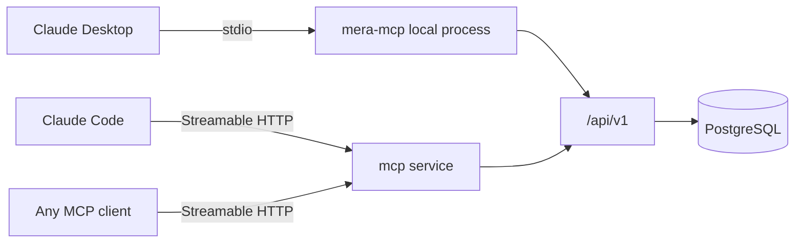
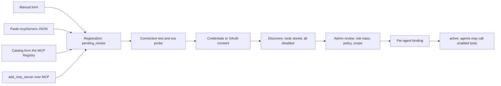
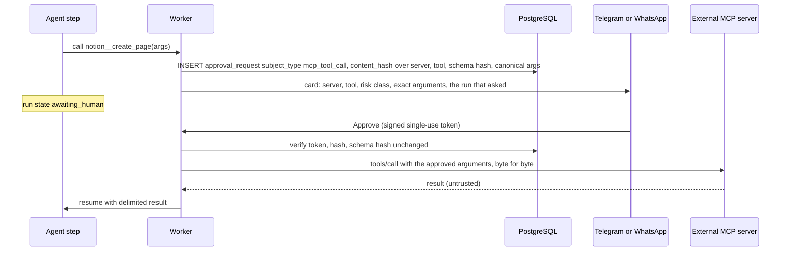

# 05 - MCP

Mera speaks Model Context Protocol in both directions.

- **As a server**, it exposes its capabilities so Claude Desktop, Claude Code, or any MCP
  client can run your social presence conversationally.
- **As a client**, its agents consume external MCP servers for web search, document
  retrieval, image generation, and anything else you register.

## 0. Protocol version

Mera targets MCP revision **`2026-07-28`** (current at the time of writing) and is
**dual-era** in both directions, because most clients and servers in the wild still
speak the handshake-based revisions.

| Revision | What changes for Mera |
| --- | --- |
| `2026-07-28` (modern) | Stateless. No `initialize` handshake and no `Mcp-Session-Id`: every request carries its protocol version, client info and capabilities in `_meta`. Servers must implement `server/discover`. Change notifications move to a single `subscriptions/listen` stream. Server-to-client requests (elicitation) are replaced by the Multi Round-Trip Request pattern (`resultType: "input_required"`). Sampling, Roots and Logging are deprecated. Dynamic Client Registration is deprecated in favour of Client ID Metadata Documents. Tasks move into the `io.modelcontextprotocol/tasks` extension. |
| `2025-11-25` and earlier (legacy) | `initialize` handshake, session-scoped state, `resources/subscribe`, server-initiated `elicitation/create`. |

As a **server**, Mera answers both: a request carrying modern `_meta` is served
statelessly; an `initialize` request selects legacy semantics for that stdio process or
HTTP session. As a **client**, Mera probes each registered server once, caches its era on
the registration, and speaks whichever it supports (section 2.1).

Statelessness suits Mera well. The `mcp` service was already a thin, sessionless wrapper
over a stateless REST API, so the modern revision removes the one thing that would have
needed sticky routing.

---

## 1. Mera as an MCP server

### 1.1 Shape and transport

The `mcp` service is a thin wrapper over the public REST API. It holds no business logic
and no database connection. Every tool call becomes an authenticated HTTP request to
`/api/v1`, which means MCP inherits RBAC, guardrails, rate limits, idempotency, and the
approval invariant without reimplementing any of them.



| Transport | Use | Auth |
| --- | --- | --- |
| **stdio** | Claude Desktop on your machine | A workspace API key from the environment |
| **Streamable HTTP** | Remote clients, Claude Code, team use | OAuth 2.1 with PKCE, or a bearer API key |

The deprecated HTTP+SSE transport is not offered.

**Streamable HTTP specifics.**

- Modern requests are independent POSTs. Any `mcp` replica can serve any request, so the
  service scales horizontally behind the proxy with no session affinity.
- The `Origin` header is validated on every request, and an invalid origin gets `403`.
- The proxy reads the required `Mcp-Method` and `Mcp-Name` headers to rate-limit and log
  by tool without parsing request bodies. Mera's own tools mark no sensitive parameter
  with `x-mcp-header`, because header values are visible to intermediaries.
- `subscriptions/listen` is a long-lived POST response stream. The proxy gives it a
  longer idle timeout than ordinary calls. A broken stream is re-opened by the client,
  since the modern revision removed SSE resumability.
- OpenTelemetry trace context (`traceparent`, `tracestate`) in request `_meta` is
  continued into the REST call, so one trace runs from Claude through `mcp` and `api`
  into the worker.

**The rule that matters:** an MCP-initiated publish is subject to exactly the same approval
rules as one initiated in the web UI. Asking Claude to "post this to LinkedIn" in Manual
mode creates an approval request and sends it to your Telegram. It does not publish. The
MCP surface is a client, not a privileged back door, and `publish_post` returning
"approval required" is the correct and expected behaviour rather than a limitation.

### 1.2 Authentication and authorization

**OAuth 2.1.** Authorization Code with PKCE, mandatory for public clients. The MCP server
publishes Protected Resource Metadata (RFC 9728) at `/.well-known/oauth-protected-resource`,
pointing at Mera's authorization server, so a compliant client can discover and complete
the flow without manual configuration. Tokens are workspace-scoped and carry the scope list
from [04 - API Contract](04-api-contract.md) section 2.5. The authorization server:

- Accepts **Client ID Metadata Documents** as the primary way clients identify
  themselves: the `client_id` is an HTTPS URL the client controls. It still accepts
  Dynamic Client Registration (RFC 7591) for older clients, now that the spec has
  deprecated DCR.
- Requires the `resource` parameter (RFC 8707) and issues tokens whose audience is the
  Mera MCP endpoint only. A token minted for Mera's MCP server cannot be replayed against
  the REST API by another party, or the other way round.
- Returns `iss` in authorization responses (RFC 9207). Clients must check it.
- Supports **incremental consent**. A call that needs a scope the token lacks, such as
  `approvals:decide`, gets a `WWW-Authenticate` challenge naming the missing scope. The
  client can step up instead of the user granting everything at first connect. Start
  read-only and widen when needed.

**API keys.** For local stdio use, `MERA_API_KEY` in the client's environment. Simpler, and
appropriate when the client process is already on your machine with your filesystem.

**Effective permission is the intersection** of the token's scopes and the acting user's
workspace role. A token minted with `approvals:decide` by someone who is only a Viewer
cannot approve anything.

**Workspace selection.** Tools take an optional `workspace_id`. When omitted, the server
uses the token's default workspace. When a token spans several workspaces and the argument
is omitted on a mutating tool, the server never guesses, because guessing here means
posting to the wrong client's account:

- If the client declared elicitation support, the server returns an `input_required`
  result with a form-mode elicitation: an enum of the candidate workspaces. The user
  picks one, and the client retries with the answer.
- Otherwise the call returns a tool execution error (`isError: true`) listing the
  candidates, so the model can ask the user and retry.

**Second factors never travel through the model.** High-risk tools (table in 1.4) do not
take a PIN argument. A PIN typed into a chat ends up in the model's context, the client's
logs and possibly the provider's. Instead the server returns `input_required` with a
**URL-mode elicitation** pointing at a short-lived Mera confirmation page. The user
confirms there with TOTP, and the client retries the original call with the server's
`requestState`. Clients that don't support URL elicitation get a tool error containing
the same link. The action then sits as a pending confirmation that completes from the
web page.

**Account selection is never guessed.** Any tool that writes to a social account requires
targets to be named explicitly, as group IDs, account IDs, or both. There is no "default
account" and no "post it everywhere" shorthand. With two LinkedIn accounts and two X
accounts in one workspace, a model inferring the target from context is a wrong post
waiting to happen.

### 1.3 Tools

Fifty-one tools across thirteen groups. Schemas below are abbreviated to the fields that
carry meaning. The full JSON Schema (2020-12 dialect, the MCP default) is generated from
the same Pydantic models as the REST API.

**Tool metadata conventions**

- **Results.** Every tool declares an `outputSchema` and returns `structuredContent`, plus
  the same JSON serialized in a text block for older clients, plus a one-line
  human-readable summary. The client's model will often relay the summary to you
  verbatim.
- **Errors.** Business outcomes the model can act on are tool execution errors
  (`isError: true`) with an actionable message: a validation failure, an account outside
  your scope, a guardrail block. Protocol errors are reserved for unknown tools and
  malformed requests. **"Approval required" is neither.** It is a successful result
  whose `status` is `pending_approval`, because it is the designed outcome.
- **Annotations.** Every tool carries `readOnlyHint`, `destructiveHint`,
  `idempotentHint` and `openWorldHint`. All `list_*` and `get_*` tools are read-only.
  `delete_post`, `delete_comment`, `disconnect_account` and `remove_mcp_server` are
  destructive. Publishing tools are open-world. These help clients decide what to
  confirm; Mera's own enforcement never depends on them.
- **Listing.** `tools/list` returns only the tools the presented token's scopes permit,
  in a fixed order, with `cacheScope: "private"` (the list varies by credential) and
  `ttlMs: 300000`. The fixed order keeps the client's prompt cache warm.
- **Names and icons.** Names use `snake_case` within the spec's allowed set
  (`A-Z a-z 0-9 _ - .`). Each group has an icon so client UIs can show which part of
  Mera a call touches.

#### Workspaces

```jsonc
// list_workspaces
{
  "name": "list_workspaces",
  "description": "Workspaces you can access, with your role in each and their account counts.",
  "inputSchema": { "type": "object", "properties": {} }
}

// create_workspace
{
  "name": "create_workspace",
  "inputSchema": {
    "type": "object",
    "required": ["name"],
    "properties": {
      "name": { "type": "string" },
      "workspace_type": { "type": "string", "enum": ["personal", "team", "agency"] },
      "timezone": { "type": "string", "description": "IANA name, e.g. Asia/Kolkata" },
      "clone_settings_from_workspace_id": {
        "type": "string",
        "format": "uuid",
        "description": "Copies voices, pillars, sources, policies and group shapes. Never copies accounts, credentials or content."
      }
    }
  }
}

// invite_member
{
  "name": "invite_member",
  "inputSchema": {
    "type": "object",
    "required": ["email", "role"],
    "properties": {
      "workspace_id": { "type": "string", "format": "uuid" },
      "email": { "type": "string", "format": "email" },
      "role": { "type": "string", "enum": ["viewer", "approver", "editor", "admin"] },
      "scope_account_group_ids": {
        "type": "array",
        "items": { "type": "string", "format": "uuid" },
        "description": "Optional. Restricts this member to these groups only."
      },
      "scope_social_account_ids": { "type": "array", "items": { "type": "string", "format": "uuid" } }
    }
  }
}
```

#### Accounts

```jsonc
// list_accounts
{
  "name": "list_accounts",
  "description": "Connected accounts with platform, nickname, type, status, group membership and health.",
  "inputSchema": {
    "type": "object",
    "properties": {
      "workspace_id": { "type": "string", "format": "uuid" },
      "platform": { "type": "string" },
      "account_group_id": { "type": "string", "format": "uuid" },
      "status": { "type": "string", "enum": ["active", "needs_reauth", "suspended", "disconnected"] }
    }
  }
}

// get_account_health
{
  "name": "get_account_health",
  "description": "Token validity, granted scopes, remaining rate budget and last error for one account.",
  "inputSchema": {
    "type": "object",
    "required": ["social_account_id"],
    "properties": {
      "social_account_id": { "type": "string", "format": "uuid" },
      "force_check": { "type": "boolean", "default": false }
    }
  }
}

// connect_account_link - returns a URL for a human to open; the model cannot complete OAuth
{
  "name": "connect_account_link",
  "description": "Returns an OAuth consent URL for connecting a new account. You must open it yourself; no credential is ever returned to the client.",
  "inputSchema": {
    "type": "object",
    "required": ["platform"],
    "properties": {
      "workspace_id": { "type": "string", "format": "uuid" },
      "platform": { "type": "string" },
      "nickname": { "type": "string", "description": "Label applied once the connection completes." }
    }
  }
}

// disconnect_account - revokes at the platform first, then deletes locally
{
  "name": "disconnect_account",
  "inputSchema": {
    "type": "object",
    "required": ["social_account_id"],
    "properties": {
      "social_account_id": { "type": "string", "format": "uuid" }
    }
  }
}
```

#### Account groups

```jsonc
// list_account_groups
{
  "name": "list_account_groups",
  "description": "Groups with their members, settings and stagger configuration.",
  "inputSchema": {
    "type": "object",
    "properties": { "workspace_id": { "type": "string", "format": "uuid" } }
  }
}

// create_account_group
{
  "name": "create_account_group",
  "inputSchema": {
    "type": "object",
    "required": ["name"],
    "properties": {
      "workspace_id": { "type": "string", "format": "uuid" },
      "name": { "type": "string", "examples": ["Tech News"] },
      "description": { "type": "string" },
      "social_account_ids": { "type": "array", "items": { "type": "string", "format": "uuid" } },
      "default_brand_voice_id": { "type": "string", "format": "uuid" },
      "stagger_mode": { "type": "string", "enum": ["none", "fixed", "random_spread"], "default": "random_spread" },
      "stagger_min_seconds": { "type": "integer", "default": 180 },
      "stagger_max_seconds": { "type": "integer", "default": 900 }
    }
  }
}

// update_account_group, add_accounts_to_group, remove_accounts_from_group
{
  "name": "add_accounts_to_group",
  "description": "Adds accounts to a group. An account may belong to several groups; this never moves it out of another.",
  "inputSchema": {
    "type": "object",
    "required": ["account_group_id", "social_account_ids"],
    "properties": {
      "account_group_id": { "type": "string", "format": "uuid" },
      "social_account_ids": { "type": "array", "items": { "type": "string", "format": "uuid" } }
    }
  }
}
```

#### Sources and content

```jsonc
// list_sources
{
  "name": "list_sources",
  "description": "List configured content sources with health and recent yield.",
  "inputSchema": {
    "type": "object",
    "properties": {
      "workspace_id": { "type": "string", "format": "uuid" },
      "status": { "type": "string", "enum": ["active", "paused", "failing"] }
    }
  }
}

// add_source
{
  "name": "add_source",
  "description": "Add a content source. Validates the feed or query before saving.",
  "inputSchema": {
    "type": "object",
    "required": ["source_type", "name", "config"],
    "properties": {
      "workspace_id": { "type": "string", "format": "uuid" },
      "source_type": {
        "type": "string",
        "enum": ["rss", "newsapi", "gnews", "google_news", "reddit", "youtube", "hackernews", "email", "mcp"]
      },
      "name": { "type": "string" },
      "config": {
        "type": "object",
        "description": "Shape depends on source_type. For rss: { url }. For reddit: { subreddit }."
      },
      "include_keywords": { "type": "array", "items": { "type": "string" } },
      "exclude_keywords": { "type": "array", "items": { "type": "string" } },
      "fetch_interval_seconds": { "type": "integer", "minimum": 300, "default": 3600 }
    }
  }
}

// fetch_trending_content
{
  "name": "fetch_trending_content",
  "description": "Content items ranked by relevance to your pillars, freshness, and engagement potential.",
  "inputSchema": {
    "type": "object",
    "properties": {
      "workspace_id": { "type": "string", "format": "uuid" },
      "limit": { "type": "integer", "default": 10, "maximum": 50 },
      "min_relevance": { "type": "number", "minimum": 0, "maximum": 1, "default": 0.5 },
      "topics": { "type": "array", "items": { "type": "string" } },
      "since": { "type": "string", "format": "date-time" }
    }
  }
}
```

#### Drafts

```jsonc
// draft_post - creates a post set with one variant per target account
{
  "name": "draft_post",
  "description": "Generate a post set: one uniquely written variant per target account. Runs the Writer, Hashtag and Editor agents. Returns the set; does not publish.",
  "inputSchema": {
    "type": "object",
    "required": ["targets"],
    "properties": {
      "workspace_id": { "type": "string", "format": "uuid" },
      "content_item_id": { "type": "string", "format": "uuid", "description": "Source article. Omit when supplying your own topic." },
      "topic": { "type": "string", "description": "Free-text topic when there is no source article." },
      "targets": {
        "type": "object",
        "description": "Groups, accounts, or both. Expanded into one variant per distinct account. At least one must be non-empty; there is no default target.",
        "properties": {
          "account_group_ids": { "type": "array", "items": { "type": "string", "format": "uuid" } },
          "social_account_ids": { "type": "array", "items": { "type": "string", "format": "uuid" } },
          "exclude_social_account_ids": { "type": "array", "items": { "type": "string", "format": "uuid" } }
        }
      },
      "brand_voice_id": { "type": "string", "format": "uuid", "description": "Override. Otherwise resolved per account: account, then group, then workspace." },
      "instructions": { "type": "string", "maxLength": 2000 },
      "media": { "type": "string", "enum": ["none", "og_image", "generate"], "default": "og_image" },
      "generate_ab_variant": { "type": "boolean", "default": false }
    }
  }
}

// update_draft - creates a NEW version per affected variant; never mutates an existing one
{
  "name": "update_draft",
  "description": "Revise a post set, creating a new immutable version for each affected account. Supersedes approvals for those accounts only; siblings keep theirs.",
  "inputSchema": {
    "type": "object",
    "required": ["post_set_id"],
    "properties": {
      "post_set_id": { "type": "string", "format": "uuid" },
      "instruction": { "type": "string", "description": "e.g. 'shorter, lead with a question'" },
      "variant_ids": {
        "type": "array",
        "items": { "type": "string", "format": "uuid" },
        "description": "Omit to apply to every enabled variant. Supply to revise specific accounts."
      }
    }
  }
}

// update_variant - one account's copy
{
  "name": "update_variant",
  "description": "Replace or revise one account's text, or enable, disable or reschedule that account's variant.",
  "inputSchema": {
    "type": "object",
    "required": ["post_variant_id"],
    "properties": {
      "post_variant_id": { "type": "string", "format": "uuid" },
      "instruction": { "type": "string" },
      "replacement_body": { "type": "string", "description": "Literal replacement text. Mutually exclusive with instruction." },
      "hashtags": { "type": "array", "items": { "type": "string" } },
      "enabled": { "type": "boolean", "description": "Disabling drops this account from the set without deleting its history." },
      "scheduled_for": { "type": "string", "format": "date-time" }
    }
  }
}

// list_drafts
{
  "name": "list_drafts",
  "inputSchema": {
    "type": "object",
    "properties": {
      "workspace_id": { "type": "string", "format": "uuid" },
      "account_group_id": { "type": "string", "format": "uuid" },
      "social_account_id": { "type": "string", "format": "uuid" },
      "state": { "type": "string", "enum": ["drafting", "needs_approval", "partially_approved", "scheduled", "published", "partially_published", "rejected", "blocked"] },
      "limit": { "type": "integer", "default": 20 }
    }
  }
}
```

#### Media

```jsonc
// generate_media - asynchronous; video takes minutes and costs dollars
// With the io.modelcontextprotocol/tasks extension negotiated, returns a task handle the client
// polls with tasks/get; otherwise returns a media_job_id for get_media_job.
{
  "name": "generate_media",
  "description": "Request image or video generation. Returns a task or job immediately; the result arrives when generation finishes. Attaching the result creates a new post version.",
  "inputSchema": {
    "type": "object",
    "required": ["kind", "prompt"],
    "properties": {
      "workspace_id": { "type": "string", "format": "uuid" },
      "kind": { "type": "string", "enum": ["image", "video"] },
      "prompt": { "type": "string", "maxLength": 2000 },
      "post_set_id": { "type": "string", "format": "uuid" },
      "post_variant_id": { "type": "string", "format": "uuid", "description": "Omit to produce one master shared by every variant in the set." },
      "parameters": {
        "type": "object",
        "properties": {
          "aspect_ratio": { "type": "string" },
          "duration_seconds": { "type": "integer", "description": "Video only." },
          "style": { "type": "string" },
          "seed": { "type": "integer" }
        }
      },
      "confirm_cost": {
        "type": "boolean",
        "default": false,
        "description": "Fallback for clients without elicitation. Clients that support it get an input_required form showing the estimate instead, so the human confirms the cost, not the model."
      }
    }
  }
}

// get_media_job
{
  "name": "get_media_job",
  "inputSchema": {
    "type": "object",
    "required": ["media_job_id"],
    "properties": { "media_job_id": { "type": "string", "format": "uuid" } }
  }
}

// attach_media - creates a new post version, because media is inside the content hash
{
  "name": "attach_media",
  "description": "Attach an asset to one account's variant. Derives the platform rendition and writes alt text. Produces a new version, invalidating that variant's approval.",
  "inputSchema": {
    "type": "object",
    "required": ["post_variant_id", "media_asset_id"],
    "properties": {
      "post_variant_id": { "type": "string", "format": "uuid" },
      "media_asset_id": { "type": "string", "format": "uuid" },
      "alt_text": { "type": "string" }
    }
  }
}
```

#### Hashtags

```jsonc
// suggest_hashtags
{
  "name": "suggest_hashtags",
  "description": "Ranked tags for one account, from the post's content, the platform's conventions and this account's own measured performance. Every suggestion carries its sample size.",
  "inputSchema": {
    "type": "object",
    "required": ["post_variant_id"],
    "properties": {
      "post_variant_id": { "type": "string", "format": "uuid" },
      "max_tags": { "type": "integer", "description": "Defaults to the platform's convention from the capability matrix." },
      "apply": { "type": "boolean", "default": false, "description": "True writes them, creating a new version." }
    }
  }
}

// get_hashtag_performance
{
  "name": "get_hashtag_performance",
  "description": "Observed lift versus this account's median engagement, per tag, with sample sizes. Tags below the minimum sample are returned with a null lift rather than a misleading number.",
  "inputSchema": {
    "type": "object",
    "properties": {
      "workspace_id": { "type": "string", "format": "uuid" },
      "social_account_id": { "type": "string", "format": "uuid" },
      "since": { "type": "string", "format": "date-time" },
      "limit": { "type": "integer", "default": 25 }
    }
  }
}
```

#### Approvals

```jsonc
// request_approval
{
  "name": "request_approval",
  "description": "Send a post set for human approval through the configured channels. Returns the request with its expiry and one decision slot per target account.",
  "inputSchema": {
    "type": "object",
    "required": ["post_set_id"],
    "properties": {
      "post_set_id": { "type": "string", "format": "uuid" },
      "approver_user_ids": { "type": "array", "items": { "type": "string", "format": "uuid" } },
      "scheduled_for": { "type": "string", "format": "date-time" },
      "note": { "type": "string", "description": "Context shown to the approver." }
    }
  }
}

// get_approval_status
{
  "name": "get_approval_status",
  "inputSchema": {
    "type": "object",
    "required": ["approval_request_id"],
    "properties": { "approval_request_id": { "type": "string", "format": "uuid" } }
  }
}

// list_pending_approvals
{
  "name": "list_pending_approvals",
  "description": "Approval requests awaiting a decision, with time remaining before expiry.",
  "inputSchema": {
    "type": "object",
    "properties": {
      "workspace_id": { "type": "string", "format": "uuid" },
      "assigned_to_me": { "type": "boolean", "default": false },
      "expiring_within_hours": { "type": "integer" }
    }
  }
}

// approve_post - requires approvals:decide AND an approver-or-above role
{
  "name": "approve_post",
  "description": "Approve a pending request as the authenticated user. Subject to the same quorum, expiry, member-scope and content-hash checks as a bot button tap.",
  "inputSchema": {
    "type": "object",
    "required": ["approval_request_id"],
    "properties": {
      "approval_request_id": { "type": "string", "format": "uuid" },
      "variant_scope": {
        "type": "array",
        "items": { "type": "string", "format": "uuid" },
        "description": "Post variant IDs to approve. Omit to approve every enabled variant. IDs rather than platforms, because two accounts on one platform must be separately decidable."
      },
      "scheduled_for": { "type": "string", "format": "date-time" }
    }
  }
}

// reject_post
{
  "name": "reject_post",
  "inputSchema": {
    "type": "object",
    "required": ["approval_request_id"],
    "properties": {
      "approval_request_id": { "type": "string", "format": "uuid" },
      "variant_scope": {
        "type": "array",
        "items": { "type": "string", "format": "uuid" },
        "description": "Reject only these accounts. Omit to reject the whole set."
      },
      "reason": { "type": "string", "description": "Stored and fed back to the Writer agent for that account's voice." }
    }
  }
}

// configure_approval_channel - admin only
{
  "name": "configure_approval_channel",
  "inputSchema": {
    "type": "object",
    "required": ["channel_type"],
    "properties": {
      "channel_type": { "type": "string", "enum": ["telegram", "whatsapp"] },
      "config": { "type": "object" },
      "policy": {
        "type": "object",
        "properties": {
          "required_approver_count": { "type": "integer" },
          "quorum_mode": { "type": "string", "enum": ["any_of", "all_of"] },
          "expires_after": { "type": "string", "description": "ISO 8601 duration, e.g. PT12H" },
          "quiet_hours": { "type": "object" }
        }
      }
    }
  }
}
```

#### Publishing

```jsonc
// schedule_post
{
  "name": "schedule_post",
  "description": "Schedule approved variants, applying the group's stagger offsets. Each account is scheduled independently; any without a valid approval is reported as skipped rather than failing the rest.",
  "inputSchema": {
    "type": "object",
    "required": ["post_set_id"],
    "properties": {
      "post_set_id": { "type": "string", "format": "uuid" },
      "variant_ids": { "type": "array", "items": { "type": "string", "format": "uuid" }, "description": "Omit for every approved variant." },
      "scheduled_for": { "type": "string", "format": "date-time", "description": "Base time. Omit to use each account's next best-time slot." },
      "stagger_mode": { "type": "string", "enum": ["none", "fixed", "random_spread"], "description": "Override the group's setting." }
    }
  }
}

// publish_post
{
  "name": "publish_post",
  "description": "Publish immediately. In Manual mode this creates an approval request and returns pending_approval rather than publishing. Returns a per-account result; partial success is a normal outcome.",
  "inputSchema": {
    "type": "object",
    "required": ["post_set_id"],
    "properties": {
      "post_set_id": { "type": "string", "format": "uuid" },
      "variant_ids": { "type": "array", "items": { "type": "string", "format": "uuid" } }
    }
  }
}

// delete_post - high risk, may require a second factor
{
  "name": "delete_post",
  "description": "Delete a published post from one account, or from every account in a set. Approval-gated by default.",
  "inputSchema": {
    "type": "object",
    "properties": {
      "published_post_id": { "type": "string", "format": "uuid", "description": "One account." },
      "post_set_id": { "type": "string", "format": "uuid", "description": "Every account in the set. Mutually exclusive with published_post_id." },
      "reason": { "type": "string" }
    }
  }
}

// list_scheduled_posts
{
  "name": "list_scheduled_posts",
  "inputSchema": {
    "type": "object",
    "properties": {
      "workspace_id": { "type": "string", "format": "uuid" },
      "from": { "type": "string", "format": "date-time" },
      "to": { "type": "string", "format": "date-time" },
      "account_group_id": { "type": "string", "format": "uuid" },
      "social_account_id": { "type": "string", "format": "uuid" }
    }
  }
}
```

#### Engagement

```jsonc
// list_comments
{
  "name": "list_comments",
  "description": "The unified inbox, with sentiment and intent classification.",
  "inputSchema": {
    "type": "object",
    "properties": {
      "workspace_id": { "type": "string", "format": "uuid" },
      "state": { "type": "string", "enum": ["new", "triaged", "replied", "hidden", "ignored", "escalated"] },
      "intent": { "type": "string", "enum": ["question", "praise", "complaint", "spam", "toxic", "other"] },
      "published_post_id": { "type": "string", "format": "uuid" },
      "limit": { "type": "integer", "default": 20 }
    }
  }
}

// reply_to_comment
{
  "name": "reply_to_comment",
  "description": "Reply to a comment. Routed through approval when the engagement rules require it.",
  "inputSchema": {
    "type": "object",
    "required": ["comment_id"],
    "properties": {
      "comment_id": { "type": "string", "format": "uuid" },
      "body": { "type": "string", "description": "Omit to have the Engagement agent draft one in brand voice." }
    }
  }
}

// delete_comment - destructive, approval-gated by default
{
  "name": "delete_comment",
  "inputSchema": {
    "type": "object",
    "required": ["comment_id"],
    "properties": {
      "comment_id": { "type": "string", "format": "uuid" },
      "action": { "type": "string", "enum": ["hide", "delete"], "default": "hide" },
      "reason": { "type": "string" }
    }
  }
}
```

#### Analytics

```jsonc
// get_post_analytics
{
  "name": "get_post_analytics",
  "inputSchema": {
    "type": "object",
    "required": ["published_post_id"],
    "properties": {
      "published_post_id": { "type": "string", "format": "uuid" },
      "include_timeseries": { "type": "boolean", "default": false }
    }
  }
}

// get_account_analytics
{
  "name": "get_account_analytics",
  "inputSchema": {
    "type": "object",
    "required": ["social_account_id"],
    "properties": {
      "social_account_id": { "type": "string", "format": "uuid" },
      "from": { "type": "string", "format": "date-time" },
      "to": { "type": "string", "format": "date-time" },
      "granularity": { "type": "string", "enum": ["day", "week", "month"], "default": "day" }
    }
  }
}

// get_group_analytics
{
  "name": "get_group_analytics",
  "description": "Aggregated metrics for one account group, with a per-account breakdown so you can see which account carried the group.",
  "inputSchema": {
    "type": "object",
    "required": ["account_group_id"],
    "properties": {
      "account_group_id": { "type": "string", "format": "uuid" },
      "from": { "type": "string", "format": "date-time" },
      "to": { "type": "string", "format": "date-time" },
      "compare_accounts": { "type": "boolean", "default": true }
    }
  }
}

// get_workspace_analytics
{
  "name": "get_workspace_analytics",
  "description": "Workspace totals with breakdowns by group, platform and account.",
  "inputSchema": {
    "type": "object",
    "properties": {
      "workspace_id": { "type": "string", "format": "uuid" },
      "from": { "type": "string", "format": "date-time" },
      "to": { "type": "string", "format": "date-time" },
      "group_by": { "type": "string", "enum": ["group", "platform", "account"], "default": "group" }
    }
  }
}

// get_insights
{
  "name": "get_insights",
  "description": "AI-generated insights with the aggregate evidence each one rests on.",
  "inputSchema": {
    "type": "object",
    "properties": {
      "workspace_id": { "type": "string", "format": "uuid" },
      "account_group_id": { "type": "string", "format": "uuid" },
      "kind": { "type": "string", "enum": ["timing", "topic", "format", "platform", "variant", "approval", "account_comparison", "group_comparison"] },
      "since": { "type": "string", "format": "date-time" }
    }
  }
}
```

#### Control

```jsonc
// set_autopilot_mode - admin only
{
  "name": "set_autopilot_mode",
  "description": "Set the mode at workspace, group or account scope. Note that modes resolve to the strictest applicable value, so setting a group to 'full' does not override an account pinned to 'manual'.",
  "inputSchema": {
    "type": "object",
    "required": ["mode", "scope_type"],
    "properties": {
      "workspace_id": { "type": "string", "format": "uuid" },
      "scope_type": { "type": "string", "enum": ["workspace", "account_group", "social_account"] },
      "scope_id": { "type": "string", "format": "uuid", "description": "Omit at workspace scope." },
      "mode": { "type": "string", "enum": ["manual", "assisted", "full"] },
      "assisted_confidence_threshold": { "type": "number", "minimum": 0, "maximum": 1 },
      "daily_post_cap": { "type": "integer", "description": "Per account." }
    }
  }
}

// pause_automation - the kill switch, at any scope
{
  "name": "pause_automation",
  "description": "Immediately halt automated activity at workspace, group or account scope. Available to approvers and above. Engaging needs no second factor; disengaging does.",
  "inputSchema": {
    "type": "object",
    "required": ["scope_type"],
    "properties": {
      "workspace_id": { "type": "string", "format": "uuid" },
      "scope_type": { "type": "string", "enum": ["workspace", "account_group", "social_account"] },
      "scope_id": { "type": "string", "format": "uuid", "description": "Omit for workspace-wide." },
      "engaged": { "type": "boolean", "default": true },
      "reason": { "type": "string" }
    }
  }
}
```

#### MCP integrations

These manage the external MCP servers that Mera's own agents use (section 2). Exposing
them over MCP is convenient: "connect the Brave search server and let the Research agent
use it" works from Claude. It is also the most dangerous group in the surface, because it
changes what Mera's agents can do. The rule follows `connect_account_link`: **a model can
propose an integration, but only a human can activate one.**

```jsonc
// list_mcp_servers
{
  "name": "list_mcp_servers",
  "description": "Registered external MCP servers with status, protocol era, scope, and counts of enabled versus discovered tools.",
  "inputSchema": {
    "type": "object",
    "properties": {
      "workspace_id": { "type": "string", "format": "uuid" },
      "status": { "type": "string", "enum": ["pending_review", "active", "degraded", "auth_required", "disabled"] }
    }
  }
}

// add_mcp_server - lands in pending_review with every tool disabled
{
  "name": "add_mcp_server",
  "description": "Propose a new external MCP server. It is tested and its tools discovered, but nothing is callable until an Admin reviews and activates it in the web app. Never accepts secrets: OAuth servers return a consent URL and API-key servers return a link to the secure credential form.",
  "inputSchema": {
    "type": "object",
    "properties": {
      "workspace_id": { "type": "string", "format": "uuid" },
      "catalog_id": { "type": "string", "description": "An MCP Registry server name, e.g. io.github.example/brave-search. Mutually exclusive with transport fields." },
      "name": { "type": "string" },
      "transport": { "type": "string", "enum": ["streamable_http", "stdio"] },
      "url": { "type": "string", "format": "uri", "description": "streamable_http only." },
      "package": {
        "type": "object",
        "description": "stdio only. Must name an exact version or image digest.",
        "properties": {
          "registry": { "type": "string", "enum": ["npm", "pypi", "oci"] },
          "identifier": { "type": "string" },
          "version": { "type": "string" }
        }
      },
      "scope_account_group_ids": { "type": "array", "items": { "type": "string", "format": "uuid" }, "description": "Omit for workspace-wide." }
    }
  }
}

// test_mcp_server
{
  "name": "test_mcp_server",
  "description": "Connect, detect the protocol era, authenticate, and list tools without changing any permission. Returns latency, era, server identity and the tool list.",
  "inputSchema": {
    "type": "object",
    "required": ["mcp_server_id"],
    "properties": { "mcp_server_id": { "type": "string", "format": "uuid" } }
  }
}

// list_mcp_tools
{
  "name": "list_mcp_tools",
  "description": "Discovered tools for one server with risk class, approval policy, enabled state, agent bindings, and whether the schema changed since review.",
  "inputSchema": {
    "type": "object",
    "required": ["mcp_server_id"],
    "properties": { "mcp_server_id": { "type": "string", "format": "uuid" } }
  }
}

// set_mcp_permissions - enabling a write or destructive tool needs web confirmation
{
  "name": "set_mcp_permissions",
  "description": "Enable or disable tools and bind them to agents. Enabling a read tool applies immediately. Enabling a write or destructive tool, or setting its approval policy to 'auto', returns a URL-mode confirmation an Admin completes in the web app.",
  "inputSchema": {
    "type": "object",
    "required": ["mcp_server_id", "tools"],
    "properties": {
      "mcp_server_id": { "type": "string", "format": "uuid" },
      "tools": {
        "type": "array",
        "items": {
          "type": "object",
          "required": ["tool_name"],
          "properties": {
            "tool_name": { "type": "string" },
            "enabled": { "type": "boolean" },
            "risk_class": { "type": "string", "enum": ["read", "write", "destructive"] },
            "approval_policy": { "type": "string", "enum": ["always", "auto", "blocked"] },
            "agent_keys": { "type": "array", "items": { "type": "string" }, "description": "Agents allowed to call it. The Publisher and Approval agents are rejected." }
          }
        }
      }
    }
  }
}

// set_mcp_server_enabled - disabling is immediate and needs no second factor
{
  "name": "set_mcp_server_enabled",
  "inputSchema": {
    "type": "object",
    "required": ["mcp_server_id", "enabled"],
    "properties": {
      "mcp_server_id": { "type": "string", "format": "uuid" },
      "enabled": { "type": "boolean" },
      "reason": { "type": "string" }
    }
  }
}

// remove_mcp_server
{
  "name": "remove_mcp_server",
  "description": "Delete a registration, revoke its OAuth grant where the server supports revocation, and destroy its credentials. Call history is kept for the audit log.",
  "inputSchema": {
    "type": "object",
    "required": ["mcp_server_id"],
    "properties": { "mcp_server_id": { "type": "string", "format": "uuid" } }
  }
}
```

### 1.4 Tool to permission mapping

| Tool | Scope | Minimum role | Approval-gated | Second factor |
| --- | --- | --- | --- | --- |
| `list_workspaces` | none | any member | no | no |
| `create_workspace` | `admin` | any user | no | no |
| `invite_member` | `admin` | Admin | no | no |
| `list_accounts`, `get_account_health` | `accounts:read` | Viewer | no | no |
| `connect_account_link` | `accounts:write` | Admin | no | no |
| `disconnect_account` | `accounts:write` | Admin | no | **yes** |
| `list_account_groups` | `groups:read` | Viewer | no | no |
| `create_account_group`, `update_account_group`, `add_accounts_to_group`, `remove_accounts_from_group` | `groups:write` | Editor | no | no |
| `list_sources`, `fetch_trending_content` | `sources:read`, `content:read` | Viewer | no | no |
| `add_source` | `sources:write` | Editor | no | no |
| `draft_post`, `update_draft`, `update_variant` | `drafts:write` | Editor | no | no |
| `list_drafts` | `drafts:read` | Viewer | no | no |
| `generate_media`, `attach_media` | `media:write` | Editor | no | video over the cap |
| `get_media_job` | `drafts:read` | Viewer | no | no |
| `suggest_hashtags` | `drafts:write` | Editor | no | no |
| `get_hashtag_performance` | `analytics:read` | Viewer | no | no |
| `request_approval` | `approvals:read` | Editor | no | no |
| `get_approval_status`, `list_pending_approvals` | `approvals:read` | Viewer | no | no |
| `approve_post`, `reject_post` | `approvals:decide` | Approver | n/a | per policy |
| `configure_approval_channel` | `admin` | Admin | no | no |
| `schedule_post`, `publish_post` | `publishing:write` | Editor | **yes** | no |
| `delete_post` | `publishing:write` | Editor | **yes** | per policy |
| `list_scheduled_posts` | `publishing:read` | Viewer | no | no |
| `list_comments` | `engagement:read` | Viewer | no | no |
| `reply_to_comment` | `engagement:write` | Editor | per rules | no |
| `delete_comment` | `engagement:write` | Editor | **yes** | per policy |
| `get_post_analytics`, `get_account_analytics`, `get_group_analytics`, `get_workspace_analytics`, `get_insights` | `analytics:read` | Viewer | no | no |
| `set_autopilot_mode` | `automation:write` | Admin | no | yes |
| `pause_automation` | `automation:write` | Approver | no | only to disengage |
| `list_mcp_servers`, `list_mcp_tools` | `agents:read` | Viewer | no | no |
| `add_mcp_server`, `test_mcp_server` | `admin` | Admin | lands in `pending_review` | no |
| `set_mcp_permissions` | `admin` | Admin | no | **yes** to enable write or destructive tools, or set `auto` |
| `set_mcp_server_enabled` | `admin` | Admin | no | only to enable |
| `remove_mcp_server` | `admin` | Admin | no | no |

"Second factor" always means the URL-mode confirmation described in 1.2, never a PIN
argument.

Every row is additionally filtered by the acting member's scope: a tool call naming an
account outside it fails as though the account did not exist.

Four asymmetries are deliberate.

**Engaging** the kill switch needs only Approver, because stopping is always safe and the
person watching the output should be able to stop it. **Disengaging** it needs Admin, a
second factor, and an audit entry, because resuming is a decision.

**Creating a group is an Editor capability; connecting an account is an Admin one.**
Grouping is editorial and reversible. Granting Mera authority to speak as a new account is
neither.

**`connect_account_link` returns a URL rather than completing a connection.** The model
cannot grant itself publishing authority over a new account; a human has to complete the
consent flow in a browser. Deliberately *not* automating this is the feature.

**`add_mcp_server` proposes; it never activates.** It is the same principle applied to
capabilities instead of accounts. A prompt-injected client session could otherwise
register a hostile server and bind it to the Research agent in one turn. Every
registration made over MCP arrives in `pending_review`, and turning on a tool that can
write anywhere needs a human with a second factor.

### 1.5 Resources

Resources expose read-only context the client model can pull in without a tool round trip.

| URI | Content | MIME |
| --- | --- | --- |
| `mera://workspaces` | Every workspace you can reach, with your role and account counts | `application/json` |
| `mera://workspace/{id}/accounts` | Connected accounts with nickname, platform, type, health, group membership | `application/json` |
| `mera://workspace/{id}/account-groups` | Groups, their members, and their resolved settings | `application/json` |
| `mera://workspace/{id}/brand-voice/{voice_id}` | Tone, banned words, emoji policy, CTA style, example posts | `application/json` |
| `mera://workspace/{id}/content-calendar?from=&to=&group_id=` | Scheduled and published posts in the window | `application/json` |
| `mera://workspace/{id}/analytics/summary?period=&group_id=` | Headline metrics and deltas | `application/json` |
| `mera://workspace/{id}/pending-approvals` | Live approval queue with per-account state and time remaining | `application/json` |
| `mera://workspace/{id}/content-pillars?group_id=` | Pillars, keywords, current weights | `application/json` |
| `mera://workspace/{id}/capability-matrix` | What each connected account can do | `application/json` |
| `mera://workspace/{id}/hashtag-performance?account_id=` | Measured lift per tag, with sample sizes | `application/json` |
| `mera://workspace/{id}/recent-posts?limit=&group_id=` | Recent published posts with performance | `application/json` |
| `mera://workspace/{id}/mcp-servers` | Registered external MCP servers, status, era, scope, enabled tools per agent | `application/json` |

`pending-approvals`, `content-calendar`, `accounts`, and `mcp-servers` support
subscriptions, so a client is notified when the queue changes, an account's health
degrades or an integration goes down, instead of polling. Modern clients opt in through
`subscriptions/listen` with `resourceSubscriptions` (plus `toolsListChanged` when a
scope change alters their tool list). Legacy clients use `resources/subscribe` on their
session. Both are fed from the same Postgres `LISTEN/NOTIFY` event bus. `resources/read`
results carry `ttlMs` and `cacheScope: "private"`.

The `accounts` and `account-groups` resources are the two worth loading early in any
session. A model that has them in context stops asking "which LinkedIn?" and starts naming
targets correctly, which is most of what goes wrong when a workspace holds a dozen
accounts.

### 1.6 Prompts

| Prompt | Arguments | Produces |
| --- | --- | --- |
| `weekly_content_plan` | `workspace_id`, `account_group_id`, `week_start`, `posts_per_account` | A week of post sets for that group from trending content, balanced across pillars, slotted into each account's best times, submitted for approval as a batch |
| `review_pending_approvals` | `workspace_id` | A walkthrough of the queue with a per-account recommendation and reasoning |
| `analyze_performance` | `workspace_id`, `period`, `account_group_id?` | A performance narrative, including which accounts carried the group, with concrete next actions |
| `draft_from_article` | `url`, `targets` | Ingest a one-off URL, draft a variant per target account, request approval |
| `engagement_triage` | `workspace_id` | Walk the inbox across accounts, propose replies in each account's voice, flag what needs you |
| `setup_wizard` | none | Conversational onboarding: workspace, accounts, groups, pillars, brand voice, sources, approval channel |
| `group_setup` | `workspace_id` | Walks your connected accounts and proposes groupings, voices, and stagger settings |

`setup_wizard` is the one worth highlighting. First-run configuration is the least
pleasant part of a tool like this, and doing it by conversation ("what three topics do you
want to be known for?") is meaningfully better than a settings form.

### 1.7 Client configuration

Claude Desktop, stdio:

```json
{
  "mcpServers": {
    "mera": {
      "command": "uvx",
      "args": ["mera-mcp"],
      "env": {
        "MERA_API_URL": "https://mera.example.com/api/v1",
        "MERA_API_KEY": "mera_sk_live_...",
        "MERA_DEFAULT_WORKSPACE_ID": "..."
      }
    }
  }
}
```

Remote, Streamable HTTP:

```json
{
  "mcpServers": {
    "mera": {
      "type": "http",
      "url": "https://mera.example.com/mcp"
    }
  }
}
```

The remote form carries no secret: the client discovers the OAuth metadata and runs the
authorization flow on first use.

---

## 2. Mera as an MCP client

Agents can call out to external MCP servers. This is how the Research agent gets web
search, the Writer agent reads your Notion, and the Media agent reaches an
image-generation service, without any of it being hardcoded.

**Adding a server is self-serve.** An Admin adds it in the UI, Mera tests it and discovers
its tools, the Admin reviews and enables the ones that should be usable, and binds them to
specific agents. No code change, no redeploy, no restart.

### 2.1 Protocol support

Mera's client is **dual-era** and follows the spec's detection rules:

| Transport | Detection | Fallback |
| --- | --- | --- |
| Streamable HTTP | Send a modern request. A recognized modern error such as `UnsupportedProtocolVersionError` means a modern server: retry with a mutually supported version. | A `4xx` without a modern error body means a legacy server: fall back to `initialize` and a session. |
| stdio | Probe with `server/discover`. | Any non-modern error or a timeout means legacy: fall back to `initialize`. |

The detected era and negotiated version are cached on the registration
(`protocol_era`, `protocol_version`) and re-probed only when a call fails in a way that
contradicts them. The deprecated HTTP+SSE transport is **not** supported. A server that
only speaks it fails the connection test with a message saying so, rather than Mera
carrying a deprecated transport indefinitely.

What Mera's client declares and does:

- **Identity on every request.** `clientInfo` names Mera and its version.
  `traceparent` continues the agent run's OpenTelemetry trace into the external server.
- **No Sampling and no Roots.** Both are deprecated in `2026-07-28`, and both would be
  liabilities here anyway. Sampling would let an external server spend Mera's LLM budget
  with prompts of its choosing. Roots would expose a filesystem the server has no reason
  to see.
- **Elicitation only where a human is present.** During an unattended agent run, any
  `input_required` result from an external server is declined, and the step records
  what was asked. During an interactive connection test in the web UI, form and URL
  elicitations are shown to the Admin. That is how a server that needs its own
  downstream OAuth (a Notion server asking you to authorize Notion, say) gets set up.
- **Tasks when offered.** If a server advertises `io.modelcontextprotocol/tasks`,
  long-running calls (video generation, large searches) are tracked as tasks and polled
  with `tasks/get` from a durable job. A worker never holds a slot for minutes.
- **Change notifications.** For modern remote servers, a lightweight listener holds a
  `subscriptions/listen` stream with `toolsListChanged` and triggers re-discovery when
  the server announces a change. Legacy servers get the same through their session's
  `notifications/tools/list_changed`. Every server is also re-discovered on a schedule
  that respects the `ttlMs` on its `tools/list` result, with a floor of one hour and a
  ceiling of one day.

### 2.2 Four ways to add a server



1. **Manual form.** Name, icon, transport, then either a URL (Streamable HTTP) or a
   package (stdio: npm, PyPI, or an OCI image), auth method, scope, and egress
   allowlist.
2. **Paste JSON.** The `mcpServers` object used by Claude Desktop and Claude Code, holding
   one or many servers. The importer turns each entry into a draft registration. It pins
   any unpinned package to the version it resolves today and shows that pin for
   confirmation. It moves values from `env` and `headers` into encrypted credentials so
   they never touch the registration row. It rejects shell wrappers (`bash -c`,
   `sh -c`, pipes), since a stdio registration must be a package, not a script.
3. **Catalog.** Browse and search the official **MCP Registry**
   (`registry.modelcontextprotocol.io`, the `server.json` format), plus a short curated
   list Mera's maintainers have reviewed (web search, Notion, Google Drive, Slack, GitHub,
   image generation). A catalog entry pre-fills transport, package, version and auth.
   Being listed in the Registry means a server is published and namespaced, not that it
   is safe, and the UI says so.
4. **Over MCP**, through `add_mcp_server` (section 1.3). This always lands in
   `pending_review`.

Whatever the entry point, the result is a registration in `pending_review` with **every
tool disabled**. Discovery is not authorization.

**Registration states:** `pending_review` → `active` ↔ `degraded` (failing health
checks, circuit open) ↔ `auth_required` (token expired or revoked) → `disabled`.
Disabling is instant, needs no second factor, and is the per-server kill switch.

A registration belongs to one workspace. An agency whose five client workspaces all want
the same web-search server registers it five times, with five credentials. Sharing one
registration across tenants would put one client's search queries in another's audit
log.

### 2.3 Authenticating to external servers

| Method | Use | Storage |
| --- | --- | --- |
| None | Public, read-only servers | none |
| API key or bearer token | Most hosted servers today | `mcp_server_credential`, encrypted |
| Custom headers | Servers that want a vendor header | `mcp_server_credential`, encrypted |
| Environment variables | stdio servers configured by env | `mcp_server_credential`, injected into the sandbox at start |
| **OAuth 2.1** | Servers implementing MCP authorization | `mcp_server_credential`, keyed by issuer |

For OAuth, Mera behaves as a spec-compliant MCP client:

- Discovers the authorization server from the server's Protected Resource Metadata
  (RFC 9728), via the `WWW-Authenticate` header or the `.well-known` fallback, then the
  authorization server's metadata (RFC 8414 or OpenID Connect Discovery).
- Identifies itself with a **Client ID Metadata Document** hosted by the Mera deployment.
  The `client_id` is that HTTPS URL. It falls back to Dynamic Client Registration with
  `application_type: "web"` only for authorization servers that don't support CIMD.
- Uses Authorization Code with PKCE (S256), sends the `resource` parameter (RFC 8707) so
  the token is audience-bound to that one server, and **validates `iss`** in the
  authorization response (RFC 9207) before redeeming the code.
- **Keys stored client credentials and tokens by issuer**, never reuses them with a
  different authorization server, and re-registers if the server moves to a new one.
- Refreshes ahead of expiry from the `accounts`-style credential queue. A failed refresh
  moves the registration to `auth_required` and notifies Admins in the web app and the
  bot, just as a social account needing re-auth does.
- Handles incremental consent: a `WWW-Authenticate` challenge for a broader scope
  becomes an Admin task ("Notion server needs `pages:write` to enable `create_page`"),
  never an automatic re-consent.

**No token passthrough.** A token Mera holds for one server is never sent to another
server, never shown to a model, and never returned by any API read. Mera's own API
tokens are never forwarded to external servers.

The OAuth grant belongs to the **registration**, which means the workspace, not an
individual user: whoever consented, every bound agent acts with that grant. The consent
screen says so. Per-user grants, where an agent acts as the person who triggered the
run, are out of scope until there is a concrete need.

### 2.4 Where stdio servers run

A stdio registration runs third-party code. It never runs on the `api` host or in a
worker process. It runs in the **`mcp-sandbox`** service:

- One container per active stdio registration, started on demand and stopped after 10
  idle minutes. gVisor (`runsc`) where the host supports it, otherwise rootless
  containers with a seccomp profile.
- Read-only root filesystem, a small `tmpfs` scratch area, no host mounts, CPU and
  memory limits, a process-count limit.
- **No network by default.** Egress is opened only to the hostnames in the
  registration's `egress_allowlist`, through an egress proxy that also enforces the SSRF
  deny-list from [09 - Security](09-security.md) (no private ranges, no metadata
  endpoints, DNS-rebinding protection). The sandbox network cannot reach Postgres, the
  API or other sandboxes.
- The package is fetched once at a **pinned version** (exact npm or PyPI version, or an
  OCI image digest) into a cache that is checksummed. An unpinned specifier is refused.
- Credentials arrive as environment variables at container start, decrypted by the
  worker that requested the start, and never written to disk.
- Workers talk to the sandbox over an internal RPC that relays JSON-RPC frames to the
  container's stdin and stdout. Stderr is captured as the server's log, as the spec
  recommends.

Remote Streamable HTTP servers need no sandbox, but their calls go through the same
egress proxy, so a registration URL pointing at `169.254.169.254` or `10.0.0.5` fails at
the connection test.

### 2.5 Reviewing tools: risk class and approval policy

Discovery writes one `mcp_tool` row per tool, with its name, title, description, input and
output schemas, annotations, and a **schema hash** over the name, description and both
schemas. The Admin reviews each tool and sets:

| Field | Values | Default |
| --- | --- | --- |
| `enabled` | true or false | **false** |
| `risk_class` | `read`, `write`, `destructive` | From annotations only if the server is on the curated list. Otherwise **`write`**, and `destructive` if `destructiveHint` is true. |
| `approval_policy` | `always`, `auto`, `blocked` | `auto` for `read`, **`always`** for `write` and `destructive` |

Annotations such as `readOnlyHint` are **untrusted hints** unless the server is trusted;
the spec says so explicitly. An uncurated server that labels a tool read-only gets no
benefit from the label. The Admin must classify it as `read` by hand.

**Tool descriptions are part of the prompt**, so the review screen shows the full
description and schema, not a summary. Discovery also runs the description through the
same injection heuristics applied to fetched articles: instructions addressed to the
model, references to other tools, requests for secrets or hidden behaviour. A flagged
tool can't be enabled until an Admin acknowledges the warning. This targets "tool
poisoning", where the description itself is the attack.

**Changed schemas.** When re-discovery finds a different schema hash for an enabled tool,
that tool is disabled, its bindings are kept but suspended, and Admins are notified with
a diff. New tools arrive disabled. Removed tools are marked `gone`. This blocks the
rug-pull where a benign tool is redefined after approval.

### 2.6 Scope and binding: three levels, default deny

An agent may call an external tool only when all three levels allow it:

1. **Workspace:** the tool is `enabled` on an `active` registration.
2. **Scope:** the registration is workspace-wide, or scoped to account groups that include
   the group of the post set or content the run is working on. A Notion server scoped to
   "Company Official" is invisible to a run drafting for "Tech News".
3. **Agent:** an `mcp_agent_binding` row names this agent and this tool.

The effective tool list is computed once at the start of each agent step and passed to
the model. A tool the agent may not call is never in its context, so it can't be talked
into calling it.

**Agents that can never be bound:** the **Publisher** (no LLM and no MCP, by design) and
the **Approval** agent (it formats decisions and must not be steerable by external
content). The API rejects bindings to either.

**No privileged chaining.** No agent with an external MCP binding has any of Mera's
publishing, approval, deletion or automation tools in its allowlist. An external result
can influence a draft. It can never cause a publish.

### 2.7 Write tools pause for a human

When an agent calls a tool whose effective policy is `always` (the default for `write`
and `destructive`), the step pauses:



- The approval card shows the **exact arguments**, not the model's description of them.
  The spec asks clients to show tool inputs to the user before calling, to prevent
  exfiltration. This is where that happens.
- The content hash covers the registration, the tool name, the tool's current schema
  hash and the canonicalized arguments. If the arguments change, or the server redefines
  the tool while the request is pending, the approval is dead.
- Expiry never executes the call. A rejected or expired call returns a tool error to the
  agent, which carries on without it.
- `auto` on a `write` tool means no human in the loop for that tool. Setting it needs an
  Admin and a second factor, and the bot sends an FYI after each call.
- `blocked` keeps a tool visible in the registry for documentation but uncallable.

### 2.8 Tool naming inside agents

The model sees each external tool as `{server_slug}__{tool_name}`, for example
`notion__create_page`. The slug is chosen at registration and unique within the
workspace. It is **not** taken from the server's `serverInfo.name`, which the spec warns
is not guaranteed to be unique.

Double underscore rather than a dot, because LLM provider tool-name rules are stricter
than MCP's. Commonly they allow only letters, digits, underscore and hyphen, up to 64
characters. A name that would exceed the provider's limit is truncated, with a short
hash suffix to keep it unique. The mapping back to the real tool name is held by the
worker and never inferred from the model's output.

### 2.9 Runtime behaviour

| Concern | Behaviour |
| --- | --- |
| Timeout | Per call, default 30 s, configurable per registration. Task-based calls have a separate wall-clock cap. |
| Rate limit | Per registration, token bucket, default 60 calls per minute. |
| Circuit breaker | Five consecutive failures open the circuit for 60 s. The registration shows `degraded`, then a half-open probe follows. Open-circuit calls fail fast and the agent carries on without the tool. |
| Budgets | Per agent, per run: maximum external calls (default 10) and total external wall-clock time. A hanging server fails the step instead of stalling the run. |
| Result size | Results over 100 KB are truncated before entering a prompt, and the step records the original size. Binary content is stored in the object store and referenced, never inlined. |
| Validation | When a tool declares an `outputSchema`, `structuredContent` is validated against it. A mismatch is a tool error. |
| Errors | `isError: true` results go back to the model so it can correct its arguments. Protocol errors do not. They fail the step and count against the circuit. |
| Health | A scheduled probe (`server/discover` for modern servers, `initialize` plus `tools/list` for legacy ones) updates status, era and latency. Alerts fire on `degraded` and `auth_required`. |
| Cost | `cost_per_call_usd` is declared per tool by the Admin, since MCP has no standard way to report charges. It rolls up into `agent_step.cost_usd` and `usage_record`. |

### 2.10 Image generation over MCP

A registered MCP server that exposes an image or video generation tool can be bound to the
Media agent as a `MediaProvider`, which is how "use my own generation service" works
without a Mera change. The binding declares which tool to call and how to map its
arguments:

```jsonc
{
  "mcp_server_id": "...",
  "tool_name": "generate_image",
  "kind": "image",
  "argument_map": { "prompt": "$.prompt", "aspect_ratio": "$.parameters.aspect_ratio" },
  "result_map": { "url": "$.structuredContent.url" },
  "cost_per_call_usd": 0.04
}
```

The result is fetched through the egress proxy, checksummed, stored, and given
per-platform renditions exactly like any other asset. Generation tools default to the
`write` risk class, because they spend money. Binding one as a `MediaProvider` sets its
policy to `auto` within the workspace media budget, since the media spend already has its
own cost estimate and human checkpoint for video ([01 - Architecture](01-architecture.md)
section 5.4).

### 2.11 Content sources over MCP

A `source` of type `mcp` points at a registered server and a `read` tool that returns
content items. The ingestion worker calls it on the source's schedule and feeds the
result into the standard pipeline: extract, embed, dedupe, summarize, classify, score.

The mapping contract is deliberately small, so most content-returning MCP tools can be
adapted with a short field map stored in `source.config`:

```jsonc
{
  "mcp_server_id": "...",
  "tool_name": "search_news",
  "arguments": { "query": "AI infrastructure", "limit": 25 },
  "field_map": {
    "url": "$.structuredContent.results[*].link",
    "title": "$.structuredContent.results[*].title",
    "published_at": "$.structuredContent.results[*].date",
    "body": "$.structuredContent.results[*].snippet"
  }
}
```

Sources may only use `read` tools. A source whose tool is reclassified or disabled pauses
with a visible reason.

### 2.12 Custom workflows

Custom workflows, YAML first and the visual builder later, may include a step that calls
an external MCP tool directly. The same three-level check, approval policy, budgets and
audit apply. A workflow step is treated as an agent called `workflow:{workflow_key}` for
binding purposes. Being written by a human in YAML does not earn a tool any extra
permission.

### 2.13 Safety constraints

External MCP servers are a serious attack surface: a tool's result, and its description,
are attacker-influenced text that goes straight into an LLM context.

- **Results are data.** Everything an external tool returns enters the prompt inside a
  delimited untrusted block, with an explicit instruction that it is reference material,
  not direction. The same treatment as a fetched article.
- **Descriptions are screened** at discovery and on every schema change (2.5).
- **Default deny at three levels**, with stdio code sandboxed and egress allowlisted (2.4,
  2.6).
- **No privileged chaining.** External results can never trigger publishing, approval,
  deletion or automation tools (2.6).
- **Writes pause for a human**, who sees the exact arguments (2.7).
- **No sampling, no roots, no token passthrough** (2.1, 2.3).
- **Pinned versions** for every stdio package. Re-discovery requires re-review.
- **Credential isolation.** Encrypted through `KeyProvider` with the workspace ID and
  registration ID as additional authenticated data. Decrypted only in the worker at call
  time, or at sandbox start. Never returned by any API read.
- **Full audit.** Every external call writes an `mcp_tool_call` row (registration, tool,
  schema hash, redacted arguments, result size, status, latency, cost, the agent step
  and, when gated, the approval request) plus an `agent_step` with
  `step_type = tool_call`. Secrets matching the registration's credential values are
  redacted from logged arguments and results.

### 2.14 Managing integrations

| Surface | What it offers |
| --- | --- |
| Web UI, **MCP Integrations** screen | Add (form, JSON import, catalog), test, review tools with diffs, set risk and policy, scope to groups, bind to agents, view health and call history, disable, remove |
| REST | `/workspaces/{id}/mcp-servers/...`, listed in [04 - API Contract](04-api-contract.md) section 4.14 |
| Mera's MCP server | The seven tools in the "MCP integrations" group (1.3), with the propose-only rule |
| Approval bots | Write-tool approval cards, `auth_required` and `degraded` alerts, schema-change notices, and `/mcp` to list integrations and disable one |

---

## 3. Phasing

| Capability | Phase |
| --- | --- |
| MCP server, stdio transport, API key auth, dual-era (`2026-07-28` and `2025-11-25`) | 2 |
| MCP server, Streamable HTTP, OAuth 2.1 with CIMD, resource indicators, incremental consent | 2 |
| Full tool set, annotations, output schemas, resources and `subscriptions/listen` | 2 |
| URL-mode elicitation for second factors and workspace selection | 2 |
| Prompts, including `setup_wizard` and `group_setup` | 2 |
| **MCP client: registry, dual-era detection, manual form and JSON import, discovery, review, three-level allowlisting** | **2** |
| **`mcp-sandbox` for stdio servers, egress proxy, pinned packages** | **2** |
| **External OAuth 2.1 (CIMD, PKCE, RFC 8707, `iss` validation)** | **2** |
| **Approval-gated write tools (`mcp_tool_call` approvals in the bots)** | **2** |
| MCP-backed media generation providers | 2 |
| "MCP integrations" tool group on Mera's own server | 2 |
| Catalog backed by the MCP Registry, curated list | 3 |
| Per-agent call and time budgets, circuit breakers, tool-description screening, re-discovery re-review | 3 |
| Tasks extension for long-running external calls and for `generate_media` | 3 |
| `mcp` source type, MCP steps in custom workflows | 3 |
| MCP Apps extension (`io.modelcontextprotocol/ui`): render the approval card inside Claude | 4 |

The server still comes before the client within Phase 2, because being drivable from
Claude is immediately useful and its risk is contained.

The client registry sits in Phase 2 because you asked to be able to add your own MCP
servers. The controls that make that defensible ship **with** the registry, not after
it: default-deny allowlisting, the stdio sandbox and egress proxy, pinned versions,
encrypted credentials, approval-gated writes, and results treated as untrusted. A
registry without those is a remote code execution feature with a settings page. Phase 3
adds refinements that reduce risk which is already bounded: budgets, circuit breakers,
description screening and re-review on schema change.

Re-discovery re-review is the one control worth pulling forward if your first servers
are third-party hosted ones you don't control. Q10 in
[00 - Overview](00-overview.md) is where to say so.
