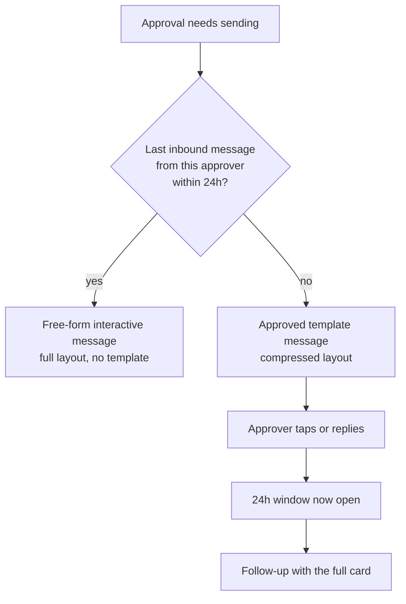
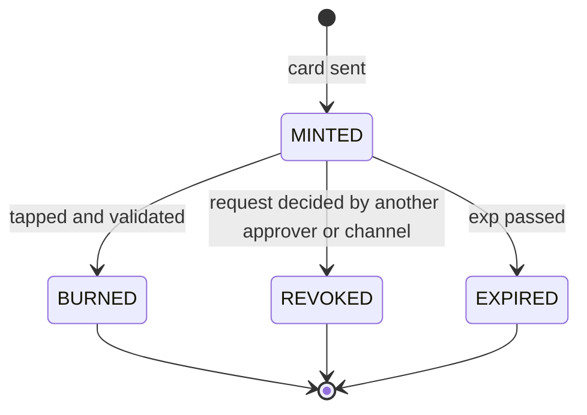
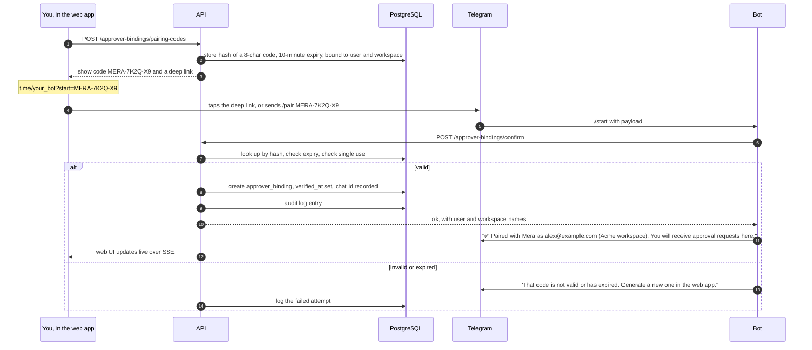
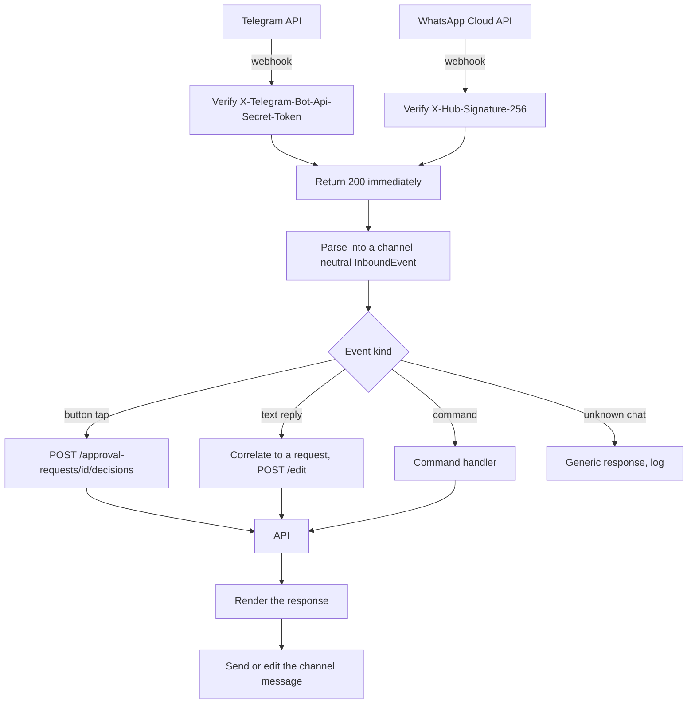

# 07 - Approval Bots

The surface you will touch every day. Message layouts, the callback and token protocol,
pairing, quorum and escalation, and the WhatsApp constraints that shape all of it.

Read [`00-overview.md` section 8](00-overview.md) first if you have not: this is the
document most worth critiquing, because it is the part of the product you will actually
live in.

---

## 1. What this has to get right

An approval interaction has about ten seconds of your attention, on a phone, probably
while you are doing something else. In those ten seconds it must give you enough to decide
responsibly, and it must be impossible for a careless tap to publish the wrong thing.

Those two goals pull against each other, and most of the design below is the compromise:

| Requirement | Consequence |
| --- | --- |
| Decide without opening the web app | The card carries the full post text, media, source, and compliance flags, not a link |
| A tap cannot publish the wrong version | Every button carries a token bound to the content hash |
| A tap cannot publish to the wrong account | Every token names the exact variants it acts on, and the hash includes the account |
| A screenshot cannot be replayed | Tokens are single-use, tracked in a database ledger |
| A forwarded message cannot approve | Tokens are bound to the approver's identity |
| Correcting is as easy as rejecting | Edit is a first-class button, not a fallback to the web app |
| Silence is safe | Expiry is terminal and never publishes |

The multi-account requirement makes this materially harder. A post set going to five
accounts is five posts to read and five decisions to make, in the same ten seconds. Most
of section 3.2 is about resolving that without either hiding information or producing a
card nobody reads to the end.

---

## 2. The `ApprovalChannel` abstraction

Telegram and WhatsApp differ enough that a lowest-common-denominator interface would
produce a bad experience on both. Instead the interface exposes each channel's constraints
and the renderer adapts.

```python
class ChannelConstraints(BaseModel):
    max_inline_buttons: int              # Telegram effectively unlimited, WhatsApp 3
    supports_button_rows: bool
    supports_list_picker: bool
    supports_message_edit: bool          # Telegram yes, WhatsApp no
    supports_media_groups: bool
    max_body_chars: int
    requires_templates_outside_window: bool
    session_window: timedelta | None     # WhatsApp 24h, Telegram none
    supports_force_reply: bool
    per_message_cost: Decimal | None
```

The renderer reads these and lays out accordingly. The most consequential difference:
Telegram can edit a message in place, so an approved card visibly becomes "Approved by you
at 09:14". WhatsApp cannot, so the channel sends a follow-up and marks the original as
stale. Pretending both behave the same would mean either a worse Telegram experience or a
broken WhatsApp one.

---

## 3. Telegram

Telegram is the Phase 1 channel because it has no business verification, no template
approval, no per-message cost, and the richest interaction model.

### 3.1 The approval card

```
┌──────────────────────────────────────────────────┐
│ 📋 Approval needed · expires in 11h 42m          │
│ Acme Workspace · Tech News                       │
│                                                  │
│ LinkedIn · Work LinkedIn (@yourhandle, personal) │
│ Scheduled: Mon 10 Nov, 09:00 IST                 │
│ ─────────────────────────────────────────────    │
│ Postgres 18 ships async I/O, and the numbers     │
│ on read-heavy workloads are worth a look.        │
│                                                  │
│ The short version: io_uring on Linux lets the    │
│ backend issue reads without blocking, and the    │
│ team is reporting meaningful gains on            │
│ sequential scans.                                │
│                                                  │
│ What I'm watching: whether this changes how we   │
│ size read replicas.                              │
│                                                  │
│ https://www.postgresql.org/about/news/...        │
│ #postgres #databases                             │
│ ─────────────────────────────────────────────    │
│ 📎 1 image · alt text set                        │
│                                                  │
│ 📰 Source: PostgreSQL News — "PostgreSQL 18      │
│    Released" · 2h ago                            │
│    Async I/O subsystem, OAuth support, and       │
│    skip-scan index improvements.                 │
│                                                  │
│ 🤖 Confidence 0.84                               │
│ ✅ Facts verified against source                 │
│ ✅ Tone matches brand voice                      │
│ ⚠️ Similar to your post from 14 Oct (0.87)       │
└──────────────────────────────────────────────────┘
  [ ✅ Approve & Schedule ]  [ ✏️ Edit ]
  [ 🔁 Regenerate ]  [ 🕒 Reschedule ]
  [ ❌ Reject ]  [ 🌐 Open in web ]
```

Decisions embedded here:

**Workspace and group are on line two, always.** One bot serves every workspace, so a card
that does not say which client it belongs to is a card that will eventually get the wrong
approval. The account's nickname rather than its handle is the primary label, because
`@yourhandle` and `@yourhandle` tell you nothing when you hold two LinkedIn accounts.

**Full post text, not a summary.** You cannot responsibly approve what you have not read.
Threads render as numbered parts, truncated past part 5 with a "show all" callback.

**Source block always present.** The most common reason to reject is that the underlying
story is not worth posting about, and that judgement needs the source, not the draft.

**Compliance flags as a short list, warnings first.** Only warnings and blocks are
expanded; passes collapse to a single tick line. Five green ticks train you to ignore the
section entirely.

**The duplicate warning carries a date.** "Similar to your post from 14 Oct" is
actionable. "Duplicate detected" is not.

**One primary action.** Approve is alone on the top row. The destructive and corrective
actions sit lower, where a mis-tap is less likely.

### 3.2 Post set cards: many accounts, one message

The hard layout. A set going to a five-account group has five posts to read, and the card
has to stay decidable on a phone.

The answer is a **two-level card**: a summary message with per-account decisions, and a
detail view per account one tap away.

```
┌──────────────────────────────────────────────────┐
│ 📋 Approval needed · expires in 11h 42m          │
│ Acme Workspace · Tech News · 4 accounts          │
│ ─────────────────────────────────────────────    │
│ 📰 PostgreSQL 18 Released · postgresql.org · 2h  │
│    Async I/O subsystem, OAuth support, and       │
│    skip-scan index improvements.                 │
│ 📎 1 image · alt text set                        │
│ ─────────────────────────────────────────────    │
│                                                  │
│ 1️⃣ Work LinkedIn (personal) · Mon 09:00 · 0.84   │
│    Postgres 18 ships async I/O, and the numbers  │
│    on read-heavy workloads are worth a look.     │
│    The short version: io_uring on Linux lets…    │
│    #postgres #databases                          │
│    ⚠️ Similar to your post from 14 Oct (0.87)    │
│                                                  │
│ 2️⃣ Acme Page (company) · Mon 09:04 · 0.91        │
│    Postgres 18 is out. The async I/O work is     │
│    the headline for anyone running read-heavy…   │
│    #postgres #infrastructure                     │
│    🔒 Company page · PIN required                │
│                                                  │
│ 3️⃣ X @main · Mon 09:08 · 0.77 · thread, 3        │
│    1/ Postgres 18 landed async I/O. On Linux…    │
│    ▸ show all 3                                  │
│    #postgres                                     │
│                                                  │
│ 4️⃣ X @tech · Mon 09:13 · 0.73                    │
│    Should we be sizing read replicas             │
│    differently now that PG18 has async I/O?      │
│    #postgres                                     │
│                                                  │
│ ─────────────────────────────────────────────    │
│ ✅ Facts verified against source (all 4)         │
│ ✅ Each account's text is distinct (max 0.41)    │
│ 🕒 Staggered over 13 min                         │
└──────────────────────────────────────────────────┘
  [ ✅ Approve all 4 ]
  [ 1️⃣ ] [ 2️⃣ ] [ 3️⃣ ] [ 4️⃣ ]      ← per-account detail and actions
  [ ✏️ Edit all ]  [ ❌ Reject all ]  [ 🌐 Open in web ]
```

Tapping a numbered button opens that account's detail, as an edit of the same message so
the chat does not fill up:

```
┌──────────────────────────────────────────────────┐
│ 3️⃣ X @main · Mon 10 Nov 09:08 IST                │
│ ─────────────────────────────────────────────    │
│ 1/ Postgres 18 landed async I/O. On Linux the    │
│    backend can issue reads without blocking.     │
│ 2/ Early numbers on sequential scans look        │
│    meaningful on read-heavy workloads.           │
│ 3/ Worth watching whether this changes how we    │
│    size read replicas.                           │
│    https://www.postgresql.org/about/news/...     │
│    #postgres                                     │
│ ─────────────────────────────────────────────    │
│ 🤖 Confidence 0.77                               │
│ ✅ Facts verified · ✅ Distinct from @tech (0.41)│
└──────────────────────────────────────────────────┘
  [ ✅ Approve this ]  [ ❌ Reject this ]
  [ ✏️ Edit ]  [ 🔁 Regenerate ]  [ 🕒 Reschedule ]
  [ ↩️ Back to all 4 ]
```

The decisions behind this layout:

**Every account's text is in the summary, truncated to its first two lines.** Not hidden
behind a tap, not summarized by a model. You should be able to approve all four without
opening anything, and the two-line preview is what makes "these all look right" a
responsible judgement rather than a guess. Full text is one tap away for the one that
looks off.

**The source block appears once, at the top.** It is the same article for every account,
and repeating it four times would push the actual posts off the screen.

**Shared signals are collapsed into one line each.** "Facts verified against source (all
4)" rather than four green ticks. Per-account flags appear under their own account, which
is why the duplicate warning sits under account 1 and the PIN notice under account 2.

**"Each account's text is distinct (max 0.41)" is stated explicitly**, because it is the
check an approver cannot perform themselves by skimming, and the consequence of it failing
is account suspension rather than embarrassment.

**The stagger is shown as a span, and each account carries its own time.** An approver
needs to know that approving this does not fire four posts simultaneously.

**One primary action, then per-account access.** "Approve all 4" is alone on the top row
because it is the overwhelmingly common decision. The numbered row is deliberately compact
and ordered identically to the previews above it.

**Numbers, not platform names, on the per-account buttons.** With two X accounts, a button
labelled "X" is ambiguous, and Telegram buttons are too narrow for "X @tech" alongside
three others. The numbers map to the numbered previews, which is unambiguous and survives
any account count.

Above eight accounts the summary switches to one line per account with no preview text,
and the card says so: at that width, honest truncation beats a wall of text nobody reads.
A group that large should be approving by digest anyway.

### 3.3 The edit flow

Edit is the feature that makes approval honest. An approver who can only accept or reject
will accept things they would have changed.

```
  [ ✏️ Edit ] tapped on account 3's detail view
        ↓
Bot: "Editing X @main. Reply with the corrected text, or tell me
      what to change. Examples: 'shorter', 'more professional',
      'add a hook', 'cut the last paragraph'"
      (ForceReply active)
        ↓
You: "shorter, and lead with the read-replica question"
        ↓
Bot: "✍️ Rewriting X @main…"   (that account's row shows 'Being revised')
        ↓
Bot: new card for X @main v2, with a diff against v1
```

**An edit from an account's detail view touches that account only.** The other three keep
their text, their approvals if already granted, and their schedule. "Edit all" on the
summary card is the explicit set-wide form, and it confirms first:

```
✏️ Apply "shorter, lead with a question" to all 4 accounts?
   Each will be rewritten separately in its own voice.
   [ ✅ All 4 ]  [ 3️⃣ Just X @main ]  [ ✖️ Cancel ]
```

The confirmation exists because a set-wide rewrite discards four drafts a human may have
already read and costs four Writer runs. The narrow option is offered alongside, since
"actually I only meant that one" is the common correction.

**Media is regenerated the same way.** The detail view's `🖼 New image` action queues a
generation job and the row shows a spinner; video generation says how long it is likely to
take and what it will cost before starting. When it lands, that account gets a new version
and a fresh card, because media is inside the content hash.

Classifying your reply as an *instruction* versus a *literal replacement* is a small
structured-output call. Heuristics: short imperative phrases without post-like structure
are instructions; text approaching the post's length with its own line breaks and links is
a replacement. Ambiguity resolves by asking, once, with two buttons.

The v2 card shows what changed:

```
│ ✏️ Revision 2 · "shorter, and lead with the      │
│    read-replica question"                        │
│ ─────────────────────────────────────────────    │
│ Should we be sizing read replicas differently    │
│ now that Postgres 18 has async I/O?              │
│                                                  │
│ io_uring lets the backend issue reads without    │
│ blocking. Early numbers on sequential scans      │
│ look meaningful.                                 │
│                                                  │
│ https://www.postgresql.org/about/news/...        │
│ ─────────────────────────────────────────────    │
│ 📊 -47 words · hook changed to question          │
```

The approval for that account's v1 is dead the moment its v2 exists. That is a property of
the content hash, not a rule the bot has to remember. The set's composite hash also
changes, so an outstanding "Approve all 4" button dies with it — but approvals already
granted to the *other three accounts* survive, because their content did not change.

That asymmetry is worth stating plainly, because it is what makes editing one account
cheap: you do not lose the three decisions you already made.

### 3.4 Other message types

**Reminder**, sent at `remind_at`, as a reply to the original card so the thread stays
intact:

```
⏰ Still waiting on this one.
   LinkedIn post about Postgres 18 · expires in 2h 14m
   [ ✅ Approve ] [ ✏️ Edit ] [ ❌ Reject ]
```

**Escalation notice**, to the primary approver:

```
↗️ Escalated to Priya (backup approver).
   You can still decide on this — the original
   buttons remain valid.
```

**Expiry**, which edits the original card to remove the buttons entirely and reports the
outcome per account:

```
⌛ Expired — partially published.
   ✅ Work LinkedIn · approved 09:12 · published
   ✅ Acme Page · approved 09:12 · published
   ⌛ X @main · never approved, will not go out
   ⌛ X @tech · never approved, will not go out
   The two unapproved posts are back in your drafts.
   [ 🌐 Open in web ]
```

Worth noting: the buttons are **removed**, not disabled. A disabled button invites a tap
and a confusing failure. Removal communicates finality.

**Published confirmation**, which reports the whole set as it completes:

```
🚀 Published · Tech News · 3 of 4
   ✅ Work LinkedIn 09:00 · linkedin.com/posts/...
   ✅ X @main 09:08 · x.com/main/status/...
   ✅ X @tech 09:13 · x.com/tech/status/...
   ❌ Acme Page · failed, retrying (attempt 2 of 5)
      "Meta API returned 500"
   [ 📊 Stats ]  [ 🔁 Retry now ]  [ 🗑 Delete set ]
```

Partial success is reported as partial success, with the failing account named and its
error shown. The alternative — a generic "some posts failed" — is how an operator ends up
discovering three days later that the company page has been silent.

**Account health alerts**, which matter more as account count grows:

```
⚠️ Work LinkedIn needs reconnecting
   The token was revoked. 2 scheduled posts for this
   account are on hold. Other accounts are unaffected.
   [ 🔗 Reconnect ]  [ ⏸ Hold its queue ]
```

**External tool call**, when an agent wants to use a `write` or `destructive` tool on an MCP
server you registered ([05 - MCP](05-mcp.md) section 2.7):

```
🔌 Tool call needs approval · Acme Workspace
   Analytics agent → Notion (notion__create_page)
   Risk: write · run: weekly_insights

   Arguments (exactly what will be sent):
   parent_id: "Marketing / Weekly reports"
   title:     "Week 45 — social performance"
   content:   "Tech News engagement up 18%, led by…"
              (2,140 chars · [ 📄 Full text ])

   [ ✅ Allow once ]  [ ❌ Deny ]  [ 🚫 Block this tool ]
```

The card shows the **canonical arguments**, the same bytes the approval token's hash
covers, not a model-written summary of them. Long values are truncated in the card, with
the full text one tap away. The approver is deciding what leaves the building, so they
must be able to read all of it. "Block this tool" sets the tool's policy to `blocked`
and needs an Admin. It exists so a misbehaving tool can be stopped from the place its
misbehaviour shows up.

**Integration alerts**, for external MCP servers:

```
⚠️ Notion integration needs re-authorizing
   The OAuth token was revoked. Its tools are switched off
   for every agent; drafting continues without them.
   [ 🔗 Re-authorize ]  [ ⏸ Disable server ]
```

```
🔁 Tool changed since review · Brave Search
   brave__web_search changed its description and schema.
   It has been switched off until an Admin reviews the diff.
   [ 🌐 Review diff ]
```

**Daily digest**, for bulk mode, grouped by account group:

```
📬 Acme Workspace · today's queue · 3 sets, 9 posts

Tech News (4 accounts)
 1. Postgres 18 async I/O · 09:00–09:13 · avg 0.81
 2. Kafka 4.0 release · 14:00–14:11 · avg 0.76

Company Official (3 accounts)
 3. Hiring post · 11:30–11:38 · avg 0.91

  [ ✅ Approve all 9 ]  [ 👀 Review one by one ]
  [ 📂 By group ]  [ ❌ Reject all ]
```

The digest counts **sets and posts separately**, because "3 sets" and "9 posts" are
different amounts of reading and an approver needs both numbers to decide whether to open
them. "Approve all" requires a confirmation step, because a single tap approving nine
posts across seven accounts deserves one moment of friction.

### 3.5 Commands

| Command | Behaviour |
| --- | --- |
| `/workspaces` | Workspaces this chat can act in, with your role and pending counts |
| `/switch <workspace>` | Set the active workspace for subsequent commands |
| `/groups` | Account groups in the active workspace, with their accounts |
| `/accounts` | Connected accounts with health, flagging anything needing reconnection |
| `/queue` | Everything pending, oldest first, grouped by group, with time remaining |
| `/today` | Today's schedule across accounts, published and upcoming |
| `/stats` | Yesterday and last-7-days headline metrics, by group then account |
| `/pause [group\|account]` | Pause automation; asks for scope if not given |
| `/resume` | Resume; requires confirmation and an Admin role |
| `/kill [group\|account]` | Emergency stop; no argument means everything |
| `/mcp` | External MCP servers in the active workspace, with status and enabled tool counts, and a button to disable each. Disabling needs no confirmation; enabling is web-only |
| `/pair <code>` | Complete pairing with a code from the web app |
| `/whoami` | Which Mera user, workspaces, and scopes this chat is bound to |
| `/help` | Command list |

**The active workspace is per chat and sticky.** Commands act on it until `/switch`
changes it, and every card states its own workspace regardless, so a stale active
workspace can confuse a command but cannot misdirect an approval. Approvals always name
their own target; only commands depend on context.

`/queue` groups by account group rather than listing posts flat, because with several
groups a flat list is a list of things you cannot act on:

```
📋 Acme Workspace · 3 pending

Tech News · 2 sets (8 posts)
  • Postgres 18 async I/O · expires 11h
  • Kafka 4.0 · expires 7h
Company Official · 1 set (3 posts)
  • Hiring post · expires 2h ⚠️

  [ 👀 Review Tech News ]  [ 👀 Review Company Official ]
```

`/kill` takes an optional scope and is otherwise a single word:

```
🛑 KILL SWITCH ENGAGED · Acme Workspace

All automation paused across 7 accounts in 2 groups.
• 9 scheduled posts held
• 3 pending approvals cancelled
• Ingestion and agents stopped

Nothing will publish until you resume.
  [ ↩️ Undo ]  [ 🌐 Open in web ]
```

Engaging is instant and needs no confirmation, because hesitation in an emergency stop is
a design flaw. The report says **how many accounts and groups** it covered, since with a
dozen accounts "all automation paused" alone does not tell you what you just stopped.
**Resuming** requires explicit confirmation, an Admin role, and a second factor, and is
audited.

`/kill` without a scope stops the active workspace, not every workspace. Stopping a
client's automation because you meant to stop your own is its own incident. Killing
everything you can reach is available as `/kill all`, which does confirm.

---

## 4. WhatsApp

Phase 2. The constraints are real and shape the design rather than being worked around.

### 4.1 The constraints

| Constraint | Consequence for Mera |
| --- | --- |
| Business-initiated messages outside the 24-hour customer-service window must use a pre-approved template | The first approval of a day is nearly always a template |
| At most **3** reply buttons per interactive message | Approve, Edit, More. Everything else lives behind More as a list |
| Interactive **list** messages allow up to 10 rows | Used for Reschedule and the overflow action menu |
| Messages cannot be edited after sending | State changes are follow-up messages; the original is marked stale |
| Conversation or per-message pricing applies | Costs are tracked per message and surfaced in the UI; digests are preferred |
| Templates need Meta approval and can be rejected or paused for quality | Templates are minimal, with variables carrying the content |
| Template body variables cannot contain newlines in some configurations | Previews are compressed into single-line fields, with full text via deep link |
| Media in templates needs a header component | One image maximum in the card header |

> Verify every one of these against Meta's current documentation at implementation time.
> WhatsApp Business Platform policy and pricing have changed repeatedly, including a shift
> in how conversations are billed. Treat the table above as a design-time snapshot.

### 4.2 Window management



The practical pattern: the template opens the conversation with enough to decide on the
simple cases, and tapping any button opens the window, after which Mera immediately sends
the full detail. Two messages, but only one is billed as business-initiated.

Where quiet hours and the window interact, Mera batches: rather than sending five
template-initiated conversations through the morning, the digest template goes once and
the ensuing free-form window carries everything else. This is a cost decision as much as a
usability one.

### 4.3 Template catalogue

Nine templates, all category `UTILITY`, which is the correct category for transactional
approval notifications and is priced lower than `MARKETING`.

**`mera_approval_request`**

```
Header: [IMAGE, optional]
Body:
  Approval needed: {{1}}

  {{2}}

  Source: {{3}}
  Confidence: {{4}} · Expires: {{5}}

  Reply or tap below to decide.
Buttons: [Approve] [Edit] [More options]
```

Variables: `{{1}}` workspace and account, `{{2}}` a 300-character compressed preview,
`{{3}}` source name, `{{4}}` confidence score, `{{5}}` expiry in local time. Used when a
set targets exactly one account.

**`mera_post_set_approval`**

```
Header: [IMAGE, optional]
Body:
  Approval needed: {{1}} — {{2}} accounts

  {{3}}

  Source: {{4}}
  Avg confidence: {{5}} · Expires: {{6}}
Buttons: [Approve all] [Review each] [More options]
```

Variables: `{{1}}` workspace and group, `{{2}}` account count, `{{3}}` one compressed line
per account (nickname, time, confidence), `{{4}}` source name, `{{5}}` average confidence,
`{{6}}` expiry. The separate template exists because the one-account and many-account
cases need different button sets, and WhatsApp templates fix their buttons at approval
time rather than at send time.

**`mera_approval_reminder`**

```
Body:
  Still waiting on your approval for {{1}}.
  Expires in {{2}}.
Buttons: [Approve] [Review] [Reject]
```

**`mera_approval_escalation`**

```
Body:
  {{1}} has not responded to an approval request for {{2}}.
  It has been escalated to you. Expires in {{3}}.
Buttons: [Approve] [Review] [Reject]
```

**`mera_daily_digest`**

```
Body:
  You have {{1}} posts awaiting approval today.

  {{2}}

  Reply REVIEW to go through them one at a time.
Buttons: [Review all] [Approve all] [Open web app]
```

**`mera_publish_confirmation`**

```
Body:
  Published {{1}} of {{2}} for {{3}}.
  {{4}}
Buttons: [View stats]
```

Variables: `{{1}}` succeeded count, `{{2}}` total accounts, `{{3}}` group or account name,
`{{4}}` per-account outcome lines including any failure. The counts are in the body rather
than implied, because "published" alone when one of four failed is a lie by omission.

**`mera_account_alert`**

```
Body:
  {{1}} needs attention: {{2}}
  {{3}} scheduled posts are on hold. Other accounts are unaffected.
Buttons: [Reconnect] [Open web app]
```

Used for token expiry, revoked scopes, and repeated publish failures on one account. The
"other accounts are unaffected" line is in the template rather than optional, because the
first question on receiving it is whether everything has stopped.

**`mera_tool_approval`**

```
Body:
  Tool call needs approval: {{1}}
  Requested by: {{2}}

  {{3}}

  Expires: {{4}}
Buttons: [Allow once] [Deny] [Open web app]
```

Used for gated external MCP tool calls when the 24-hour window has closed. `{{3}}` carries
the canonical arguments, truncated to the template's variable limit. When truncation
happens, the body says so and "Allow once" is replaced by "Open web app", so nobody
approves arguments they could not see in full.

**`mera_urgent_alert`**

```
Body:
  {{1}}
  Action may be needed: {{2}}
Buttons: [Open web app]
```

Used for kill-switch engagement and workspace-wide failures.

### 4.4 Three buttons, many accounts

This is where WhatsApp's constraints bite hardest. Telegram can offer a button per
account; WhatsApp allows three reply buttons total, and a set may target six accounts.

The resolution uses list messages, which allow ten rows:

```
[Approve all 4] [Review each] [More]
        ↓ "Review each"
   Interactive list message:
   ┌──────────────────────────────────┐
   │ Which account?                   │
   ├──────────────────────────────────┤
   │ 1. Work LinkedIn · 0.84          │
   │ 2. Acme Page · 0.91 · 🔒 PIN     │
   │ 3. X @main · 0.77                │
   │ 4. X @tech · 0.73                │
   │ ─────────────────────            │
   │ ❌ Reject all                    │
   │ 🌐 Open in web app               │
   └──────────────────────────────────┘
        ↓ selecting an account
   Full text for that account, then:
   [Approve] [Reject] [Edit]
```

Three consequences follow, and they are honest limitations rather than parity with
Telegram:

**Per-account approval on WhatsApp is two taps, not one.** Telegram shows four numbered
buttons on the summary card; WhatsApp needs a list selection first. For the common case —
approving everything — both are one tap, which is the case worth optimizing.

**A set larger than eight accounts cannot fit one list** alongside the reject and web-app
rows. Above that, the list paginates by group, and the card says so.

**The summary card is more compressed.** Template body variables cannot reliably carry
newlines, so the per-account previews collapse to one line each: nickname, time,
confidence. Full text requires either the list selection or the deep link. This is the
clearest case where WhatsApp is a worse approval surface than Telegram for multi-account
sets, and it is a reason to prefer Telegram as the primary channel rather than something
to engineer around.

Approve-all and Review-each are promoted to the top level because together they cover the
large majority of real decisions.

---

## 5. The approval token

The security core. Every button in every channel carries one.

### 5.1 Structure

A compact signed token, deliberately not a general-purpose JWT, because the smaller the
claim set the smaller the surface:

```python
class ApprovalTokenClaims(BaseModel):
    v: int = 1                     # format version
    jti: str                       # unique id, the ledger key
    req: UUID                      # approval_request_id
    sub: UUID                      # approver user_id
    act: str                       # approve | reject | edit | regenerate | reschedule
    scope: list[UUID] | None       # post_variant ids, None means every enabled variant
    ch: str                        # telegram | whatsapp
    hash: str                      # first 16 hex chars: the variant's hash for a scoped
                                   # token, the set's composite hash for an unscoped one
    iat: int
    exp: int
    ws: UUID                       # workspace_id
```

`scope` carries **post variant IDs, not platforms**. "Approve X @main" and "Approve
X @tech" are two tokens with two different scopes and two different hashes; a platform
name could not distinguish them. This is the claim that makes per-account buttons safe.

The pairing of `scope` and `hash` is what binds a button to exactly what it displayed. An
unscoped "Approve all" token carries the composite hash, so it dies the moment any variant
is edited or disabled. A scoped token carries that variant's own hash, so it survives its
siblings being edited and dies only when its own account's text changes.

Serialized as `base64url(json)` plus `.` plus `base64url(HMAC-SHA256(key, payload))`, with
a per-workspace signing key derived from the master key through the `KeyProvider`.

Size matters here. Telegram's `callback_data` is capped at **64 bytes**, which no
meaningful signed payload fits into. So the callback carries only a short opaque handle:

```
callback_data = "a:" + <22-char base62 jti>
```

The full token row lives in the `approval_token` table, looked up by `jti`. This is better
than a self-contained token anyway: revocation becomes a database update rather than a
problem.

WhatsApp button payloads are larger but use the same scheme for symmetry and so one
validation path serves both.

### 5.2 Validation

In order, with early exit:

```python
async def validate(jti: str, channel: str, external_id: str) -> ValidatedToken:
    tok = await repo.lock_token(jti)                  # SELECT ... FOR UPDATE
    if tok is None:                   raise InvalidToken("unknown")
    if tok.revoked_at is not None:    raise InvalidToken("revoked")
    if tok.used_at is not None:       raise InvalidToken("already_used")
    if tok.expires_at < now():        raise InvalidToken("expired")

    if not hmac.compare_digest(tok.signature, recompute(tok)):
        raise InvalidToken("bad_signature")

    binding = await repo.get_binding(tok.approver_user_id, channel)
    if binding is None or binding.status != "active":
        raise InvalidToken("no_active_binding")
    if binding.external_id != external_id:            # forwarded message
        raise InvalidToken("identity_mismatch")

    req = await repo.lock_request(tok.approval_request_id)
    if req.state not in ("pending", "awaiting_edit", "partially_approved"):
        raise Conflict("already_decided")

    variants = tok.scope or await repo.enabled_variant_ids(req.id)
    if not await policy.approver_scoped_to(tok.approver_user_id, variants):
        raise Forbidden("approver_not_authorized")    # member_scope excludes an account

    subject_hash = await repo.current_hash_for_scope(req, tok.scope)
    if tok.content_hash_prefix != subject_hash[:16]:
        raise Conflict("content_mismatch")            # edited since the token was minted

    for v in variants:
        if await repo.variant_state(req.id, v) != "pending":
            raise Conflict("already_decided")         # this account was already decided

    if await automation.kill_switch_engaged_for(variants):
        raise Conflict("kill_switch_engaged")         # workspace, group, or account level

    await repo.burn(jti)                              # used_at = now, same transaction
    return ValidatedToken(...)
```

Three checks are new, and all three exist because a request now covers several accounts:

- **`approver_scoped_to`** rejects a tap naming an account the approver's `member_scope`
  excludes. A scoped Approver receiving a forwarded card for another group cannot act on
  it even with a structurally valid token.
- **The per-variant state check** is why a second tap on "Approve X @main" fails while
  "Approve X @tech" still works on the same card. Request-level state alone could not
  express that.
- **`kill_switch_engaged_for`** walks all three automation levels for every account in
  scope. A group-level kill stops its accounts even though the workspace is running.

The `identity_mismatch` check is what makes forwarding useless. A card forwarded to
someone else carries working buttons, but the tap arrives from a chat ID that is not the
bound approver's, and it is rejected and logged as a security event.

### 5.3 Lifecycle



Tokens are minted per button per recipient, so a two-approver request on a four-account
set with six actions each mints several dozen. They are cheap: a row with a short expiry.

Revocation is now **scoped rather than wholesale**. When a decision resolves some
variants, only the tokens whose scope intersects those variants are revoked; tokens for
the still-pending accounts stay live. Revoking everything on the first decision would make
"approve LinkedIn now, decide on X later" impossible from a bot, which is the main reason
per-account approval exists.

When the request reaches a terminal state by any route, every remaining token is revoked
in the same transaction, which is why a tap on a stale card gives "already decided" rather
than an ambiguous failure.

---

## 6. Pairing

Binding a messaging identity to a Mera user. Until this completes, the bot answers nothing
useful.



Rules:

- Codes are single-use and expire in 10 minutes. Stored hashed, never in plaintext.
- Five failed attempts from one chat ID triggers a one-hour lockout for that chat.
- A user may hold several bindings (phone and tablet Telegram, plus WhatsApp); each is
  revocable independently from the web UI.
- **A binding is to a user, not to a workspace.** One pairing covers every workspace that
  user belongs to, which is what makes one bot serving many clients workable. What the
  chat receives is determined by the user's memberships and `member_scope` at send time,
  so adding them to a new workspace needs no re-pairing, and removing them stops delivery
  immediately.
- **Only paired, active bindings can approve.** An unpaired chat messaging the bot receives
  a generic "pair in the web app" response and nothing else. No enumeration of workspaces,
  no acknowledgement that a user exists.
- Revoking a binding immediately revokes every outstanding token issued to it, across
  every workspace.

---

## 7. Policy, quorum, escalation

### 7.1 Configuration

```yaml
approval_policy:
  scope: workspace                      # workspace | account_group | social_account
  subject_types: [post_set, post_variant, comment_reply, post_deletion, mcp_tool_call]

  approvers: [alex, priya]
  required_approver_count: 1
  quorum_mode: any_of                   # any_of | all_of

  timers:
    remind_after: PT2H
    escalate_after: PT4H
    expires_after: PT12H
    approval_validity_window: PT24H     # how long an approval stays usable

  escalation_chain:
    - level: 1
      after: PT4H
      user_ids: [priya]
    - level: 2
      after: PT8H
      user_ids: [sam]
      also_notify: [email, slack]

  quiet_hours:
    start: "22:00"
    end: "07:00"
    timezone: Asia/Kolkata
    behaviour: defer                    # defer | send_silently

  second_factor_actions:
    - publish_to_company_page
    - delete_published_post
    - disengage_kill_switch

  digest_mode: immediate                # immediate | digest | both
  digest_time: "08:30"
```

Policies exist at three levels and resolve to the **strictest** applicable value, not the
most specific. The canonical case:

```yaml
- scope: account_group:tech_news
  required_approver_count: 1
  quorum_mode: any_of

- scope: social_account:acme_linkedin_page
  required_approver_count: 2
  quorum_mode: all_of
  second_factor_actions: [publish]      # every company-page post needs a PIN
```

A set targeting the Tech News group, which contains the company page, produces a request
where three accounts need one approver and the company page needs two plus a PIN. The
per-variant quorum tracking in `approval_variant_state` is what makes that expressible:
one card, one expiry clock, four independently resolving decisions.

Strictest-wins is the rule because the alternative has an obvious failure mode. If the
most specific scope won, adding the company page to a permissive group would quietly
weaken its protection, and nobody would notice until something went out unapproved.

### 7.2 Timer behaviour

```
created ──► remind_at ──► escalate_at ──► expires_at
   │            │              │               │
   │            │              │               └─► EXPIRED, nothing published
   │            │              └─► notify next level, original tokens stay valid
   │            └─► remind, same thread
   └─► card dispatched to all current-level approvers
```

Quiet hours shift the timers rather than consuming them. A reminder due at 02:00 with
quiet hours until 07:00 fires at 07:00, and `expires_at` moves by the same five hours, so
you are never handed a request that was already dead when it reached you.

### 7.3 Concurrency

Two approvers tapping simultaneously is the normal case, not an edge case.

```sql
BEGIN;
SELECT * FROM approval_request WHERE id = :id FOR UPDATE;   -- serializes
-- validate and burn the token
-- increment approve_count or reject_count
-- if quorum reached: state = APPROVED, revoke all outstanding tokens,
--                    insert scheduled_post, defer the publish job
COMMIT;
```

The second tap finds a resolved request and gets `already_decided`, which the bot renders
as "Already approved by Priya at 09:12" rather than as an error. The difference matters
for whether people trust the tool.

---

## 8. Bot service internals



Properties:

- **Stateless.** No database. Correlation state lives in `channel_message` through the API.
  The service can be restarted or scaled at will.
- **Returns 200 fast.** Both providers retry aggressively and will duplicate deliveries if
  made to wait. Real work is queued.
- **Deduplicates.** Telegram `update_id` and WhatsApp message IDs are checked against
  recent deliveries, because at-least-once delivery is guaranteed and exactly-once is not.
- **Treats all inbound text as untrusted.** It is forwarded as data, never interpolated
  into a prompt or a command.

Outbound dispatch is the reverse path: the `approvals` queue calls the bot service's
internal endpoint, which renders and sends. The bot service never reads the database to
decide what to send.

### 8.1 Rendering a card

```python
async def render_card(req: ApprovalRequest, c: ChannelConstraints) -> RenderedMessage:
    preview = await api.get_approval_preview(req.id)
    blocks = [
        header(req, preview),            # platform, account, schedule, expiry
        *[variant_block(v, c) for v in preview.variants],
        media_block(preview),
        source_block(preview.source),
        flags_block(preview.compliance_flags, preview.confidence_score),
    ]
    body = fit(blocks, c.max_body_chars)          # truncate low-priority blocks first

    actions = available_actions(req, preview)      # policy and capability aware
    buttons = layout_buttons(actions, c.max_inline_buttons, c.supports_list_picker)
    tokens = await api.mint_tokens(req.id, [a.key for a in actions], recipient)

    return RenderedMessage(body=body, buttons=bind(buttons, tokens), media=preview.media)
```

The `fit` step truncates in priority order: compliance passes first, then the source
summary, then media captions, and the post body last. The post body is never truncated
without an explicit "show full text" action, because approving a truncated post is exactly
the failure this product exists to prevent.

---

## 9. Security summary

| Threat | Mitigation |
| --- | --- |
| Forged webhook | Telegram secret-token header; WhatsApp HMAC-SHA256 over the raw body, constant-time compare |
| Replayed button tap | Single-use `jti` ledger with a row lock |
| Forwarded card used by someone else | Token bound to `approver_user_id`; inbound chat ID must match the active binding |
| Approving an account outside your remit | Token scope is checked against the approver's `member_scope` at validation time |
| A tap landing on the wrong account | Token `scope` names exact variant IDs; the hash includes `social_account_id` |
| Stale approval after an edit | Token carries the content-hash prefix; mismatch rejects |
| Acting in the wrong workspace | Every card states its workspace; tokens carry `ws`; the sticky active workspace affects commands only, never approvals |
| Unauthorized chat messaging the bot | Allowlist of active bindings; unknown chats get a generic response and no information |
| Prompt injection via a reply | Inbound text is data, delimited in prompts; the Writer agent has no publishing tool |
| Accidental high-risk action | Second factor (PIN or web confirmation) for company pages, deletion, kill-switch disengagement |
| Token theft from a compromised phone | Short expiry, revocation on binding revocation, every use audited with channel and identity |
| Bot token leak | Encrypted at rest via `KeyProvider`, rotatable from the UI, never returned by any read endpoint |
| Enumeration via pairing codes | Hashed storage, 10-minute expiry, single use, lockout after five failures |

Every decision writes an `audit_log` row with actor, surface, channel, external identity,
action, subject, **and the content hash**, which is what lets you answer "who approved this
exact text" months later.

---

## 10. Setup

### 10.1 Telegram

1. Message `@BotFather`, send `/newbot`, choose a name and username.
2. Save the token into Mera at **Approval Channels → Add Telegram**; it is encrypted at
   rest immediately.
3. Mera registers the webhook with a generated secret token:
   `setWebhook(url=https://your-host/api/v1/webhooks/telegram, secret_token=...)`.
   Locally, use Cloudflare Tunnel or ngrok, or switch the bot service to long polling.
4. Generate a pairing code in the web app and send `/pair <code>` to the bot.
5. Use **Send test message** to confirm the round trip before relying on it.

Expect about ten minutes. There is no review process.

### 10.2 WhatsApp Business Cloud API

Considerably more involved, and the timeline is outside your control:

1. Create a Meta Business account and complete **business verification**, which requires
   business documentation and can take several days.
2. Create a Meta app, add the WhatsApp product, and obtain a WhatsApp Business Account ID.
3. Add and verify a phone number. **It must not be registered to a personal WhatsApp
   account**; a dedicated number is the usual answer.
4. Submit the nine templates in section 4.3 for approval. Review typically takes minutes to
   hours, and templates can be rejected or later paused on quality grounds.
5. Generate a permanent system-user access token with the `whatsapp_business_messaging`
   permission.
6. Configure the webhook URL and verify token; Mera handles Meta's `hub.challenge`
   handshake.
7. Enter the credentials in Mera, then pair your number.
8. Review the pricing page and set a spend alert. Conversation and per-message pricing
   varies by country and category.

Budget several days end to end, mostly waiting. This is the main reason WhatsApp is Phase
2 and Telegram is Phase 1: Telegram gets the approval loop working today, and WhatsApp can
be added once the mechanics are proven.

---

## 11. Testing

The approval flow carries the product's central guarantee, so it gets the heaviest
coverage. Required scenarios, all runnable against fake channels in sandbox mode:

| Scenario | Expected |
| --- | --- |
| Request, tap approve, publish | Published once, audit shows channel and identity |
| Tap approve twice | Second returns `already_decided`, exactly one publish |
| Edit, regenerate, approve v2 | v1 approval superseded, v1 tokens revoked, v2 publishes |
| Tap a v1 button after v2 exists | `content_mismatch`, nothing publishes |
| Replay a captured callback payload | `already_used`, logged as a security event |
| Forward a card, tap from another chat | `identity_mismatch`, logged |
| Let a request expire | `EXPIRED`, nothing published, buttons removed, draft retained |
| Expire during quiet hours | Timers shifted, approver still gets a usable window |
| Two approvers, `all_of`, both approve | One publish, both decisions recorded |
| Two approvers, one approves one rejects | Rejected, no publish |
| Escalation then primary approves | Accepted, escalation recorded, single publish |
| `/kill` with posts queued | All held, approvals cancelled, nothing publishes |
| `/kill` scoped to a group | That group's accounts held; other groups publish normally |
| Webhook with a bad signature | 401, no state change, logged |
| Duplicate webhook delivery | Processed once |
| Prompt injection in an edit reply | Treated as text, no tool invoked, no publish |
| **Four-account set, approve all** | Four publishes, staggered, one decision record per account |
| **Approve two accounts, reject two** | Two publish, two do not, request resolves `PARTIALLY_APPROVED` |
| **Approve one account, edit another** | The approved one publishes; the edited one supersedes and re-asks; the untouched two stay pending |
| **Edit one account, tap "Approve all" from the old card** | `content_mismatch` on the composite hash, nothing publishes |
| **Edit one account, tap a sibling's scoped Approve** | Succeeds; a sibling's edit does not invalidate this account's approval |
| **Tap the same account's Approve twice** | Second returns `already_decided`; other accounts' buttons still work |
| **Scoped approver taps a card for another group** | `approver_not_authorized`, logged as a security event |
| **Expiry with two of four approved** | Two publish, two expire, nothing waits |
| **One account's publish fails** | Siblings publish, set is `partially_published`, the failure is named in the bot |
| **Two X accounts with near-identical text** | Blocked before the card is ever sent |
| **Group with `stagger_mode: none` and two X accounts** | Blocked with the setting named |

Fakes record every outbound message, so a test asserts on rendered card content, not just
on state transitions. A regression that drops the source block from the card would
otherwise pass every state-machine test while quietly making approvals less informed.
