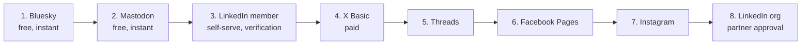

# 08 - Platform Capability and Limitation Matrix

What each platform actually lets a third-party tool do, what access costs, and what
simply is not possible. This is the document that constrains Phase 1 scope, so read it
before committing to a build order.

> ## Accuracy warning
>
> Everything in this document is a **design-time snapshot**. Social platform API terms,
> tiers, rate limits, and pricing change frequently and without much notice. X's pricing
> has been restructured repeatedly. LinkedIn has moved capabilities behind partner
> programs. Meta changed how WhatsApp conversations are billed.
>
> **Re-verify every figure against the platform's own current documentation at the start
> of the sprint that implements its adapter.** Treat the structure of this analysis as
> durable and the numbers as provisional. Where a figure drives a decision, the decision
> is noted so you can see what would change if the figure moved.

---

## 1. The honest summary

| Platform | Difficulty to ship | Cost to operate | Analytics quality | Verdict for Phase 1 |
| --- | --- | --- | --- | --- |
| **Bluesky** | Very low | Free | Basic counts only | **Build first** |
| **Mastodon** | Very low | Free | Basic counts only | **Build first** |
| **X / Twitter** | Medium | $0 to $200+/month | Good on paid tiers | In Phase 1, expect to pay |
| **LinkedIn (personal)** | Medium | Free | **Very poor** | In Phase 1, with expectations set |
| **LinkedIn (company page)** | High, partner approval | Free once approved | Good | Phase 2, approval dependent |
| **Threads** | Medium | Free | Decent | Phase 2 |
| **Instagram** | High | Free | Good | Phase 2 |
| **Facebook Pages** | Medium-high | Free | Good | Phase 2 |
| **YouTube** | High, quota-bound | Free, quota-bound | Good | Phase 4 |
| **Reddit** | Medium | Free, terms-bound | Poor | Phase 4 |

Two things in that table deserve to be said plainly before you plan around them.

**LinkedIn personal-profile analytics are effectively unavailable.** The API will let you
publish as a member and read engagement counts on your own shares, but impressions, reach,
follower growth, and demographics are organization-level capabilities. If LinkedIn
personal posting is your primary use case, Mera's analytics for it will be limited to what
Mera can observe itself: likes, comments, and share counts on posts it published, plus its
own approval and publishing telemetry. This is a platform limitation and no tool can work
around it without scraping, which is out of scope. See
[`00-overview.md` question Q7](00-overview.md).

**X's free tier is too small to run on.** It exists for testing. Any real posting cadence
means the paid tier.

---

## 1.1 Multiple accounts per platform: what each platform actually allows

The brief assumes several accounts per platform in one workspace. That is supported
everywhere, but the terms differ in ways that change the design.

| Platform | Several accounts from one app | Per-account cost | Identical content across accounts | What Mera does about it |
| --- | --- | --- | --- | --- |
| **X** | Yes, each with its own OAuth grant | **Per-account rate budget on the app's tier** | **Prohibited.** Enforced by suspension | Unique variants enforced, staggering required, cross-account similarity blocked at 0.90 |
| **LinkedIn member** | Yes, one grant per member | Shared app throttles | Discouraged, not explicitly banned | Unique variants by default |
| **LinkedIn org** | Yes, if you administer the pages | Shared app throttles | Fine; a page and a person are different voices | Unique variants, different register per account type |
| **Facebook Pages** | Yes, one Page token per page | Per-page limits | Fine | Unique variants |
| **Instagram** | Yes, one per Business account | **25 posts/24h per account** | Fine | Per-account daily cap enforced |
| **Threads** | Yes | Per-user limits | Fine | Unique variants |
| **Bluesky** | Yes, trivially | Effectively none | Fine | Unique variants |
| **Mastodon** | Yes, **one app registration per instance** | Per-account, generous | Fine, though instance culture varies | Unique variants, per-instance registration |

Three consequences worth stating before they bite.

**X's rule is the one with teeth.** Posting duplicate or substantially similar content
across multiple accounts is prohibited, and enforcement is account suspension rather than
an API error. Mera therefore treats "two X accounts in one group" as a configuration that
*requires* unique generation and staggering, not one that merely permits it. The
`cross_account_duplicate` guardrail blocks at a lower threshold than the same-account
duplicate check, and `stagger_mode: none` is itself a blocking condition when two accounts
on one platform are involved. Detail in section 3.3.

**Rate limits are per account but quotas are often per app.** X's tier allowance is
consumed by every connected account together, so a second X account halves the posting
headroom rather than doubling it. The UI shows tier allowance at the app level and
remaining budget per account, because conflating the two is how an operator discovers the
ceiling by hitting it.

**Instagram's 25-posts-per-24-hours is per account**, which is generous for one account
and worth watching for a group that fans out heavily. The per-account `daily_cap`
guardrail defaults below it.

---

## 2. Capability matrix

The machine-readable version of this table is served at
`GET /workspaces/{ws}/social-accounts/{id}/capabilities` and drives both the UI and agent
behaviour. A greyed-out Edit button is the adapter reporting `supports_edit: false`, never
a hardcoded platform check in the frontend.

| Capability | LinkedIn personal | LinkedIn page | X | Threads | Instagram | Facebook Page | Bluesky | Mastodon |
| --- | --- | --- | --- | --- | --- | --- | --- | --- |
| Publish text | yes | yes | yes | yes | **no, media required** | yes | yes | yes |
| Publish with image | yes | yes | yes | yes | yes | yes | yes | yes |
| Publish with video | yes | yes | yes | yes | yes | yes | yes | yes |
| Carousel / multi-image | yes | yes | yes, 4 | yes | yes, 10 | yes | yes, 4 | yes, 4 |
| Threads / chains | no | no | yes | yes | no | no | yes | yes |
| Native scheduling | no | no | no | no | no | **yes** | no | yes, some instances |
| **Edit after publish** | no | no | **paid tiers only** | no | caption only | yes | no | **yes** |
| Delete | yes | yes | yes | yes | yes | yes | yes | yes |
| Alt text on media | yes | yes | yes | yes | yes | yes | yes | yes |
| Read comments | limited | yes | yes | yes | yes | yes | yes | yes |
| Reply to comments | limited | yes | yes | yes | yes | yes | yes | yes |
| Hide / delete comments | no | yes | limited | yes | yes | yes | no | no |
| Read DMs | no | no | paid tiers | no | yes, with review | yes | yes | yes |
| Post analytics | **counts only** | yes | yes, paid | yes | yes | yes | counts only | counts only |
| Account analytics | **no** | yes | yes, paid | yes | yes | yes | no | no |
| Character limit | 3,000 | 3,000 | 280, 25k premium | 500 | 2,200 caption | 63,206 | 300 | 500, instance-set |
| Hashtag convention | 3-5 | 3-5 | 1-2 | 3-5 | up to 30 | 2-3 | 1-2 | 2-3 |

Notes on the entries that will surprise you:

- **Instagram cannot publish text-only.** Every post needs media. The Media agent is not
  optional for Instagram; a text-only draft targeting Instagram fails validation at
  freeze time rather than at publish time.
- **Facebook Pages schedules natively.** Mera's adapter can hand the post to Facebook with
  a future timestamp instead of holding it in Mera's own queue. Whether to use that is a
  real design choice: native scheduling survives Mera being down, but it takes the post
  out of Mera's control once handed over, so a kill switch cannot recall it. The planned
  default is **Mera-side scheduling** precisely so the kill switch stays meaningful.
- **X edit is tier-dependent and time-limited.** Treat it as unavailable and surface
  "delete and repost" as the correction path.
- **Mastodon edit works well** and is one of the few places the Edit affordance is genuinely
  useful after publishing.

---

## 3. Platform detail

### 3.1 Bluesky — recommended first adapter

**Why first:** no application process, no review, no cost, no quota anxiety. You can have
the full ingest → draft → Telegram approval → publish loop working end to end in a day,
which means the core of the product is provable before any gatekeeper is involved.

| Aspect | Detail |
| --- | --- |
| Protocol | AT Protocol, direct XRPC against a PDS |
| Auth | App password, or OAuth where supported |
| Access | Free, self-serve, immediate |
| Publishing | `com.atproto.repo.createRecord` with an `app.bsky.feed.post` record |
| Limit | 300 graphemes, not characters, which matters for emoji and non-Latin scripts |
| Links and mentions | Rich-text **facets**: byte-offset ranges computed over the UTF-8 encoding. Getting this wrong produces posts with broken links, so the adapter computes facets in code and the test suite covers multi-byte cases |
| Media | Up to 4 images, alt text supported |
| Threads | Reply records referencing root and parent |
| Analytics | `likeCount`, `repostCount`, `replyCount`, `quoteCount` from `getPosts`. No impressions |
| Rate limits | Generous; practically not a constraint at this scale |

### 3.2 Mastodon — recommended second adapter

| Aspect | Detail |
| --- | --- |
| Auth | OAuth 2.0, **per instance**. Each server is a separate app registration |
| Access | Free, immediate, no review |
| Publishing | `POST /api/v1/statuses`, with `Idempotency-Key` supported natively, which maps perfectly onto Mera's idempotency design |
| Limit | 500 characters by default, instance-configurable. The adapter reads the instance's `/api/v1/instance` to get the real limit rather than assuming |
| Media | 4 attachments, alt text, `POST /api/v2/media` first then attach |
| Threads | `in_reply_to_id` chaining |
| Edit | Supported, with public edit history |
| Analytics | Favourites, reblogs, replies. No impressions |
| Scheduling | `scheduled_at`, supported on many instances |
| Rate limits | Typically 300 requests per 5 minutes per account |

The per-instance OAuth registration is the only real complexity: a user connecting
`mastodon.social` and a user connecting `hachyderm.io` need separate app registrations,
which the adapter performs dynamically on first connection and caches.

### 3.3 X / Twitter

| Aspect | Detail |
| --- | --- |
| Auth | OAuth 2.0 with PKCE, user context |
| API | v2 |
| **Free tier** | Write-only in practice: a small monthly post allowance, essentially no read access, one app. Enough to test an adapter, not enough to operate |
| **Basic tier** | Around $200/month at last check. A few thousand posts per month and a usable read allowance |
| Pro and Enterprise | Substantially more expensive; not relevant here |
| Publishing | `POST /2/tweets` |
| Threads | `reply.in_reply_to_tweet_id`, posted sequentially |
| Media | Upload via the media endpoint, then attach by ID. Up to 4 images, or 1 video |
| Alt text | Supported through media metadata |
| Analytics | Public metrics on all tiers for your own posts; non-public metrics such as impressions require elevated access |
| **Automation rules** | This is the part that matters most |

X's automation rules are the strictest of any platform here and are enforced with account
suspension rather than API errors. The ones that shape Mera's design:

- No posting **duplicate or substantially similar content** across multiple accounts, or
  repeatedly from one account.
- No bulk, aggressive, or spammy automated posting.
- No automated actions that create a misleading impression of engagement.
- Automated accounts should be identifiable as such where relevant.

Mera's response, built into the product rather than left to the user. This is the single
place where the multi-account design is driven by compliance rather than convenience:

1. **Each X account gets its own Writer run**, with the sibling accounts' drafts supplied
   as context and an explicit instruction to take a different angle. Generating once and
   reusing the text is not an option the system offers.
2. The `cross_account_duplicate` guardrail compares every pair of same-platform variants
   in a set and **blocks above 0.90**, lower than the 0.95 same-account threshold, because
   the consequence is suspension rather than repetitiveness. A block routes back to the
   Writer in `differentiate` mode rather than failing the set.
3. The Editor agent independently checks for the subtler case: two posts worded
   differently that make the same argument in the same order. Embedding similarity misses
   this; a model reading both does not.
4. **Staggering is mandatory** when a group holds two or more accounts on one platform.
   `stagger_mode: none` is a blocking guardrail in that configuration, with the setting
   named in the error.
5. Minimum spacing between posts on the same account is enforced by the Scheduler, and the
   Scheduler will not place two same-platform accounts inside that window either.
6. The daily post cap defaults conservatively for X, per account.
7. The UI shows the app's tier allowance **and** each account's remaining budget, since
   the allowance is shared across accounts and a second account does not bring its own.

The combined effect: posting one story to two X accounts produces two genuinely different
posts, minutes apart, each checked against the other twice. That is more machinery than
cross-posting would need, and it is the minimum that makes two X accounts safe to operate
from one tool.

**If budget is a constraint, this is the adapter to defer.** The free tier will not
support real use, and $200/month for a personal tool is a legitimate reason to postpone.

### 3.4 LinkedIn

The most valuable platform for professional content and the most awkward API.

**Personal profile posting** is reachable without partner approval:

| Aspect | Detail |
| --- | --- |
| Product | "Share on LinkedIn" plus "Sign In with LinkedIn using OpenID Connect" |
| Access | Self-serve request in the Developer Portal; the app must be associated with a LinkedIn Page you administer, and verified by a Page admin |
| Scopes | `w_member_social` to post, `openid profile email` for identity |
| Publishing | The Posts API, or the older UGC Posts API |
| Limit | 3,000 characters |
| Media | Images and video via a register-upload-then-reference flow |
| **Analytics** | **Essentially unavailable for members.** You can read social actions (like and comment counts) on your own shares. Impressions, reach, follower growth, and demographics are organization-scoped |
| Rate limits | Daily per-app and per-member throttles, not publicly fixed. The adapter must handle throttling gracefully rather than assume a ceiling |

**Company page posting** needs more:

| Aspect | Detail |
| --- | --- |
| Product | Community Management API |
| Access | **Partner program application with review.** Not self-serve, not guaranteed, and the timeline is not under your control |
| Scopes | `w_organization_social`, `r_organization_social`, plus analytics scopes |
| Capabilities | Post as the organization, read and moderate comments, full page analytics |

Design consequences:

- The adapter is split into `linkedin_member` and `linkedin_organization` with different
  capability descriptors, so the UI can honestly show what each connected account can do.
  This split is what makes "LinkedIn personal and LinkedIn company in the same group"
  behave correctly: the two accounts have genuinely different capabilities, different
  analytics, and different approval policies, and the capability descriptor is where that
  difference lives rather than in branching logic.
- Analytics for member accounts fall back to **Mera-observed metrics**: comment and
  reaction counts polled from the social-actions endpoint, plus Mera's own data on
  publish time, approval turnaround, and variant. The UI labels these as observed rather
  than reported, instead of presenting an empty impressions chart.
- Company-page support is Phase 2 and explicitly gated on partner approval. The build
  order does not depend on it.

### 3.5 Threads

| Aspect | Detail |
| --- | --- |
| Auth | Meta app plus a Threads account |
| Access | Self-serve app creation; no business verification for basic posting |
| Publishing | Two-step: create a media container, then publish it |
| Limit | 500 characters |
| Threads | Reply chaining supported |
| Analytics | Views, likes, replies, reposts, quotes. Better than Bluesky or Mastodon, worse than Facebook |
| Rate limit | A few hundred posts per 24 hours per user, well above any sane cadence |

The two-step publish is worth noting in the adapter design: the container can be created
and then fail to publish, so the adapter must reconcile orphaned containers on retry
rather than creating a second one.

### 3.6 Instagram

| Aspect | Detail |
| --- | --- |
| Requirement | A **Business or Creator** account linked to a Facebook Page. Personal accounts cannot be used |
| Auth | Facebook Login with Instagram permissions, plus App Review for production |
| Publishing | Content Publishing API, two-step container-then-publish like Threads |
| Quota | Around 25 published posts per 24 hours per account |
| **Text-only** | **Not possible.** Media is mandatory |
| Media | Images, video, reels, carousels of up to 10 |
| Caption | 2,200 characters, up to 30 hashtags |
| Comments | Full read, reply, hide, and delete support, which makes it one of the better platforms for the unified inbox |
| Analytics | Good: impressions, reach, saves, profile visits |
| App Review | Required before anyone outside your own test users can connect. Expect a submission with a screencast and a written use-case justification |

### 3.7 Facebook Pages

| Aspect | Detail |
| --- | --- |
| Auth | Facebook Login, Page access token derived from a user token |
| Scopes | `pages_manage_posts`, `pages_read_engagement`, `pages_manage_engagement` |
| App Review | Required for production use with Pages you do not own |
| Publishing | Page feed endpoint; supports `scheduled_publish_time` natively |
| Edit | Supported |
| Comments | Full read, reply, hide, delete |
| Analytics | Rich page and post insights |
| Token handling | Page tokens can be exchanged for long-lived tokens. The adapter refreshes proactively and flags the account well before expiry |

### 3.8 YouTube and Reddit — Phase 4

**YouTube** is quota-bound rather than fee-bound: a daily unit budget where a video upload
consumes a large share of it. Community posts are not available through the public API at
all, which removes the main use case Mera would have had. Shorts upload is possible but
the quota maths means roughly a handful of uploads per day on a default budget.

**Reddit** has a free tier adequate for non-commercial use with per-minute request limits,
but its terms draw a sharp line around commercial use and its community norms are hostile
to automated promotional posting. The technical work is small; the reputational risk of
automating it badly is not. Deferred on judgement, not on difficulty.

---

## 4. WhatsApp Business Platform

Not a publishing target. Listed because it is the Phase 2 approval channel and the only
component of Mera with a **per-message cost**.

| Aspect | Detail |
| --- | --- |
| Prerequisite | Meta Business account with completed **business verification** |
| Phone number | A dedicated number not registered to a personal WhatsApp account |
| Templates | Required for business-initiated messages outside the 24-hour window. Each needs approval and can be paused for quality |
| Category | Mera's templates are `UTILITY`, the correct and cheaper category for transactional notifications |
| Pricing | Has moved between conversation-based and per-message models; varies by country and category. Utility messages inside an open customer-service window have at times been free |
| Buttons | Maximum 3 reply buttons; lists allow up to 10 rows |
| Editing | Sent messages cannot be edited |

Cost control is a product feature here, not an afterthought: `channel_message.cost_estimate`
records an estimate per message, the Approval Channels screen shows monthly spend, and
digest mode exists substantially to reduce message count. Full handling in
[07 - Approval Bots](07-approval-bots.md) section 4.

---

## 5. Capability descriptor

Every adapter publishes one of these. The UI and the agents read it; neither contains
platform-specific branching.

```python
class PlatformCapabilities(BaseModel):
    platform: str
    account_types: list[Literal["personal", "page", "organization"]]

    # composition
    max_chars: int
    counts_graphemes: bool = False        # Bluesky
    max_hashtags: int | None
    supports_threads: bool
    max_thread_parts: int | None
    requires_media: bool = False          # Instagram
    max_media: int
    supported_media: list[str]
    supports_alt_text: bool
    max_alt_text_chars: int | None
    supports_link_preview: bool

    # lifecycle
    supports_native_scheduling: bool
    supports_edit: bool
    edit_window: timedelta | None
    supports_delete: bool

    # engagement
    supports_read_comments: bool
    supports_reply_to_comments: bool
    supports_hide_comments: bool
    supports_delete_comments: bool
    supports_dms: bool

    # analytics
    available_post_metrics: list[str]
    available_account_metrics: list[str]
    metrics_lag: timedelta                # how stale the platform's numbers are

    # operational
    rate_limit_posts_per_day: int | None
    rate_limit_requests_per_window: RateLimit | None
    rate_limit_shared_across_accounts: bool   # X yes, Instagram no
    requires_app_review: bool
    requires_partner_approval: bool
    monthly_cost_usd: Decimal | None
    automation_policy_notes: list[str]

    # multi-account
    prohibits_duplicate_across_accounts: bool   # X yes; enforcement is suspension
    cross_account_similarity_threshold: float   # 0.90 for X, 0.95 elsewhere
    requires_stagger_within_platform: bool
    min_seconds_between_accounts: int | None
```

The four multi-account fields exist so that "two X accounts need different text and need
to be minutes apart" is **data the guardrails read**, not a special case written into the
X adapter. When another platform tightens its rules, the change is four values in a
descriptor rather than a new branch in the publishing path.

`rate_limit_shared_across_accounts` is the field that prevents a specific wrong
assumption: on X the tier allowance is consumed by every connected account together, so
connecting a second account halves the headroom rather than doubling it. The UI reads this
field to decide whether to show one shared budget bar or one per account.

`metrics_lag` is the field that prevents a recurring support question. Platforms report
numbers with meaningfully different delays, and a dashboard that shows "0 impressions" on a
post published ten minutes ago looks broken. With the lag declared, the UI says "metrics
available in about an hour" instead.

---

## 6. Recommended build order



The reasoning, which differs from the Phase 1 scope in the original brief and is the main
recommendation of this document:

**Build Bluesky first even though it is not a platform you may care about.** It is the only
one where the entire loop can be exercised against a real network with zero gatekeeping.
Having a real adapter working proves the `PlatformAdapter` interface, the idempotency
handling, the retry and dead-letter path, the comment polling, and the metric sync against
reality rather than against a fake. Every later adapter then becomes an exercise in
filling in a known shape.

Attempting LinkedIn or X first means the first weeks are spent on OAuth approval flows and
developer-portal paperwork while the actual product remains untested end to end.

**Revised Phase 1 recommendation:** Bluesky and Mastodon as the proving adapters, plus
LinkedIn member and X, with the understanding that the latter two may slip on external
approval or budget without blocking anything else. This keeps the Phase 1 goal intact
(a working ingest-to-approval-to-publish loop) while removing the external dependency from
the critical path.

---

## 7. Verification checklist

Before implementing each adapter, confirm against current official documentation:

- [ ] Current API version and whether the version in use is deprecated
- [ ] Exact scopes required, and whether any now require review or partner approval
- [ ] Whether app review or business verification is needed, and the current timeline
- [ ] Current rate limits, and whether they are per app, per user, or per token
- [ ] **Whether the quota is shared across connected accounts or allocated per account**
- [ ] Current pricing tier and what it includes
- [ ] Current automation and acceptable-use policy, especially around duplicate content
- [ ] **Whether posting similar content from multiple accounts is restricted, and how it
      is enforced — an API error is survivable, a suspension is not**
- [ ] **Whether connecting several accounts from one developer app is permitted**
- [ ] Which metrics are actually returned for the account type in question
- [ ] Token lifetime and the refresh mechanism
- [ ] Whether an idempotency mechanism is offered natively
- [ ] Whether deletion is immediate or eventually consistent, which affects retry logic

The results go into the adapter's `PlatformCapabilities` descriptor and into a dated note
in the adapter module, so the next person can see when the information was last confirmed
rather than trusting a table in a document written at design time.
