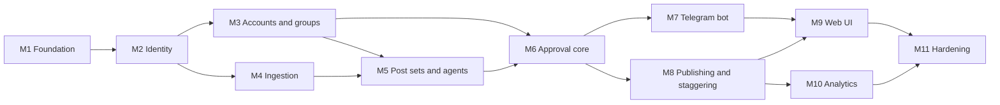

# 11 - Phase 1 Plan

The MVP build, in dependency order, with acceptance criteria per milestone.

---

## 1. Definition of done for Phase 1

One sentence: **a real article from a real RSS feed becomes several differently-written
real posts across several real accounts, each approved individually from Telegram and
published minutes apart, with every step auditable.**

Concretely, all of these must be true:

1. A fresh `git clone` plus `make up` gives a working system with seeded demo data in
   sandbox mode, in under two minutes.
2. An RSS source fetches, deduplicates, summarizes, and scores content items **per account
   group** on schedule.
3. Several accounts per platform can be connected in a workspace, organized into groups,
   and a post can target a whole group in one action.
4. The Writer produces a **genuinely different post for each target account**, verified by
   the cross-account duplicate guardrail, and the Editor flags issues with a confidence
   score per account.
5. A Telegram approval card arrives carrying every account's post, the source, and the
   flags, and supports Approve all, per-account Approve and Reject, Edit, and Reschedule.
6. Approving two accounts and rejecting two publishes exactly two posts, and the request
   resolves `PARTIALLY_APPROVED`.
7. Editing one account's post invalidates **only that account's** approval and the
   set-level one, leaving sibling approvals intact.
8. Approved posts publish **staggered** across the group, and one account failing leaves
   the others published with the failure visible in the UI and the bot.
9. An unapproved post **never** publishes, including on expiry, replay, forwarding,
   post-approval edit, or a token scoped to a different account. Every one of these has a
   passing test.
10. The web approval queue and the bot stay in sync in both directions.
11. Media can be uploaded in the composer and is resized per platform; hashtags are
    proposed per account from content and platform convention.
12. Basic analytics show per-post, per-account, and per-group engagement where the
    platform reports it.
13. Workspace isolation holds across the API, MCP, and the bot, with tests.
14. The OpenAPI spec is complete for the implemented surface, the TypeScript SDK is
    generated from it, and CI fails on drift.
15. Coverage gates pass, with 100% on the state machines, policies, crypto,
    `assert_publishable`, and `post_set_service`.

---

## 2. Scope changes from the original brief

Two recommendations.

### 2.1 Add Bluesky and Mastodon ahead of LinkedIn and X

Carried over from [08 - Platform Matrix](08-platform-matrix.md) section 6.

LinkedIn and X both sit behind external gates you do not control. LinkedIn member posting
needs a developer app verified by a Page admin; X needs a paid tier for any real cadence.
Either could take days or cost money before a single post goes out.

Bluesky and Mastodon need neither. They let the entire loop (ingest, draft, approve,
publish, poll comments, sync metrics) be proven against a live network in the first weeks.
Every later adapter then fills in a shape that is already known to work.

Multi-account posting makes this argument stronger, not weaker: **two free Bluesky
accounts are the cheapest possible way to exercise per-account generation, the duplicate
guardrail, staggering, and partial failure** against a real network. Testing group posting
for the first time against two paid X accounts would be an expensive way to find bugs.

LinkedIn and X remain in Phase 1. They are simply no longer on the critical path.

### 2.2 Phase 1 grows, and M4 and M5 grow most

The multi-account requirement is not an increment on the original Phase 1; it changes the
shape of the drafting and approval milestones. Per-account variants, the composite hash,
per-variant approval state, staggering, and partial-failure handling are all structural,
and all of them are cheaper to build now than to retrofit into a single-account approval
path later.

Two things were added to Phase 1 from the follow-up requirements, and one was deliberately
not:

- **Media upload** is in Phase 1. Attaching an image is table stakes for a composer, and
  the rendition pipeline it needs is also what the OG image already requires.
- **The Hashtag agent** is in Phase 1, using content and platform conventions. Its
  performance-history half is useless until there is history, so the `hashtag_stat`
  feedback loop lands in Phase 3 alongside the rest of the analytics loop.
- **Image and video generation** is Phase 2. It needs provider selection, cost ceilings,
  an async job pipeline, and a human checkpoint before spending — none of which is hard,
  but none of which is on the critical path to proving the approval loop.

---

## 3. Milestones

Eleven milestones, each ending in something demonstrable. Sizes are relative effort, not
calendar estimates, since team size is unknown.

M3 is new and sits early on purpose: accounts and groups are the vocabulary every later
milestone speaks in, and building drafting before the target model exists would mean
rewriting it.

---

### M1 - Foundation

**Goal:** the skeleton runs, migrations apply, CI is green.

| # | Task | Size |
| --- | --- | --- |
| 1.1 | Repository, monorepo layout per [10 - Repo Structure](10-repo-structure.md), `uv` and `pnpm` workspaces | S |
| 1.2 | `docker-compose.yml` with the six services, pinned digests, healthchecks | M |
| 1.3 | `config.py` with `pydantic-settings`, fail-fast validation, `.env.example` | S |
| 1.4 | SQLAlchemy base, async session, transaction-scoped `mera.workspace_id` | M |
| 1.5 | Alembic, initial migration: `workspace`, `user`, `workspace_member` | M |
| 1.6 | RLS policies with `FORCE ROW LEVEL SECURITY`, non-superuser app role | M |
| 1.7 | procrastinate app, task registry, worker entry point with queue selection | M |
| 1.8 | FastAPI skeleton, `/healthz`, `/readyz` reporting migration revision, error envelope | M |
| 1.9 | Structured JSON logging with correlation IDs; OpenTelemetry scaffolding | S |
| 1.10 | `Makefile` and the CI workflow through the typecheck stage | M |

**Acceptance**

- `make up` brings all six services healthy.
- `/readyz` reports the applied Alembic revision.
- A test enqueues a job through procrastinate, a worker executes it, and the result is
  asserted.
- A test writes to workspace A, queries with the context set to workspace B, and gets zero
  rows **with the repository filter deliberately removed**, proving RLS works independently.
- CI runs lint, typecheck, and unit tests on a pull request.

---

### M2 - Identity, tenancy, RBAC

**Goal:** people can authenticate and are correctly constrained.

| # | Task | Size |
| --- | --- | --- |
| 2.1 | `user`, `refresh_token`, `oauth_identity`, `api_key` models and migrations | M |
| 2.2 | Argon2id passwords, registration, login, breached-password check | M |
| 2.3 | JWT issue and verify; refresh rotation with reuse detection | M |
| 2.4 | `Principal` resolution, `WorkspaceContext` dependency | M |
| 2.5 | RBAC policy module with the role ordering; `policy.require(...)` | M |
| 2.6 | API keys: scoped, hashed, `mera_sk_` prefix, shown once | M |
| 2.7 | Google and Microsoft OAuth login with PKCE | M |
| 2.8 | Workspace CRUD, invitations, archive, and the workspace switcher contract | M |
| 2.9 | `member_scope` model and scope enforcement inside `policy.require(...)` | M |
| 2.10 | `audit_log` model, append-only trigger, middleware writing entries | M |
| 2.11 | `KeyProvider` and envelope encryption with workspace-bound AAD | M |
| 2.12 | Rate limiting middleware, Postgres token bucket | M |
| 2.13 | Idempotency middleware with request-hash comparison | M |

**Acceptance**

- Full auth cycle works: register, login, refresh, logout.
- Presenting a rotated refresh token revokes the chain; a test proves it.
- Each of the five roles is tested against the permission matrix in
  [04 - API Contract](04-api-contract.md) section 2.6.
- A user belonging to two workspaces with different roles gets the right permissions in
  each, and no data from one appears in the other.
- A scoped member is denied on an out-of-scope subject through REST, and the fixture that
  enumerates service methods passes.
- A secret encrypted for workspace A fails to decrypt under workspace B's AAD.
- Replaying a request with the same `Idempotency-Key` and body returns the cached
  response; a different body returns 409.
- Coverage on `domain/policies` is 100%.

---

### M3 - Accounts and account groups

**Goal:** a workspace holds several accounts per platform, organized into groups, with
settings that resolve predictably.

This milestone is new and deliberately early. Every later milestone addresses accounts and
groups, so building it after drafting would mean rewriting drafting.

| # | Task | Size |
| --- | --- | --- |
| 3.1 | `social_account` model with nickname, type, health, rate budget; encrypted per-account credentials | M |
| 3.2 | OAuth connect, callback with signed state, reconnect, disconnect with platform-side revocation | L |
| 3.3 | Duplicate-connection detection returning 409 with the existing account | S |
| 3.4 | `account_group`, `account_group_member` models; membership CRUD; an account in several groups | M |
| 3.5 | **`settings_resolution`**: post → account → group → workspace, with strictest-wins for autopilot and approval policy | M |
| 3.6 | Resolved-settings endpoints returning value **plus provenance** | S |
| 3.7 | `accounts` worker queue: token refresh at 80% lifetime, health checks, capability refresh | M |
| 3.8 | `NEEDS_REAUTH` handling: pause that account's jobs, notify, leave siblings running | M |
| 3.9 | Group settings: default voice, pillars, posting schedule, stagger mode and bounds | M |
| 3.10 | `source_group_link`; sources feeding specific groups | S |
| 3.11 | Workspace, account, and group endpoints per [04 - API Contract](04-api-contract.md) sections 4.1 to 4.3 | M |

**Acceptance**

- Two LinkedIn accounts, two X accounts, and a Facebook Page coexist in one workspace with
  separately encrypted credentials.
- An account belongs to two groups; removing it from one leaves the other intact.
- Deleting a group does not disconnect its accounts.
- `settings_resolution` is property-tested over every combination of levels, and the
  strictest-wins rule holds: an account pinned to Manual stays Manual inside a group set
  to Full.
- A resolved setting reports which level it came from.
- Revoking one account's token pauses only that account's jobs and raises a notification.
- Reconnecting an account preserves its group memberships, history, and analytics.

---

### M4 - Ingestion

**Goal:** sources produce scored, deduplicated content items on a schedule, scored per
group.

| # | Task | Size |
| --- | --- | --- |
| 4.1 | `source`, `content_item`, `content_pillar`, `content_item_score` models; `pgvector` extension and HNSW index | M |
| 4.2 | RSS and Atom fetcher with ETag and Last-Modified conditional requests | M |
| 4.3 | Article extraction (`trafilatura`), language detection, keyword filtering | M |
| 4.4 | URL canonicalization and hashing; exact dedupe | S |
| 4.5 | **`LiteLLMProvider`**: the `LLMProvider` port over LiteLLM, structured-output bridge, per-agent model and fallback config, pinned pricing table, `FakeLLM` | L |
| 4.6 | Embedding generation and vector dedupe with a tunable threshold | M |
| 4.7 | Summarization and topic classification (Research agent, first LLM use) | M |
| 4.8 | **Per-group relevance scoring**: pillar similarity, source weight, freshness decay | M |
| 4.9 | Periodic fetch task honouring per-source intervals; SSRF protections | M |
| 4.10 | Source CRUD and health endpoints; trending endpoint filterable by group | M |
| 4.11 | `agent_run` and `agent_step` recording with cost capture and `fallback_from` | M |

**Acceptance**

- Three real RSS feeds ingest without error.
- The same article arriving from two feeds produces one `content_item` with
  `covered_by_source_count = 2`.
- Two differently-worded articles about one event are caught by vector dedupe; a test
  fixture pins this.
- One article scores differently for two groups with different pillars, and each group's
  trending view ranks it accordingly.
- Relevance scores are reproducible for a fixed input, since scoring is arithmetic.
- **Switching an agent's model to a different provider by configuration alone works**, with
  no code change; a test runs the same agent against two providers.
- A forced primary-model failure falls back and records `fallback_from` on the step.
- Every LLM call writes an `agent_step` with token counts and cost.
- A source URL resolving to a private IP range is refused.

---

### M5 - Post sets, Writer, Editor, Hashtag

**Goal:** a content item becomes a post set with a genuinely different, reviewable post
for every target account.

| # | Task | Size |
| --- | --- | --- |
| 5.1 | `Agent[TIn, TOut]` base with step recording, `post_variant_id` tagging, structured-output retry | M |
| 5.2 | `brand_voice` model at workspace, group, and account scope; CRUD; few-shot storage | M |
| 5.3 | `post_set`, `post_variant`, `post_version`, `media_asset` models | M |
| 5.4 | **Immutability trigger** on `post_version` | S |
| 5.5 | `compute_content_hash` per variant, **including `social_account_id`**; property tests | M |
| 5.6 | `compute_composite_hash` over enabled variants; invalidation semantics | M |
| 5.7 | **Target expansion**: groups plus accounts, deduplicated, recording the routing group | M |
| 5.8 | Writer agent, per account, with sibling drafts supplied and `angle` output | L |
| 5.9 | **`cross_account_duplicate` guardrail** plus the Writer's `differentiate` mode and attempt limit | L |
| 5.10 | Hashtag agent: content and platform convention, with `basis` and `sample_size` on every suggestion | M |
| 5.11 | Editor agent: grounding, compliance flags, confidence, `account_mismatch`, same-argument duplication | L |
| 5.12 | Deterministic guardrails: banned words, PII, toxicity, same-account duplicate, per-account daily cap | L |
| 5.13 | Orchestrator with the `draft_from_content` template and per-account fan-out | M |
| 5.14 | `ObjectStore` port, filesystem implementation, OG image fetch, **media upload and per-platform renditions** | L |
| 5.15 | Post set, variant, and version endpoints per [04 - API Contract](04-api-contract.md) section 4.6 | M |
| 5.16 | Agent cost caps, per-agent daily and per-workspace monthly, with per-account attribution | M |

**Acceptance**

- A content item targeting a five-account group produces one set and five variants, each
  respecting its own platform's limits.
- **The two X accounts receive measurably different text**, and a seeded near-duplicate is
  blocked, regenerated in `differentiate` mode, and passes on the retry.
- Two failed differentiation attempts raise a human checkpoint instead of looping.
- An `UPDATE` against `post_version` is rejected by the database.
- `compute_content_hash` is stable across row ordering, dict ordering, and process
  restarts; property-tested.
- **A version approved for account A cannot publish to account B**: the hash differs.
- Changing the bytes behind a `media_asset` without changing its ID changes the post hash.
- Disabling one variant changes the composite hash and leaves sibling hashes untouched.
- An uploaded image is resized correctly for every target platform, and alt text is
  generated per rendition.
- Hashtag suggestions carry `basis` and `sample_size`, and with no history the basis is
  `platform_convention` rather than a fabricated lift.
- A variant with a planted unsupported factual claim is blocked; its siblings proceed.
- Exceeding the daily cost cap fails the run with a specific error and a notification.
- Cost is attributable per target account.
- The eval suite reports Editor recall on planted errors and a differentiation score; both
  baselines are recorded.

---

### M6 - Approval core

**Goal:** the invariant exists and is enforced, channel-independently.

This is the most important milestone in Phase 1. Everything else is replaceable; this is
the product.

| # | Task | Size |
| --- | --- | --- |
| 6.1 | `approval_policy`, `approval_request`, **`approval_variant_state`**, `approval_decision`, `approval_token`, `approver_binding`, `approval_channel`, `channel_message` models | L |
| 6.2 | **Two state machines** in `domain/state_machines`, pure, no I/O: per-variant, and the derived request-level summary including `PARTIALLY_APPROVED` | L |
| 6.3 | Approval token mint, sign, validate, burn; **`variant_scope` claim**; `jti` ledger with row locking | L |
| 6.4 | `ApprovalChannel` port and `FakeChannel` that records rendered messages | M |
| 6.5 | `ApprovalService`: create, decide with scope, supersede per variant, cancel; **per-variant quorum under a request-level row lock** | L |
| 6.6 | **`assert_publishable(post_variant_id)`**, all eleven checks including version identity and three-level kill switch | M |
| 6.7 | **Scoped token revocation**: resolving some variants leaves the rest live | M |
| 6.8 | Sweeper periodic task: remind, escalate, expire per variant, with quiet-hours shifting | L |
| 6.9 | Policy snapshotting at request creation; strictest-wins resolution across three levels | M |
| 6.10 | Edit flow: instruction classification, scoped revision agent run, per-variant supersession | L |
| 6.11 | Approval endpoints: list, get, variants, preview, decisions, edit, cancel, policies | M |
| 6.12 | `automation_state` at three scopes, autopilot resolution, scoped kill switch | M |
| 6.13 | **The full approval test matrix** from [07 - Approval Bots](07-approval-bots.md) section 11, including the eleven multi-account scenarios | L |
| 6.14 | Property-based test over random event sequences and random account counts | M |

**Acceptance**

Every scenario in the test matrix passes. Specifically and non-negotiably:

- An expired request or variant can never transition to approved; neither state machine
  has such an edge.
- A token minted for v1 is rejected against v2 with `content_mismatch`.
- A replayed token is rejected with `already_used`.
- A token used from an unbound external identity is rejected with `identity_mismatch`.
- **A token scoped to account A cannot decide account B.**
- **Approving two of four accounts publishes exactly two**, and the request resolves
  `PARTIALLY_APPROVED`.
- **Editing one account invalidates its approval and the composite, and no sibling's.**
- **A group-scoped kill switch holds that group and leaves other groups running.**
- A mixed policy (company page needs two approvers, others need one) resolves correctly
  within a single request.
- Concurrent decisions serialize; exactly one publish results per account.
- Coverage on both state machines, the token module, `assert_publishable`, and
  `post_set_service` is 100%.
- The property-based test passes over at least 10,000 generated sequences, asserting both
  that nothing publishes without an approval and that nothing publishes under another
  account's approval.

---

### M7 - Telegram bot

**Goal:** approvals happen on your phone.

| # | Task | Size |
| --- | --- | --- |
| 7.1 | `bots` service skeleton, webhook route, secret-token verification | M |
| 7.2 | Telegram `ApprovalChannel` implementation with `ChannelConstraints` | M |
| 7.3 | **Post set card renderer**: workspace and group header, per-account previews, shared source and flags, `fit` priority order | L |
| 7.4 | **Per-account detail view** as a message edit, with its own action row | M |
| 7.5 | Inline keyboard layout; numbered per-account buttons; `callback_data` as a short `jti` handle | M |
| 7.6 | Callback handling to `POST /decisions` with scope; message editing on state change | M |
| 7.7 | `ForceReply` edit flow scoped to one account, reply correlation, instruction classification | L |
| 7.8 | "Edit all" with its confirmation step | S |
| 7.9 | Reminder, escalation, expiry, and **per-account publish-confirmation** messages | M |
| 7.10 | Account health alerts with a reconnect deep link | S |
| 7.11 | Pairing: code generation, `/pair`, deep link, binding across all a user's workspaces, lockout | M |
| 7.12 | Commands: `/workspaces`, `/switch`, `/groups`, `/accounts`, `/queue`, `/today`, `/stats`, `/pause`, `/resume`, `/kill`, `/whoami` | L |
| 7.13 | Sticky active workspace per chat, with cards always self-labelling | S |
| 7.14 | Update deduplication by `update_id` | S |
| 7.15 | Approval dispatch task on the `approvals` queue | M |
| 7.16 | Long-polling mode for local development | S |
| 7.17 | Runbook: `telegram-bot-setup.md` | S |

**Acceptance**

- Pairing works end to end from the web app to a live bot, and one pairing serves both
  seeded workspaces.
- A card for a four-account set arrives with every account's text, its scheduled time, and
  its confidence, plus the source block once and the shared flags collapsed.
- "Approve all 4" publishes four posts, staggered; the card edits in place to show who
  approved and when.
- Approving two accounts and rejecting two publishes exactly two, and the card shows the
  mixed outcome per account.
- Tapping a numbered button opens that account's full text and its own action row.
- Edit from an account's detail view produces v2 for that account with a diff; siblings
  keep their approvals and the "approve all" button dies.
- Expiry edits the card, removes the buttons, and reports per-account outcomes.
- `/kill` scoped to a group halts that group and reports what it stopped.
- A forwarded card tapped from another chat is rejected and logged.
- A scoped approver receives only the groups they are scoped to.
- A webhook with a wrong secret token returns 401 and changes nothing.

---

### M8 - Publishing, staggering, partial failure

**Goal:** approved posts reach real accounts, spread over time, failing independently.

| # | Task | Size |
| --- | --- | --- |
| 8.1 | `PlatformAdapter` port, `PlatformCapabilities` including the multi-account fields, registry, `FakePlatformAdapter` with per-account failure injection | M |
| 8.2 | **Bluesky adapter**: posts, facets computed over UTF-8, media, alt text, threads | L |
| 8.3 | **Mastodon adapter**: per-instance OAuth, native idempotency key, instance limit discovery | L |
| 8.4 | `scheduled_post` and `published_post` models, one per variant; idempotency key derivation | M |
| 8.5 | Publish worker with per-account queueing locks | M |
| 8.6 | **Scheduler agent**: per-account slot selection, quiet hours, per-account caps, minimum spacing, and **stagger offset computation stored at scheduling time** | L |
| 8.7 | **`stagger_required` guardrail** for two same-platform accounts with mode `none` | S |
| 8.8 | **Partial-failure handling**: per-variant retry, `partially_published` set state, dead-letter per account with UI and bot visibility | M |
| 8.9 | Retry with exponential backoff; dead-letter queue | M |
| 8.10 | **LinkedIn member adapter**: posting, media upload, social actions read | L |
| 8.11 | **X adapter**: posting, threads, media, automation-rule guardrails, shared-quota reporting | L |
| 8.12 | Scheduling endpoints, set-level schedule and publish-now returning per-account results, calendar read filtered by group, retry | M |
| 8.13 | Contract-test cassettes per adapter | M |

**Acceptance**

- A post set publishes to **two real Bluesky accounts and a real Mastodon instance**, with
  different text on each and minutes apart.
- Stagger offsets are computed once, stored, and honoured on retry; the calendar shows the
  same times the approver saw.
- A group with two X accounts and `stagger_mode: none` is blocked with the setting named.
- **One account's publish failing leaves the others published**, the set in
  `partially_published`, and the failure visible with its error in both the UI and the bot.
- A Bluesky post containing emoji and a non-Latin script has correct link facets; this is
  a specific test, because getting it wrong silently breaks links.
- `POST /scheduled-posts` without a valid approval for that variant returns 403
  `approval_required`.
- A publish retried after a lost response does not double-post; the idempotency key is
  honoured.
- Two posts queued for the same account serialize rather than racing.
- A platform 429 backs off and retries rather than dead-lettering immediately.
- A revoked token moves one account to `NEEDS_REAUTH`, pauses its jobs, notifies, and
  leaves its siblings publishing.
- LinkedIn and X publish **if access is available**; if not, their adapters pass contract
  tests and the milestone is not blocked.

---

### M9 - Web UI

**Goal:** everything the bot does, plus the things a phone is bad at.

| # | Task | Size |
| --- | --- | --- |
| 9.1 | Next.js app, Tailwind, shadcn/ui, dark and light themes | M |
| 9.2 | SDK generation pipeline and the CI drift check | M |
| 9.3 | Auth pages, session handling, **workspace switcher** | M |
| 9.4 | SSE client hook with `Last-Event-ID` reconnection | M |
| 9.5 | Dashboard filterable by group and account: queue, upcoming, recent posts, agent activity | M |
| 9.6 | **Connected Accounts**: multiple per platform, health badges, reconnect, per-account settings | L |
| 9.7 | **Account Groups**: create and edit, drag accounts between groups, group settings, stagger controls | L |
| 9.8 | Sources screen: CRUD, health, manual fetch, group links | M |
| 9.9 | Content discovery and trending with group filtering | M |
| 9.10 | **Composer**: target picker (groups → platforms → accounts), **a preview per account**, per-account edit, enable and disable, stagger preview, media upload | L |
| 9.11 | **Approval Queue**: live, per-account decisions, with the same information as the bot card | L |
| 9.12 | Calendar with drag-and-drop rescheduling, colour-coded by group | L |
| 9.13 | Brand Voice at three scopes, Approval Channels, Workspaces and members with scopes | L |
| 9.14 | Agent run viewer: timeline, per-account step attribution, costs, retry and abort | L |
| 9.15 | Audit log viewer with filters including account | M |
| 9.16 | Automation settings at three scopes and a prominent kill switch | M |
| 9.17 | Sandbox inspector at `/sandbox` showing captured messages and platform calls | M |
| 9.18 | WCAG 2.1 AA pass: keyboard navigation, focus management, contrast, labels | M |

**Acceptance**

- Switching workspace changes everything on screen and nothing leaks between them.
- The composer's target picker expands a group into its accounts, shows a preview per
  account, and lets each be edited or disabled independently.
- Approving in the web UI updates the Telegram card within seconds, and vice versa,
  including per-account decisions.
- The composer preview matches what each platform actually renders for that account.
- The agent run viewer shows every step with its cost and its target account.
- A scoped member sees only their groups, in every screen.
- An axe accessibility scan passes with no serious or critical violations.
- A lint error is raised if application code calls the API without the SDK.

---

### M10 - Basic analytics

**Goal:** you can see whether any of this is working, per account and per group.

| # | Task | Size |
| --- | --- | --- |
| 10.1 | `metric_snapshot` model with the uniqueness constraint, BRIN index, and denormalized set and group IDs | M |
| 10.2 | Metric sync task with age-tapered cadence and per-account rate budgets | M |
| 10.3 | Per-adapter metric normalization recording the source field | M |
| 10.4 | **Rollups**: variant → post set, account → group → workspace | M |
| 10.5 | Metrics endpoints: per post, per set, per account, per group, timeseries, overview | M |
| 10.6 | **Account-versus-account and group-versus-group comparison**, normalized against each account's own baseline | M |
| 10.7 | Analytics screens with Recharts, filterable by group and account | M |
| 10.8 | **Approval turnaround** metric, which is Mera-specific and always available | S |
| 10.9 | "Not reported" rendering where a platform supplies no value | S |
| 10.10 | CSV export with the chosen scope | S |

**Acceptance**

- Metrics sync on schedule without duplicate snapshots; a re-run writes nothing new.
- A post set's combined performance and its per-account split are both available and
  clearly distinguished.
- Account comparison normalizes against each account's own baseline rather than ranking by
  raw totals.
- A platform that does not report impressions shows "not reported", never a zero.
- Approval turnaround is charted; it works for every platform because Mera owns the data.
- A rate-limited sync reschedules rather than losing the window, and does not starve other
  accounts.

---

### M11 - Hardening and release

**Goal:** it is safe to point at a real account and walk away.

| # | Task | Size |
| --- | --- | --- |
| 11.1 | Full E2E suite in sandbox: ingest through staggered multi-account publish, bot simulated | L |
| 11.2 | Coverage gates per area enforced in CI | S |
| 11.3 | Security scans wired in; address all high-severity findings | M |
| 11.4 | Seed data: two workspaces, five accounts, two overlapping groups, 90 days of per-account metrics | M |
| 11.5 | OpenAPI completeness review; descriptions and examples on every operation | M |
| 11.6 | Runbooks completed, including `account-groups-and-staggering.md` | M |
| 11.7 | README with real setup instructions, verified by a clean-machine run | S |
| 11.8 | Load sanity check: 1,000 content items, 100 post sets across 10 accounts, 50 approvals in flight | M |
| 11.9 | Backup and restore drill following the runbook | S |
| 11.10 | Production config validation: refuse to boot with sandbox on or a weak key | S |

**Acceptance**

- A clean clone on a machine that has never run Mera reaches a published sandbox **post
  set across four accounts** by following the README alone.
- Every coverage gate passes.
- The restore drill reproduces the system from `pg_dump` plus the media directory.
- The load check shows the approval sweeper staying under 50ms per sweep with 50 pending
  requests covering 200 variants, verifying the partial indexes do their job.
- Ten accounts publishing simultaneously do not starve each other's queueing locks.

---

## 4. Risks

| Risk | Impact | Mitigation |
| --- | --- | --- |
| **X suspends an account for near-duplicate content** | **Unrecoverable loss of an account** | Per-account generation, duplicate block at 0.90, Editor same-argument check, mandatory staggering, all in Phase 1 rather than later; `guardrail_result` scores retained as appeal evidence |
| **Writer cannot make two same-platform accounts genuinely different** | Groups with two X accounts are unusable | Sibling drafts in the prompt, `differentiate` mode, a differentiation eval with a recorded baseline, and a human checkpoint after two failures rather than a loop |
| **The multi-account approval card is unreadable on a phone** | The product's core interaction fails at its main new case | Two-level card with per-account detail, tested at four and eight accounts; highest-value thing to critique before M7 |
| LinkedIn verification delayed or refused | Can't post to the primary target | Bluesky and Mastodon carry the critical path, and two free Bluesky accounts exercise group posting end to end |
| X pricing makes the paid tier unattractive | No X in Phase 1 | Adapter still built and contract-tested; enable when the tier is bought |
| Writer agent output is not good enough to approve | The product is unusable regardless of correctness | Eval suite from M5; budget for prompt iteration; the edit loop is the escape hatch |
| Editor agent misses hallucinations | Wrong information published in your name | Measured recall on planted errors; human approval is the backstop; Assisted mode is not enabled in Phase 1 |
| Approval UX is annoying enough to be bypassed | Users switch to Full Autopilot and lose the guarantee | M7 card design is the highest-value thing to critique before building; see [`00-overview.md` section 8](00-overview.md) |
| Telegram webhook needs public HTTPS | Local development friction | Long-polling mode in 7.16 and a Cloudflare Tunnel service in the Compose override |
| **LLM cost scales with account count** | Five accounts is roughly five times the drafting cost | Per-account and per-set cost reporting from M5, prompt caching on the shared prefix, cheap models for high-volume agents, per-workspace caps |
| **LiteLLM bug or breaking change in the agent layer** | Agent runs fail in a way that looks like a model problem | Pinned version, contract tests per configured provider, `fallback_from` recorded on every step, documented escape hatch to a native SDK call |
| Single Postgres becomes a bottleneck | Rework | Account count multiplies jobs; load check in 11.8 uses ten accounts for that reason; [ADR-0002](adr/0002-single-postgres-datastore.md) names the exit path |

---

## 5. Explicitly out of Phase 1

Listed so nobody builds them by accident:

- WhatsApp approval channel (Phase 2)
- Multiple approvers, quorum, and escalation beyond the schema and sweeper support, which
  are built but exercised with a single approver (Phase 2)
- **Image and video generation.** Media **upload** and per-platform renditions ship in
  Phase 1; generation needs provider selection, cost ceilings, the async job pipeline, and
  the pre-spend checkpoint (Phase 2)
- **Hashtag performance history.** The Hashtag agent ships in Phase 1 using content and
  platform convention; `hashtag_stat` and the lift-based ranking need history to exist
  first (Phase 3)
- **MCP server and client registry** (Phase 2)
- Unified inbox and the Engagement agent (Phase 2)
- **Group-scoped team permissions beyond the schema.** `member_scope` is built and
  enforced in Phase 1; the UI for managing it is Phase 2
- Assisted and Full Autopilot modes. The schema, three-level mode resolution, and the kill
  switch exist; **Manual is the only mode enabled** (Phase 3)
- **Workspace cloning.** The provenance column exists; the copy logic is Phase 3
- Threads, Instagram, Facebook, LinkedIn organization (Phase 2)
- Outbound webhooks, A/B testing, insight generation, evergreen recycling (Phase 3)
- Mobile, desktop, custom agent builder, billing (Phase 4)

The autopilot decision deserves a note. The modes are designed in from the start because
retrofitting them would mean touching the publish path, which is the last place anyone
should want to make a late structural change. But enabling unattended publishing before
the Editor agent's hallucination recall has been measured against real content would be
putting the guarantee at risk for a convenience nobody has asked for yet.

---

## 6. Before coding starts

Answers needed to the questions in [`00-overview.md` section 7](00-overview.md):

- **Q1, answered: LiteLLM.** Any provider key works, selected per agent by a `model`
  string. M4.5 builds it. Nothing is blocked.
- **Q2**, platform API access, determines whether M8.10 and M8.11 are real or
  contract-only.
- **Q3**, webhook hosting, determines whether M7.16 is needed early.
- **Q4**, content pillars and brand voice, blocks realistic seed data in M4 and meaningful
  Writer output in M5.
- **Q5**, timezone and posting windows, blocks M8.6.
- **Q6**, confirming WhatsApp stays in Phase 2.
- **Q7**, confirming the LinkedIn personal-analytics limitation is understood.
- **Q8**, how many accounts share a platform within one group, calibrates M5.9's
  differentiation work and the M11.8 load check.
- **Q9**, generation provider and whether video is wanted at all, is Phase 2 but worth
  settling early since it has cost consequences.
- **Q10**, which MCP servers you intend to add, shapes the Phase 2 guardrail work.

**Q4 is now the only answer that blocks starting.** Q8 shapes effort rather than
direction. The rest can be answered while M1 through M3 are underway.
