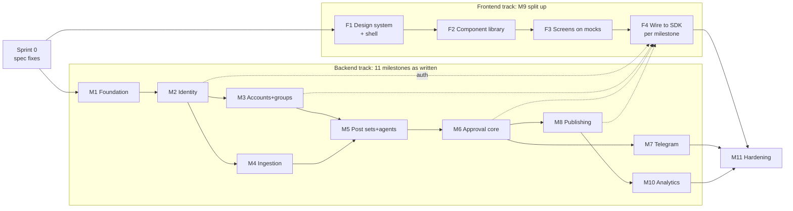

# 12 - Implementation Plan

How to turn the design set (`docs/00` to `docs/11`, the ADRs, the OpenAPI outline) and the
v2 mockups (`docs/mockups-v2/`) into running software.

[11 - Phase 1 Plan](11-phase1-plan.md) already defines **what** Phase 1 is: eleven
milestones, M1 to M11, each with acceptance criteria. This document does not redo that. It
adds four things 11 does not cover:

1. **Spec fixes before coding.** Contradictions between the docs that would otherwise be
   settled by whoever writes the code first (section 1).
2. **A frontend track that runs alongside the backend.** In 11 the web UI is M9, gated on
   M7 and M8. The mockups now exist, so most UI work can start in week one (sections 2–4).
3. **A mockup-to-scope map.** The v2 mockups show Phase 2 and 3 features. Each screen and
   element is marked build, build-gated, or defer (section 4).
4. **A sprint order.** The two tracks, how they meet, and the checkpoints (section 5).

---

## 0. Ground rules carried forward

- **Stack** (ADR-0001, 0002, 0003, 0010, 01 §7.6):
  - Python 3.11 / FastAPI / SQLAlchemy 2 async / Alembic.
  - PostgreSQL 16 + pgvector is the only datastore. procrastinate for jobs. LiteLLM behind
    `LLMProvider`. SSE for realtime.
  - Next.js + TypeScript + Tailwind + shadcn/ui + Recharts. Generated `@mera/sdk`; raw
    `fetch` is banned in `apps/web`.
- **Layout** follows [10 - Repo Structure](10-repo-structure.md) exactly. `domain/` imports
  nothing. Every port has a `fake.py`. Sandbox mode is the default.
- **Visual authority is `docs/mockups-v2/`**, not root `DESIGN.md` or v1. The `.impeccable`
  config records that v2 uses its own type system ("Dispatch ledger": IBM Plex
  Sans/Condensed/Mono, verdigris accent, always-dark 232px rail). Where v2 and DESIGN.md
  disagree, v2 wins. DESIGN.md should then be regenerated from the built UI (M9 exit).
- **Non-negotiables stay non-negotiable.** 100% coverage on the state machines, policies,
  crypto, `assert_publishable` and `post_set_service`. The approval test matrix (10 §6.3).
  The property test over at least 10,000 sequences.

---

## 1. Sprint 0 — reconcile the spec (before M1 code)

A short doc-only sprint. Each item below is a real contradiction found across the docs. Left
open, each one gets decided by accident inside a PR. Output: amended docs plus one new ADR
where noted. Recommended resolutions are given; the owner confirms.

### 1.1 Blocking: these shape tables or the approval core

| # | Contradiction | Where | Recommended resolution |
| --- | --- | --- | --- |
| C1 | Is `PARTIALLY_APPROVED` terminal? 03 says terminal. 07 §5.2 accepts new decisions in that state. 04 §4.9 says the request "stays PENDING until every enabled variant has a decision". 02 flow 2 goes `AWAITING_EDIT → PARTIALLY_APPROVED` mid-flow. | 02, 03, 04, 07, OpenAPI | **ADR-0014.** Request state is *derived* from variant states. It stays `PENDING` while any enabled variant is undecided, and becomes `PARTIALLY_APPROVED` only once every variant is terminal with a mix of outcomes. Then it is terminal. Update 07 §5.2 and 02. |
| C2 | Token revocation on decision: scoped (07 §5.3) or revoke-all-on-quorum (07 §7.3 SQL), which also skips the Scheduler | 07 | Scoped. Fix the §7.3 SQL comment. The Scheduler always places. |
| C3 | Status codes for token failures: 409 vs 422 for `content_mismatch` | 04 §3.1, 07 §5.2, OpenAPI | 422 `approval_content_mismatch`, 410 used/revoked (matches 04 + OpenAPI). Fix 07. |
| C4 | Agent roster: "eleven" vs "ten"; `agent_key` enum lacks `hashtag`; 06 §7 also uses `media_prompt` | 06, ADR-0005, 03 | 11 agents. Add `hashtag` to `agent_key`. `media_prompt` is a model-config key of the Media agent, not an agent. |
| C5 | Columns and tables referenced but undefined: `approval_token.signature`, `workspace_secret`, `security_event`, PIN storage, index on `post_variant.account_group_id` (column is `via_account_group_id`) | 03 vs 07, 09 | Add `user.approval_pin_hash` (Argon2id) and the `workspace_secret` and `security_event` tables. Tokens are HMAC-verified from claims, so drop the `signature` column reference in 07. Fix the index. |
| C6 | Enum drift: the `guardrail_key` list vs 06 §5 names; `insight.kind` lacks `hashtag`; severity `error` vs `block`; OpenAPI `Platform.linkedin` vs adapters `linkedin_member`/`linkedin_organization`; channel enum lacks `web`/`push` for tokens | 03, 04, 06, 08 | One canonical enum file per domain in `domain/value_objects/`, generated into the OpenAPI spec. Adopt the 06 guardrail names. Severity = `info, warning, block`. Split `linkedin_member` and `linkedin_organization` in `Platform`. |
| C8 | **Login cannot list a user's workspaces under RLS.** Found in the M1 review: `workspace` and `workspace_member` are visible only when `mera.workspace_id` is set, and that id is exactly what login needs to discover. | 03 §11, ADR-0006 | Before M2.4: add a second permissive SELECT policy keyed on a transaction-local `mera.user_id` (`member_self` on `workspace_member`, `workspace_via_membership` on `workspace`), plus a `user_transaction(user_id)` helper and cross-tenant tests. The alternative is owner-owned `SECURITY DEFINER` functions; record the choice in ADR-0006. |
| C7 | Endpoints used but not in 04: `POST /approver-bindings/confirm`, the bot internal dispatch endpoint, token mint | 07, 04 | Add the first to 04. Mark the dispatch endpoint internal (bots network only). Token mint is a service call, not an endpoint. |

### 1.2 Phase-scope conflicts (decide once, record in 11 §5)

| # | Conflict | Recommendation |
| --- | --- | --- |
| P1 | 00 §5 puts Bluesky/Mastodon in Phase 2 and only Research+Writer in Phase 1. 08/11 put Bluesky/Mastodon first and include the Editor. | 11 wins. Update 00 §5. |
| P2 | 11 DoD #13 requires MCP isolation tests, but MCP is Phase 2. | Strike "MCP" from DoD #13 for Phase 1. |
| P3 | `member_scope` enforced in Phase 1 (11) vs Phase 2 (09 §13). | Phase 1 enforcement, Phase 2 UI (as 11 says). Update 09. |
| P4 | Second factor (PIN) appears all over the mockups. 09 §13 puts second factors in Phase 2. | Phase 1 ships PIN storage and the company-page and kill-switch-resume checks only, because the seed data includes a company page. The rest of the second-factor list stays Phase 2. |
| P5 | Workspace cloning is "available" in 03/04 and deferred in 00/11. | Phase 3. The OpenAPI op returns 501 until then. |
| P6 | Compose: "seven vs eight containers". `/webhooks` route vs `/api/v1/webhooks/*` paths. | Phase 1 Compose = postgres, api, worker, bots, web (+ optional tunnel). mcp, mcp-sandbox and egress arrive in Phase 2. Route `/api/v1/webhooks/` to bots **before** the `/api` rule. |

### 1.3 Open product questions (00 §7.2)

- **Q4** (content pillars and brand voice) is the only one that blocks starting. Without it,
  M4 seed data and M5 Writer evals are fiction. **Ask now.**
- **Q5** (timezone, posting window) blocks M8.6. The mockups assume `Asia/Kolkata`. Confirm.
- **Q2** (answered 2026-11-08): LinkedIn and Meta developer apps are approved, so LinkedIn,
  Facebook, Instagram and Threads publish live; X follows them. Previously it decided whether
  M8.10/M8.11 (LinkedIn, X) were live or contract-only. It did not
  block the plan.

**Exit:** amended docs merged, ADR-0014 accepted, and Q4 answered or a placeholder agreed.

---

## 2. The two-track shape

**Why split M9.** About 70% of the M9 effort has no API dependency: tokens, shell, roughly 30
components, page layouts, accessibility. Leaving it until after M8 puts the whole UI on the
critical path, and wastes the mockups for months.

**How the tracks avoid drift**
- The frontend builds against **MSW handlers generated from
  `docs/api/openapi-v1-outline.yaml`**.
- Once FastAPI's live spec exists (M1.8 onward), the SDK is regenerated from the live spec.
- The CI SDK-drift check (M9.2) moves forward to M2. Any outline-vs-code divergence then
  fails loudly instead of surfacing at integration.

---

## 3. Frontend track in detail

### F1 — Design system and shell (parallel with M1)

| # | Task | Notes |
| --- | --- | --- |
| F1.1 | `apps/web` Next.js (App Router) + Tailwind + shadcn/ui init; `pnpm` workspace with `packages/sdk` | per 10 §1 |
| F1.2 | **Port `mockups-v2/assets/mera.css` tokens to CSS variables + a Tailwind theme** | Surfaces (`bg`, `muted`, `sunken`, `raised`, `hover`, `active`, `inverse`), borders, fg tiers, verdigris accent, five status colours with `-bg`, rail palette, group colours (`g-tech`/`g-corp`/`g-launch` become a generated palette, since groups are user-created), radii 3/4/6, single `shadow-popover`. Light and dark via `[data-theme]`. |
| F1.3 | **Introduce a spacing scale** | v2 hardcodes px. Map to a 4px scale and record the mapping (22px page padding → 5.5 is the only awkward one; use 24/16). |
| F1.4 | Fonts: IBM Plex Sans / Sans Condensed / Mono via `next/font` (self-hosted, no Google CDN at runtime) | self-hosted product |
| F1.5 | Icon set: port the `mera.js` sprite (~50 UI glyphs + 7 platform marks) to typed React components | keep the 16px grid / 1.5 stroke |
| F1.6 | App shell: Rail (nav groups Work / Content / Accounts / System, count badges, active bar), WorkspaceSwitcher (a real listbox; v2 only has the button), UserChip, rail KillSwitch, Topbar (crumb, title, mono sub, ⌘K, theme toggle, primary action), mobile off-canvas rail at ≤900px | from `mera.js` `renderRail`/`renderTopbar` |
| F1.7 | Theme: system / light / dark, persisted, no flash (pre-paint script) | v2's settings seg is unwired; wire it |
| F1.8 | Command palette (shadcn `Command`): screens first, then actions (approve next, stop automation) | v2 is navigation only |
| F1.9 | Storybook (or Ladle) + axe addon + visual snapshots in both themes | the a11y gate starts here, not at M9.18 |

### F2 — Component library (parallel with M2–M3)

From the mockup inventory. **Signature** components carry product meaning and get the most
review.

- **Primitives**:
  - Button (default, primary, ghost, danger, sm, icon) and ButtonGroup
  - Chip (toggle with `aria-pressed`, filter-trigger)
  - Tag (neutral/ok/warn/danger/info/outline-mono)
  - SegmentedControl, Switch, Field/Label/Hint, Input/Select/Textarea, Kbd
  - ProgressBar/Meter, DescriptionList, Notice (4 tones + action row), Panel (head/body/flush/foot, danger variant)
  - Empty and Skeleton (in the CSS, unused in v2: **design these**)
- **Signature**:
  - `StatusPill`: dot shapes full / ring / half / diamond **plus** label. Never colour alone.
  - `AccountChip`: platform mark + name + handle, `lg`.
  - `GroupDot`.
  - `PlatformMark`.
  - `VariantRow`: account, excerpt, confidence, time, status; `off` state with reason.
  - `PostSetCard`: collapsible head with group, count, source, stagger window, expiry urgency; body of VariantRows.
  - `ApprovalProof` receipt: approver · time · surface / account / version / hash (mono).
  - `VariantDecisionCard`: header, platform preview, notices, action row, optional proof.
  - `PlatformPreview`: per-platform rendering, desktop/mobile.
  - `CharCounter`: grapheme-aware, per-platform limit, from capabilities.
  - `StaggerTimeline`.
  - `ResolvedSettingRow`: value + source level + rule "Most specific" / "Strictest wins".
  - `CapabilityTags`.
- **Data**:
  - `DataTable` on TanStack Table (sortable header buttons, right-aligned numerics, matrix ✓/– cells with sr text, horizontal scroll wrapper)
  - `Timeline` (agent steps)
  - `WeekCalendar` with **keyboard reschedule** (v2 declares `draggable` but has no handlers; use `dnd-kit` plus the existing Reschedule popover as the keyboard path)
  - `TwoPaneList`
  - Recharts wrappers (line, horizontal bar) using the token palette, with "Not reported" rendering for null metrics

**Rules baked into components, not pages**
- `StatusPill` maps backend enums to label, tone and shape **in one table**. The `post_variant.state`,
  `approval_variant_state.state` and `scheduled_post.state` enums from 03 are the inputs.
  Display labels from the mockups ("Pending · PIN", "Needs 1 more", "Retrying 2/5") are derived
  from the inputs, never stored.
- Capability-driven affordances: a disabled Edit reads `capabilities.supports_edit`, never a
  platform name check (ADR-0008, PRODUCT.md).
- Every timestamp renders in the **workspace timezone**, with the zone shown.

### F3 — Screens on mocked data (parallel with M3–M6)

Build each Phase 1 screen (section 4) against MSW handlers and seed-shaped fixtures. Reuse
the mockup demo content: Acme, the Tech News group, the Postgres 18 story, confidences
0.84/0.91/0.77/0.73, the 09:00–09:13 stagger. Pages own layout only; logic lives in
components and in `lib/` hooks.

Data layer:
- TanStack Query over `@mera/sdk`. Query keys are always prefixed with `workspace_id`;
  switching workspace clears the cache. That is the M9 "nothing leaks" acceptance, made
  structural.
- An SSE hook (`useWorkspaceEvents`) with `Last-Event-ID` reconnection. It maps event types
  to query invalidations from one table.
- URL-addressable workspace: `/w/[slug]/...` route group, so a pasted link can never act in
  the wrong workspace.

### F4 — Wire to the real API (as each backend milestone lands)

| Backend lands | Frontend wires |
| --- | --- |
| M2 | Auth pages (login, register, OAuth Google/Microsoft), refresh handling, workspace switcher, Team list (read), Settings → API keys |
| M3 | Connected Accounts, Account Groups (drag reorder, stagger settings, resolved-settings table) |
| M4 | Sources, Discovery |
| M5 | Composer (target picker → per-account variants → preview → media upload → hashtags), Brand Voice, Agents run viewer (read) |
| M6 | **Approval Queue**, dashboard "Awaiting your approval", Automation (Manual-only + kill switch) |
| M7 | Approval Channels (Telegram pairing, paired approvers, policy form) |
| M8 | Calendar (move = `PATCH /calendar/{id}/move`), dashboard "Published today" + retry, dead letters |
| M10 | Analytics |
| M11 | Audit Log viewer, `/sandbox` inspector |

---

## 4. Mockup-to-scope map

**Build** = Phase 1, full. **Gated** = the screen ships, and the out-of-phase parts render as
a clearly labelled disabled or "Phase 2" state, as the mockups already do for WhatsApp.
**Defer** = not built in Phase 1.

| Screen (mockup) | Phase 1 | Notes, and elements to gate or cut |
| --- | --- | --- |
| Dashboard | Build | Agent-activity costs come from `agent-runs/costs`. "This week" telemetry comes from M10. |
| Approvals | Build | **Gate** the "Tool call waiting" aside (MCP, Phase 2). The "1 of 2 approvers" quorum UI ships, because the schema supports it, but is exercised with one approver. |
| Composer | Build | **Gate** media "Generate" (Phase 2). Hashtag evidence table: Phase 1 shows `basis = platform_convention / content_only` only. The "Measured" lift column is empty until Phase 3, so show the honest empty state, not fabricated lift. |
| Calendar | Build | Month view can trail week view. |
| Sources | Build | Type select: RSS/Atom is Phase 1 (M4.2). Other types are in the `source_type` enum but have no fetcher. Show them disabled with "Not yet available". |
| Discovery | Build | Pillar auto-tuning (≤15% per run) is the Phase 3 analytics loop. Show the weights read-only. |
| Brand Voice | Build | "Learned from your edits" needs M6.10 edit classification. Ship it read-only and empty-capable. |
| Connected Accounts | Build | The connect flow lists only Phase 1 adapters as connectable. **Re-prioritised 2026-11-08:** LinkedIn (profiles and Pages), Facebook Pages, Instagram and Threads, then X. Bluesky and Mastodon moved to Phase 2. |
| Account Groups | Build | Core of M3. |
| Agents | Build | "Retry from step" and "Abort" map to `agent-runs/{id}/retry`, `/abort`. The model config table is editable (Admin). |
| Automation | Build | Only Manual is selectable. Assisted/Full render disabled with the reason. The kill switch is fully live at three scopes. |
| Approval Channels | Build | Telegram is live. WhatsApp shows "Phase 2", as in the mockup. Digest mode is in the schema; the toggle is gated. |
| Team & Roles | Build | Invite, role change, permission matrix. **Gate** the "Restrict to" group-scope editor (11 §5: member-scope UI is Phase 2; enforcement is Phase 1, so show existing scopes read-only). |
| Audit Log | Build | M2.10 writes the data; the viewer arrives in M11. |
| Settings | Build | **Cut** "Clone settings to a new workspace" (Phase 3). **Gate** "Media generation" and "WhatsApp" usage meters. |
| Analytics | Build | Scope seg Workspace/Group/Account/Post set. "Insights" panel: **cut** (Phase 3). "Not reported" cells are mandatory. |
| Inbox | **Defer** | Unified inbox + Engagement agent are Phase 2. Rail item hidden behind a feature flag. |
| MCP | **Defer** | Phase 2 (server, client registry, sandbox). Rail item hidden behind a flag. |
| index.html specimen | Storybook | Becomes the Storybook "Foundations" page. |

**Gaps the mockups do not cover** (each needs a quick design pass before its F3 slot):
- Auth pages and onboarding: first workspace, first account connect, Telegram pairing walkthrough.
- Empty states for every list, and loading skeletons (classes exist, designs do not).
- Error states: page-level 404/403 (remember the cross-workspace 404 rule), API-down banner.
- Second-factor PIN prompt (web confirmation dialog).
- Workspace switcher menu, notifications surface (no bell in v2; decide whether one is needed
  or whether the dashboard plus Telegram is enough).
- `/sandbox` inspector (M9.17): captured channel messages and platform calls, with
  simulate-tap buttons.
- Per-variant version diff view (v1 → v2), referenced by the edit flow.

---

## 5. Sprint order

Two-week sprints. The team size is unknown, so this assumes **two backend engineers and one
frontend engineer**. With one person, run the tracks serially in the same order; the
checkpoints do not move.

| Sprint | Backend | Frontend | Checkpoint |
| --- | --- | --- | --- |
| 0 | Spec reconciliation (section 1), ADR-0014, Q4/Q5 answers | Design gaps list (section 4) triaged | Docs amended |
| 1 | M1 Foundation | F1 design system + shell, Storybook | `make up` green; shell renders all rail routes in both themes |
| 2 | M2 Identity (part 1: auth, JWT, RBAC, audit) | F2 primitives + signature components | RLS proof test; axe clean on Storybook |
| 3 | M2 (part 2: keys, OAuth, envelope crypto, rate limit, idempotency), SDK drift CI | F2 data components; F4 auth wiring | Real login against the API |
| 4 | M3 Accounts and groups | F3 Accounts, Groups, Settings, Team | Settings-resolution property tests; groups screen live |
| 5 | M4 Ingestion (LiteLLMProvider, RSS, dedupe, scoring) | F3 Sources, Discovery, Dashboard shell | Three real feeds ingesting; Discovery live |
| 6–7 | M5 Post sets, Writer, Editor, Hashtag, media | F3 Composer (largest screen), Brand Voice, Agents viewer | **Checkpoint A:** one story → five distinct variants, visible in the Composer. Sprint 7's media work is now critical-path: Instagram cannot post without media, and Facebook, Instagram and Threads each need their own renditions |
| 8–9 | M6 Approval core, full test matrix, property test | F3 Approval Queue, Automation, dashboard approvals panel | **Checkpoint B:** the approval matrix passes; web approve/reject per account works |
| 10 | M7 Telegram bot | F4 Approval Channels, pairing; web↔bot sync | Card critique at 4 and 8 accounts (11 §4 risk) **before** finalizing the renderer |
| 11 | M8 Publishing core (scheduler, staggering, partial failure) + LinkedIn (profile and Page) + Facebook Pages adapters, real OAuth connectors | F4 Calendar, published-today, dead letters | **Checkpoint C:** real post set to a LinkedIn profile, a LinkedIn Page and a Facebook Page, minutes apart |
| 12 | M8 Instagram (container publishing, media required, carousels) + Threads adapters; contract cassettes | Sandbox inspector, empty/error states | Real post set reaching Instagram and Threads with per-platform renditions |
| 13 | M8 X adapter (after the four) + M10 Analytics | Analytics screen, Audit Log viewer | 90-day seed renders; "Not reported" verified. **Tightest sprint: X may slip to a short Sprint 13b** |
| 14 | M11 Hardening (E2E, load check, security scans, runbooks, restore drill) | WCAG pass, Playwright E2E, regenerate DESIGN.md from built UI | **Phase 1 DoD** (11 §1) |

**Critical path:** Sprint 0 → M1 → M2 → M3 → M5 → M6 → M8 → M11. M4 can slip a sprint
without moving Phase 1. M6 cannot.

**Where to spend review effort**, in order:
1. M6 state machines and `assert_publishable`.
2. `compute_content_hash` and the composite hash.
3. The Telegram card renderer.
4. The Composer.
5. Everything else.

---

## 6. Practices that apply across every sprint

- **TDD on the domain layer.** The state machines and policies are written test-first; the
  100% gates hold from the first PR that adds them, not from M11.
- **Each milestone's acceptance bullets become tests** named after the bullet, so the
  checklist in 11 is executable.
- **Feature flags** (`settings.features`) gate Phase 2 surfaces (Inbox, MCP, media
  generation, WhatsApp, autopilot modes). They are read server-side and exposed through
  `GET /auth/me`, so the UI never hardcodes phase.
- **Seed data grows with milestones.** M3 adds accounts and groups, M4 sources and items, M5
  post sets in every state, and so on, ending at the full 10 §6.8 shape by M11.4. The
  frontend MSW fixtures are generated from the same seed module, so mocks and seed cannot
  drift.
- **Commit and PR conventions:** Conventional Commits. Each PR states which 11 task IDs (e.g.
  `M6.3`) or F-IDs it advances.

---

## 7. Risks this plan adds or changes

| Risk | Mitigation |
| --- | --- |
| The frontend builds against the OpenAPI outline, and the real API diverges | SDK drift check moved to Sprint 3. MSW handlers regenerate from the live spec once it exists. |
| The v2 mockups set expectations for Phase 2 features (MCP, Inbox, tool-call approvals) | Section 4 gating, plus feature flags. Gated states copy the mockup's own WhatsApp "Phase 2" treatment. |
| Design gaps (auth, empty/error states, PIN prompt) block F3 | Triaged in Sprint 0. Each gets a design pass one sprint before its slot. |
| C1 (`PARTIALLY_APPROVED` semantics) is resolved late | It is in Sprint 0 by design. M6.2 does not start without ADR-0014. |
| Q4 stays unanswered | Agree placeholder pillars and voice in Sprint 0, clearly labelled. Writer evals in M5 are re-baselined once real answers arrive. |

---

## 8. Carried forward from sprint reviews

Items found in code review that were deliberately not fixed in the sprint that found them.
Each names the sprint that should close it.

| From | Item | Close in |
| --- | --- | --- |
| Sprint 1 | ~~Production should refuse to boot when `MERA_ENV` is unset~~ Closed in Sprint 3 | — |
| Sprint 1 | ~~A `session.commit()` inside `workspace_transaction` silently drops the tenant setting; re-apply it on `after_begin` or forbid mid-block commits~~ Closed in Sprint 4 | — |
| Sprint 1 | ~~Worker has no healthcheck in Compose~~ Closed in Sprint 3 | — |
| Sprint 2 | ~~Unaudited auth failures and workspace probes~~ Closed in Sprint 3 | — |
| Sprint 2 | Monthly `audit_log` partitions: the creation task must enable and force RLS, create both policies, `REVOKE ALL`, then grant only `SELECT, INSERT`; add a test that fails if any partition lacks RLS | Whichever sprint adds the partition task (latest M11.9) |
| Sprint 2 | `actor_label` is the actor's own display name at write time; render it from `user` at read time, or show the id beside it, so a renamed user cannot impersonate someone in the log view | Sprint 13 (Audit Log viewer) |
| Sprint 2 | Behind a reverse proxy, `ip_address` is the proxy unless uvicorn runs with `--forwarded-allow-ips`; set it in the production Compose and Caddy config | M11 |
| Sprint 3 | No outbound email: verification and invitation links are shown in-app; outside sandbox, verification returns 503. Needs the Notifier port and an email provider | Before any real deployment |
| Sprint 3 | ~~Audit `surface` is `api` for web-UI actions; the BFF should mark its requests so they record `web`~~ Closed in Sprint 4 | — |
| Sprint 3 | ~~Audit flooding: cap or sample `permission.denied` and `security.workspace_probe` per principal~~ Closed in Sprint 4 | — |
| Sprint 3 | ~~Envelope AAD should bind the record id once per-row secrets exist (account credentials, M3)~~ Closed in Sprint 4 | — |
| Sprint 3 | Login lockout DoS is bounded (20 per account per 15 min, refunded on success) but not eliminated; revisit with MFA | Phase 2 |
| Sprint 3 | BFF refresh dedupe is per process; several web instances need shared state | M11 |
| Sprint 3 | Root `pnpm` scripts that call `pnpm` fail where pnpm is not on PATH (this Windows machine); `corepack enable pnpm` fixes it | Environment |
| Sprint 4 | Decision needed: daily cap and quiet hours resolve most-specific, so a group-scoped Editor can raise a group's cap above the workspace cap. Keep, or make them strictest-wins / admin-only? | Before M6 |
| Sprint 4 | No platform catalogue endpoint; the web app copies platform names, limits and conventions from `capabilities.py` | Endpoint done Sprint 7; web migration Sprint 8 |
| Sprint 4 | Request-schema validation messages are Pydantic's wording; map to product copy | M9 polish |
| Sprint 5 | Sandbox relevance scores are low with hashed embeddings; tune dedupe threshold and the 0.5 filter against real embeddings | When keys exist |
| Sprint 5 | Inline rescoring is synchronous; move to the `agents` queue if volumes grow past the daily item cap | M11 |
| Sprint 5 | Scoped Editors' group pillars move the workspace-wide maximum relevance | Before M6 (with the caps decision) |
| Sprint 5 | Per-host politeness for article fetches; network-level egress policy for workers | M11 |
| Sprint 5 | Prompts are not persisted (`prompt_object_key` NULL) until the object store exists | M5 |
| Sprint 6 | Publishing re-prioritised (product decision): LinkedIn profile + Page, Facebook Pages, Instagram, Threads, then X; Bluesky and Mastodon to Phase 2. Apps approved (Q2), so these are live adapters | Sprints 11–13 |
| Sprint 6 | M6 must re-run deterministic guardrails at approval, refuse approval while a duplicate check is "not checked", and honour set-scoped blocks for per-variant approval | M6 |
| Sprint 6 | Media (5.14), A/B, version diff, templates, hashtag registry, agent definitions and the monthly cap moved to Sprint 7 | Sprint 7 |
| Sprint 7 | Product decision: brand voices give way to vendored platform writing skills (github.com/sergebulaev/{linkedin,facebook,instagram,threads,x}-skills, MIT, pinned and checksum-verified, tooling stripped; Mera's grounding and attribution rules win). Brand voice becomes a slim account profile (about, story bank). Media (5.14), version diff and the monthly cap done | Done |
| Sprint 7 | A/B variants, post templates, hashtag registry, editable agent definitions, `skipped` on getPostSet, and replacing the web app's hardcoded platform catalogue with `GET /platforms` moved to Sprint 8 (alongside M6) | Sprint 8 |
| Sprint 8 | Product decisions (ADR-0014): C1–C3 accepted as recommended; caps and quiet hours strictest-wins; no PIN or other second factor in Phase 1; only people approve (API keys cannot). M6 part 1 built; editable agent models done | Done |
| Sprint 8 | M6 part 2 (sweeper 6.8, bot edit flow 6.10, remaining endpoints) plus A/B, templates, hashtag registry, `skipped` on getPostSet and the web catalogue from `GET /platforms` | Sprint 9 |
| Sprint 6 | PII inside immutable versions needs a redaction path for erasure | M11 |
