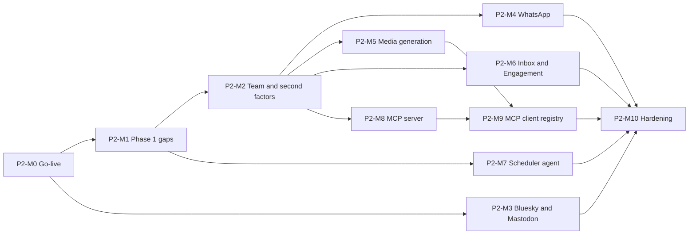

# 13 - Phase 2 Plan

Phase 2 is **breadth**: more platforms, a second approval channel, a team, generated media,
an inbox, and Mera drivable from Claude through MCP. The plan has the same shape as
[11 - Phase 1 Plan](11-phase1-plan.md): definition of done, scope decisions, milestones with
acceptance criteria, risks, what stays out, and a sprint order like
[12 - Implementation Plan](12-implementation-plan.md) §5.

Written 2026-11-09, after Sprint 14. Inputs: the phase map in
[00 - Overview](00-overview.md) §5, the Phase 2 rows of [05 - MCP](05-mcp.md) §3 and
[09 - Security](09-security.md) §13, WhatsApp in [07 - Approval Bots](07-approval-bots.md)
§4, the Media, Scheduler and Engagement agents in [06 - Agents](06-agents.md) §4.5, §4.8
and §4.10, and every item [PROGRESS.md](../PROGRESS.md) marks "Phase 2" or still open.

**Status (2026-11-13):** P2-M1 to P2-M10 are built and tested, including the release
security review, the Phase 2 browser journeys and the 50-account load check. Live
credentials (WhatsApp, an image provider, platform comment APIs, a real MCP client) are
still to try. What was built, what differs from this plan and why, is in
[ADR-0016](adr/0016-phase2-delivery-decisions.md) and [PROGRESS.md](../PROGRESS.md) *Phase 2*.

---

## 1. Definition of done for Phase 2

One sentence: **a small team, each person limited to the accounts they are allowed to
touch, runs several brands across seven platforms, approves from Telegram or WhatsApp
with second factors where it matters, answers comments from one inbox as the right
account, attaches generated images, and drives all of it from Claude through Mera's MCP
server, with every external MCP server sandboxed and every external write approved by a
person.**

All of these must be true:

1. **Phase 1 is live, not just built.** Every Phase 1 platform has made a real post through
   a real OAuth connection, the real Telegram bot has approved a real post set, CI is green
   on a runner, and the images build behind the corporate proxy (P2-M0).
2. Bluesky and Mastodon publish, report metrics, and take part in groups, staggering and
   the duplicate guardrail exactly like the Phase 1 platforms. A Mastodon account can live
   on any instance.
3. WhatsApp is a second `ApprovalChannel`: the same post set card, Approve all, per-account
   decisions, edit by reply and the kill switch work from WhatsApp, inside the 24-hour
   window, with templates outside it. Signatures are verified on every webhook.
4. A post-set request can be approved from Telegram, WhatsApp and the web at the same time,
   and a decision on any one shows on the others within one dispatch cycle.
5. Admins and Owners must use MFA. The high-risk actions in 09 §5.3 need a second factor
   (PIN from a bot, web confirmation, URL elicitation over MCP), configurable per workspace
   and on by default. Engaging the kill switch never does.
6. Member scopes can be managed in the UI, and a member scoped to one group cannot see,
   draft, approve, reply as or report on any other account from **any** surface: web, API,
   either bot, or MCP. Each surface has a cross-scope test.
7. Generated images can be requested from the Composer and from a bot card, show a cost
   estimate first, respect per-request and monthly ceilings, and go through approval like
   any other version change. Video is behind a flag and off unless Q9 says otherwise.
8. Comments on published posts are polled, shown in one inbox per workspace, and the
   Engagement agent drafts a reply **as the account that was commented on**. No reply is
   sent without approval, and a reply can never be sent as a different account.
9. The Scheduler agent proposes slots from the workspace's posting slots and history; the
   deterministic placement from Phase 1 still has the last word on caps, quiet hours and
   spacing.
10. Mera's MCP server works over stdio and Streamable HTTP, dual-era (`2026-07-28` and
    `2025-11-25`), with OAuth 2.1 and resource indicators. A Claude session can list
    content, draft a post set, request approval and read analytics. It **cannot** approve.
11. External MCP servers can be registered four ways (manual form, JSON import, discovery,
    Mera's own `add_mcp_server` proposal). Each starts `pending_review`, is allowlisted at
    three levels, runs stdio servers in `mcp-sandbox` behind the egress proxy with pinned
    versions, and every write tool call waits for a person's approval in a bot.
12. Workspace isolation tests now cover MCP (the clause 12 §1.2 P2 struck from Phase 1).
13. Coverage gates still pass, with the 100% floors extended to the second-factor policy,
    the WhatsApp window logic, the reply-identity check and the MCP allowlist resolver.
14. OpenAPI and SDK drift checks stay green; the MCP tool schemas are generated from the
    same service layer, so there is one source of truth for both.

---

## 2. Scope decisions

### 2.1 Go-live comes first

Phase 1 is built and verified against sandbox adapters and a fake Telegram transport. None
of it has touched a real platform. Phase 2 work on top of an unproven publish path would
multiply the cost of whatever the first live post finds, so **Sprint 15 is P2-M0: take
Phase 1 live.** Nothing else in this plan starts until Checkpoint D (§7) passes.

### 2.2 Bluesky and Mastodon are cheap and early

They need no app review and no paid tier, and the adapter port is proven by five
platforms. They go in the first feature sprint as a low-risk warm-up that also widens the
platform matrix before the team and inbox work changes the UI.

### 2.3 WhatsApp is the long pole, so start the paperwork now

Business verification, a dedicated number and nine pre-approved templates (07 §4.3) are a
multi-day external process with per-message costs. The code is perhaps one sprint; the
waiting is not. **Start verification in Sprint 15** so the templates are approved by the
time P2-M4 starts. If Q6 says WhatsApp is not wanted, P2-M4 drops out and nothing else
moves.

### 2.4 The MCP server before the MCP client

Following 05 §3: being drivable from Claude is useful immediately and its risk is
contained, because the server exposes Mera's own service layer under the caller's own
permissions. The client registry runs other people's code, so it ships only together with
its controls (sandbox, egress proxy, default deny, approval-gated writes). There is no
intermediate release with a registry and no sandbox.

### 2.5 Image generation now, video behind a flag

Image generation is seconds and fractions of a cent. Video is minutes and dollars, and it
is a second-factor action (09 §5.3). Phase 2 builds the job pipeline, cost estimate and
ceilings once, ships image providers, and leaves video providers configured off until Q9
is answered.

### 2.6 Quorum already exists; Phase 2 makes it a team feature

Per-account quorum (`any_of` / `all_of`, required count, strictest-wins) shipped in M6.5.
What Phase 2 adds is the team around it: named approvers per group in the UI, vote
progress on every approver's card, escalation to named people instead of "any Admin", and
out-of-office delegation.

### 2.7 Phase 1 carry-overs land where they belong

The open rows in PROGRESS.md "Carried forward" are folded into the milestone that touches
the same code, rather than collected into a cleanup sprint. Go-live blockers go into
P2-M0; the publishing and composer gaps into P2-M1.

---

## 3. Milestones

Ten milestones, each ending in something demonstrable. Sizes are relative effort (S, M,
L), as in docs/11.

P2-M2 sits on the critical path on purpose: second factors and member-scope enforcement
are what WhatsApp, the inbox, media generation and MCP all have to call, and retrofitting
them after those surfaces exist is how a scope leak ships.

---

### P2-M0 - Phase 1 go-live

**Goal:** the Phase 1 loop works against real platforms, a real bot and real CI.

| # | Task | Size |
| --- | --- | --- |
| 0.1 | Register developer apps (LinkedIn, Meta, Threads, X); configure callback URLs per [GUIDE.md](../GUIDE.md) | M |
| 0.2 | First live post per platform: LinkedIn profile, LinkedIn Page, Facebook Page, Instagram (with media), Threads, X; fix whatever the contract tests missed and record new cassettes | L |
| 0.3 | Real Telegram bot: BotFather, webhook over public HTTPS (Q3) or polling in dev, pairing from a real phone | S |
| 0.4 | CI green on a GitHub runner, including drift, coverage gates and security workflow | M |
| 0.5 | Docker images build behind the corporate TLS proxy with `CORP_CA_BUNDLE`; clean-machine `make up` under two minutes | M |
| 0.6 | Backup restore drill per runbook, timed | S |
| 0.7 | Playwright E2E for the approval loop (compose → approve all → staggered publish → report) | M |
| 0.8 | Outbound email `Notifier` (verification, invitations, health alerts) behind a provider port | M |
| 0.9 | `--forwarded-allow-ips` behind the reverse proxy; RLS and narrow grants on monthly audit partitions | S |
| 0.10 | Start WhatsApp Business verification and template submission (2.3) | S |

**Acceptance**

- **Checkpoint D:** one real post set reaches at least one real account on each Phase 1
  platform, approved from a real Telegram chat, published minutes apart, with metrics
  appearing on the Analytics screen within one sync.
- CI is green on `main` on a hosted runner.
- A teammate who has never run Mera gets a seeded stack with `make up` from the README alone.
- A restore from last night's backup to an empty database passes `/readyz` and the
  isolation tests.

---

### P2-M1 - Phase 1 gaps in publishing and the Composer

**Goal:** close the functional gaps PROGRESS.md deferred to Phase 2.

| # | Task | Size |
| --- | --- | --- |
| 1.1 | Approval validity vs far-out scheduling: measure validity from the scheduled time, or refuse at submission; decide in an ADR and test both edges | M |
| 1.2 | Banned-word and banned-tag recheck in `assert_publishable` (settings may change after approval) | S |
| 1.3 | Hashtag registry CRUD, banned-tag guardrail, Hashtag screen | M |
| 1.4 | Post templates (docs/04): CRUD, "start from template" in the Composer | M |
| 1.5 | Facebook / Instagram multi-Page picker at connect time | M |
| 1.6 | `posting-slots` endpoints (docs/04 §4.10) and a slots editor in Automation | M |
| 1.7 | Agent run retry and abort | S |
| 1.8 | Alt-text generation per rendition (vision call), always editable | M |
| 1.9 | Instagram carousel planner skill | S |
| 1.10 | Map Pydantic validation errors to product copy; replace stale web platform catalogue copies with the API's | S |
| 1.11 | BFF refresh dedupe moves to shared state so the web tier can run more than one instance | S |
| 1.12 | Analytics CSV export becomes a 202-and-link job (docs/04 §4.12) | S |

**Acceptance**

- A post approved now and scheduled for next week publishes next week, or is refused at
  submission with a clear reason, per the ADR; never dead-letters `approval_stale` silently.
- Adding a banned word after approval stops the queued post with a visible reason.
- A workspace with three Facebook Pages connects the second one without reconnecting.

---

### P2-M2 - Team, member scopes and second factors

**Goal:** several people share a workspace safely.

| # | Task | Size |
| --- | --- | --- |
| 2.1 | Member scope management UI (Team screen becomes editable; API exists since 2.9b) | M |
| 2.2 | Scope enforcement audit across web, API, bot and (stubbed) MCP; cross-scope test per surface | M |
| 2.3 | MFA (TOTP + recovery codes) for all; enforced for Admin and Owner | M |
| 2.4 | `user.approval_pin_hash` (Argon2id), PIN setup and reset, lockout (12 §1.1 C5) | M |
| 2.5 | `SecondFactorPolicy` for the 09 §5.3 action list, per-workspace toggles, default on | M |
| 2.6 | Second factor from Telegram (PIN prompt or web confirmation link), never through a model | M |
| 2.7 | `workspace_secret` and `security_event` tables (C5); security events for MFA, PIN and lockouts | S |
| 2.8 | Named approvers per group, vote progress on every approver's card, escalation chain to named people, out-of-office delegation | L |
| 2.9 | Per-account rate budgets (09 §13 Phase 2) | S |

**Acceptance**

- Resuming a kill switch, disconnecting an account and publishing to a company Page each
  ask for a second factor from both the web and Telegram; engaging the kill switch does
  not.
- A Group-scoped Editor receives no card, no event and no search result for accounts
  outside the group, on every surface.
- An `all_of` request with three named approvers shows "2 of 3 approved" on each of their
  cards and publishes only after the third.
- Property test: no sequence of scope changes and decisions lets a member decide an
  account outside their scope.

---

### P2-M3 - Bluesky and Mastodon

**Goal:** seven platforms.

| # | Task | Size |
| --- | --- | --- |
| 3.1 | Bluesky adapter: AT Protocol session, facets for links and mentions, image blobs, threads | M |
| 3.2 | Bluesky connector (OAuth for AT Protocol where available, app password otherwise, encrypted) | S |
| 3.3 | Mastodon adapter: per-instance base URL, media upload, visibility, content warnings | M |
| 3.4 | Mastodon connector: dynamic per-instance app registration, OAuth | M |
| 3.5 | Platform skills for both (vendored, pinned, checksum-verified like Phase 1's) | S |
| 3.6 | Capabilities, renditions, metrics mapping, "Not reported" where the platform has none | S |
| 3.7 | Contract cassettes and fake adapters; seed accounts | S |

**Acceptance**

- A group with two Bluesky accounts and one Mastodon account gets three distinct posts,
  staggered, with the duplicate guardrail passing.
- A Mastodon account on a second instance connects without a code change.

---

### P2-M4 - WhatsApp approval channel

**Goal:** approve from WhatsApp as well as Telegram. Depends on Q6 and on verification
started in P2-M0.

| # | Task | Size |
| --- | --- | --- |
| 4.1 | `WhatsAppChannel` implementing `ApprovalChannel`; Cloud API client; `X-Hub-Signature-256` verification | M |
| 4.2 | Window management (07 §4.2): free-form inside 24 h, templates outside, re-open prompt | M |
| 4.3 | Template catalogue (07 §4.3), nine templates, versioned with their approval ids | M |
| 4.4 | Three buttons, many accounts (07 §4.4): list messages for per-account decisions | M |
| 4.5 | Pairing by phone, edit by reply, commands subset, kill switch | M |
| 4.6 | Cost tracking per message category and a monthly ceiling | S |
| 4.7 | Runbook: replace the [WhatsApp setup](runbooks/whatsapp-business-setup.md) stub | S |

**Acceptance**

- The Telegram integration suite runs a second time against the WhatsApp channel with the
  same assertions (parametrized), plus window-specific tests.
- A card sent 25 hours after the last user message goes out as a template and still
  decides correctly.
- A forged webhook is refused before parsing.

---

### P2-M5 - Media generation

**Goal:** generated images in the Composer and from the bot, with costs known in advance.

| # | Task | Size |
| --- | --- | --- |
| 5.1 | `MediaGenerator` port; first image provider via configuration (Q9); fake for sandbox | M |
| 5.2 | `media/generate` endpoints (docs/04 §4.7): estimate, job, status, cancel | M |
| 5.3 | Generation job on its own queue with timeout, retry and per-request and monthly cost ceilings | M |
| 5.4 | Media agent (06 §4.5): prompt from the post and the account profile, safety screening, alt text | M |
| 5.5 | Composer: generate, regenerate, pick, crop to renditions; result is a new version | M |
| 5.6 | Bot: "🎨 Regenerate image" on cards, with cost shown; above-ceiling needs a second factor | S |
| 5.7 | Video providers behind a flag, off by default; second factor always (09 §5.3) | S |

**Acceptance**

- Attaching a generated image to an approved post invalidates that account's approval only.
- A request above the ceiling is refused before any provider call.
- Spend per workspace is visible in Settings and matches the provider's invoice within 5%.

---

### P2-M6 - Unified inbox and Engagement agent

**Goal:** answer comments from one place, as the right account.

| # | Task | Size |
| --- | --- | --- |
| 6.1 | `comment`, `reply`, `engagement_rule` tables (03 §8), RLS, migration | M |
| 6.2 | Tapering comment poll per published post (`comment_cursor_at`), per adapter | L |
| 6.3 | Engagement agent (06 §4.10): triage, draft reply in the account's voice, flags | M |
| 6.4 | Reply approval: reuses the approval core with a `reply` subject; reply identity bound to the commented account in `assert_publishable` | M |
| 6.5 | Inbox screen out of its flag: filters by group, account, platform, sentiment; bulk triage | L |
| 6.6 | Reply cards in Telegram (and WhatsApp when M4 is in) | M |
| 6.7 | Deleting a comment is a second-factor action | S |

**Acceptance**

- A comment on the X @tech post can only be answered as X @tech; a test forges the account
  id and is refused at publish.
- Polling a 30-day-old post stops on schedule; a fresh post is polled every few minutes.
- Comments are treated as untrusted input: an injection test comment cannot change the
  agent's target account, tools or approval state.

---

### P2-M7 - Scheduler agent and full orchestration

**Goal:** the agent suggests when; the policy still decides whether.

| # | Task | Size |
| --- | --- | --- |
| 7.1 | Scheduler agent (06 §4.8): proposes slots from posting slots and engagement history | M |
| 7.2 | Deterministic placement remains authoritative; agent proposals are inputs, logged with reasons | S |
| 7.3 | Orchestration: Research → Writer → Hashtag → Media → Editor → Scheduler as one run, resumable | M |
| 7.4 | Agents screen shows the full run graph with per-step cost | S |

**Acceptance**

- No agent proposal can place a post inside quiet hours, above a cap or closer than the
  spacing rules; property test over random proposals.

---

### P2-M8 - Mera's MCP server

**Goal:** drive Mera from Claude. 05 §3, Phase 2 rows one to five.

| # | Task | Size |
| --- | --- | --- |
| 8.1 | `mcp` service; stdio transport with API-key auth; dual-era negotiation | M |
| 8.2 | Streamable HTTP; OAuth 2.1 with CIMD, resource indicators, incremental consent | L |
| 8.3 | Tool set over the service layer with annotations and output schemas; resources and `subscriptions/listen` | L |
| 8.4 | URL-mode elicitation for second factors and workspace selection; secrets never pass through the model | M |
| 8.5 | Prompts: `setup_wizard`, `group_setup` | S |
| 8.6 | MCP surface added to every isolation and scope test (DoD 12) | M |
| 8.7 | MCP screen out of its flag: connected clients, keys, recent calls | M |

**Acceptance**

- From Claude: "draft a post for Tech News about this link and send it for approval"
  produces a post set and a Telegram card; the approval happens on the phone.
- No tool approves, resumes a kill switch or reveals a credential; a test enumerates the
  tool list and asserts it.

---

### P2-M9 - MCP client registry with its controls

**Goal:** agents can use external MCP servers you choose, safely. 05 §3, rows six to
eleven; 09 §13.

| # | Task | Size |
| --- | --- | --- |
| 9.1 | Registry: manual form, JSON import, discovery, `add_mcp_server` proposal; `pending_review` | M |
| 9.2 | Dual-era detection, tool discovery, risk classification on review | M |
| 9.3 | Three-level allowlisting (workspace, group, agent); default deny | M |
| 9.4 | `mcp-sandbox` container for stdio servers (gVisor if the host allows, Q10), pinned packages | L |
| 9.5 | Egress proxy with per-server allowlist | M |
| 9.6 | External OAuth 2.1 (CIMD, PKCE, RFC 8707, `iss` validation); issuer-keyed encrypted credentials | M |
| 9.7 | Approval-gated write tools: `mcp_tool_call` approvals on bot cards with arguments shown | M |
| 9.8 | Results treated as untrusted (prompt-injection layers apply) | S |
| 9.9 | MCP-backed media generation provider; "MCP integrations" tool group on Mera's own server | M |
| 9.10 | Incident path: disable a registration instantly, stop its sandbox, cancel pending calls (09 incident table) | S |

**Acceptance**

- A newly registered server is unusable until an Admin approves it with a second factor.
- A stdio server cannot reach a host outside its egress allowlist (test from inside the
  sandbox).
- A write tool call made during a drafting run waits on a bot card and does nothing if
  rejected or expired.

---

### P2-M10 - Hardening and release

| # | Task | Size |
| --- | --- | --- |
| 10.1 | Security review of M2, M4, M6, M8, M9 (scopes, webhooks, reply identity, MCP auth, sandbox escape) | L |
| 10.2 | Playwright E2E extended: WhatsApp (fake), inbox reply, MCP draft-to-approval | M |
| 10.3 | Load check with seven platforms, 50 accounts, inbox polling on | M |
| 10.4 | Runbooks: WhatsApp, MCP server for Claude, registering an MCP server, MFA recovery, revoking a compromised MCP server | M |
| 10.5 | ADR-0016 (Phase 2 delivery decisions), docs and PROGRESS updated, 00 §5 phase map refreshed | S |

**Acceptance:** §1 holds end to end, in the browser and on a phone.

---

## 4. Risks

| Risk | Likelihood | Impact | Mitigation |
| --- | --- | --- | --- |
| First live posts expose adapter bugs the cassettes did not | High | High | P2-M0 before anything else; fix in the adapters, re-record cassettes |
| LinkedIn or Meta app review takes weeks | Medium | High | Start in Sprint 15; Bluesky and Mastodon keep the live loop provable meanwhile |
| WhatsApp verification or template rejection stalls | Medium | Medium | Start in Sprint 15; M4 is off the critical path and can slip a sprint |
| Scope enforcement drifts as surfaces multiply | Medium | High | P2-M2 before the new surfaces; one parametrized cross-scope suite every surface must join |
| Engagement agent replies as the wrong account | Low | High | Identity bound in `assert_publishable`; every reply approved; forged-id test |
| Generation costs surprise | Medium | Medium | Estimate first, hard ceilings, video off, second factor above ceiling |
| `mcp-sandbox` cannot use gVisor on the target host | Medium | High | Q10 early; fall back to a rootless container with seccomp and no stdio servers until hardened |
| Third-party MCP servers change their tool schemas | Medium | Medium | Pull re-discovery re-review forward from Phase 3 if Q10 says third-party |
| MCP spec moves again | Medium | Low | Dual-era support already designed in; conformance tests per era |

---

## 5. Explicitly out of Phase 2

These stay in Phase 3 or later, per 00 §5 and 05 §3:

- Autopilot modes beyond manual approval, and the analytics insight loop that feeds them.
- Hashtag selection from performance history (`hashtag_stat`).
- A/B tests, daily digests, outbound webhooks, workspace cloning (the 501 stays).
- MCP Registry catalog, per-agent call budgets, circuit breakers, tool-description
  screening, re-discovery re-review (unless Q10 pulls it forward), the Tasks extension,
  the `mcp` source type.
- GDPR export and erasure endpoints, security event stream and alerting.
- Phase 4: mobile and desktop apps, custom agent builder, billing, Slack and Teams,
  YouTube and Reddit, KMS or Vault key provider, MCP Apps cards inside Claude.

---

## 6. Questions to answer before Sprint 16

| # | Question | Blocks |
| --- | --- | --- |
| Q3 | Telegram: public HTTPS webhook in production from the start, or polling? | P2-M0 deploy shape |
| Q4 | Content pillars and brand voice (still open since Phase 1) | Writer evals, seed realism |
| Q6 | WhatsApp: wanted in Phase 2? Which business, which number? | P2-M4 (and the paperwork in Sprint 15) |
| Q7 | LinkedIn personal analytics are thin; acceptable? | Analytics copy; nothing structural |
| Q8 | How many accounts per platform in one group? | Load check sizing, duplicate guardrail tuning |
| Q9 | Image provider; video yes or no in Phase 2? | P2-M5 |
| Q10 | Which MCP servers first: stdio? third-party hosted? per-user OAuth? | P2-M9 shape and the sandbox host |
| New | Mastodon instance(s) and Bluesky handles to test against | P2-M3 |
| New | Approval validity: measure from scheduling or refuse far-out requests? | P2-M1.1 |
| New | Email provider for the `Notifier` (SMTP relay, SES, other) | P2-M0.8 |

Spec fixes C4 to C7 in 12 §1.1 that are still open get done in Sprint 15 alongside these,
because M2 and M8 depend on C5 (PIN and `security_event`) and C7 (endpoints in 04).

---

## 7. Sprint order

Two-week sprints, the same assumed team as 12 §5 (two backend, one frontend). One person
runs the tracks serially; the checkpoints do not move.

| Sprint | Backend | Frontend | Checkpoint |
| --- | --- | --- | --- |
| 15 | **P2-M0 go-live**: app registrations, live posts, real bot, CI, image builds, Notifier, restore drill; start WhatsApp verification | Playwright E2E for the Phase 1 loop; fixes from live runs | **Checkpoint D**: real post set on every Phase 1 platform, approved from a real phone |
| 16 | P2-M1 (validity ADR, banned recheck, hashtags, templates, Page picker, slots) | Hashtag screen, templates in Composer, slots editor | Far-out scheduled post behaves per ADR |
| 17 | P2-M3 Bluesky + Mastodon; P2-M1 leftovers (alt text, agent retry) | Platform catalogue from API; error copy | Seven platforms in one group |
| 18–19 | P2-M2 team, scopes, MFA, PIN, second factors, named approvers | Team screen editable, MFA and PIN setup, vote progress | **Checkpoint E**: cross-scope suite green on web, API and bot |
| 20 | P2-M4 WhatsApp (if Q6 = yes) | Approval Channels: WhatsApp pairing | Same card decided from WhatsApp and Telegram |
| 21 | P2-M5 media generation | Composer generate / regenerate, spend in Settings | Generated image approved and published |
| 22–23 | P2-M6 inbox and Engagement agent; P2-M7 Scheduler agent | Inbox screen | **Checkpoint F**: a real comment answered as the right account from the phone |
| 24 | P2-M8 MCP server | MCP screen | Draft-to-approval from Claude |
| 25 | P2-M9 MCP client registry, sandbox, egress | Registry review screens | Hostile-server test suite green |
| 26 | P2-M10 hardening | WCAG pass on new screens, E2E extensions | **Phase 2 DoD** (§1) |

**Critical path:** Sprint 15 → P2-M2 → P2-M8 → P2-M9 → P2-M10. M3, M4 and M7 can each slip
a sprint without moving the end date. M0 and M2 cannot.

**Where to spend review effort**, in order:

1. Second-factor policy and scope enforcement across surfaces (P2-M2).
2. Reply identity in `assert_publishable` (P2-M6).
3. `mcp-sandbox`, egress and allowlist resolution (P2-M9).
4. WhatsApp window and template logic (P2-M4).
5. Everything else.
