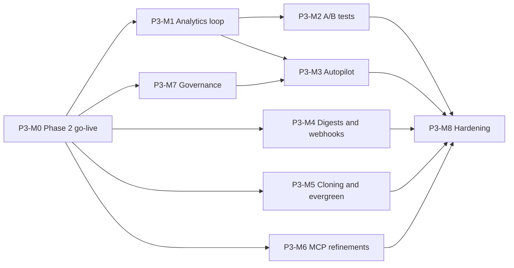

# 14 - Phase 3 Plan

Phase 3 is **intelligence and autonomy**. Phase 2 gave Mera breadth: seven platforms, two
approval channels, a team, an inbox, generated media and MCP in both directions. Phase 3
makes it learn from what it published and, where a person has said so, act without
asking. The plan has the same shape as [13 - Phase 2 Plan](13-phase2-plan.md): definition
of done, scope decisions, milestones with acceptance criteria, risks, what stays out,
questions, and a sprint order.

Written 2026-11-13, after Phase 2. Inputs:

- the Phase 3 row of [00 - Overview](00-overview.md) §5;
- the Phase 3 rows of [05 - MCP](05-mcp.md) §3 and [09 - Security](09-security.md) §13;
- the autopilot flow in [02 - Sequence Flows](02-sequence-flows.md) and the guardrails in
  [06 - Agents](06-agents.md);
- `hashtag_stat`, `insight`, workspace cloning and A/B labels in
  [03 - Data Model](03-data-model.md);
- webhooks in [04 - API Contract](04-api-contract.md) §4.14 and digests in
  [07 - Approval Bots](07-approval-bots.md);
- everything [PROGRESS.md](../PROGRESS.md) and
  [ADR-0016](adr/0016-phase2-delivery-decisions.md) leave open.

**Status (2026-11-13):** built and security-reviewed, P3-M1 to P3-M8, migrations 0023
to 0029. P3-M0.1–0.6 still need live credentials. Not built: the MCP Tasks extension
(6.5), MCP `set_autopilot_mode` (3.7), Undo and the daily unattended summary (3.5). The
new E2E journeys and the load re-check are still to run. Decisions and the review's
follow-ups are in [ADR-0017](adr/0017-phase3-delivery-decisions.md).

---

## 1. Definition of done for Phase 3

1. Phase 2 runs against real services: a WhatsApp number, an image provider, the
   platforms' comment APIs, a real Claude client, and the sandbox containers on a Docker
   host with gVisor or the documented fallback.
2. Every published post's engagement is attributed to the hashtags it used
   (`hashtag_stat`). The Hashtag agent ranks tags by measured lift, and a tag with too
   few samples says so instead of claiming a lift.
3. A weekly insight run per workspace and per group writes `insight` rows. Each row
   cites the deterministic aggregate it came from, and the Analytics agent only narrates
   and recommends.
4. Analytics compares group against group and account against account with "not
   reported" cells kept honest. The weights that feed Research scoring, the Scheduler and
   the Hashtag agent move by at most 15% per run, and every move is visible and
   reversible.
5. A/B tests: a variant can get a labelled counterpart. Both go through approval like any
   other variant, results are attributed per label, and a result is called only above a
   stated sample size.
6. **Assisted and Full Autopilot** can be enabled per workspace, group and account,
   resolving to the strictest. An unattended publish carries its own ledger entry
   (`via_autopilot`) and passes every guardrail `assert_publishable` checks today.
   Turning on Full needs a second factor. Company Pages stay Manual unless an Owner opts
   them in one by one. Deleting or hiding comments always needs a person.
7. Daily approval digests on Telegram, WhatsApp (template `mera_daily_digest`) and
   email, counting sets and posts separately.
8. Outbound webhooks: signed deliveries, retries with backoff, a deliveries log, and the
   guarded transport (public addresses only).
9. Workspace cloning copies settings, voices, pillars, sources, policies, agent
   definitions and group shapes, and **never** accounts, credentials, content or history.
   The 501 is gone.
10. External MCP gains:
    - a curated catalog backed by the MCP Registry;
    - per-agent call and time budgets;
    - circuit breakers (five failures open the circuit for 60 s);
    - the Tasks extension for long-running calls;
    - the `mcp` source type.
11. Governance:
    - a security event stream with alerting;
    - GDPR export and erasure endpoints;
    - step-up through the identity provider for provider-only accounts;
    - refresh of external MCP OAuth tokens ahead of expiry.
12. A release security review with every high and medium fixed, browser journeys for
    autopilot, A/B, digests and cloning, and a load check with insights on.

---

## 2. Scope decisions

### 2.1 Go-live of Phase 2 comes first

Phase 2 was verified against fakes: a fake Graph API, a sandbox image provider, fake
comment adapters. P3-M0 runs it for real before anything new is built, for the same
reason P2-M0 did for Phase 1: live services find what cassettes do not. It also closes
the follow-ups the Phase 2 release review left open (ADR-0016 §41, §43).

### 2.2 The analytics loop needs history, so it starts early and decides late

Insights, hashtag lift, slot learning and A/B results are only as good as the weeks of
real metrics behind them. P3-M1 builds the attribution and aggregation first, so
history accumulates while the rest of the phase is built. The parts that *act* on it
(weight moves, autopilot thresholds) come later and are gated on sample sizes. Before
then they say "not enough data" instead of guessing.

This is also where the Scheduler agent gets its minimum: today it will move a post to an
hour that one or two past posts favoured, possibly days away (PROGRESS.md, *Follow-ups*).
P3-M1 adds a minimum sample size and a maximum shift for a post with no requested time.

### 2.3 Autopilot is a policy change, not a feature, so it gets its own ADR first

Everything Mera guarantees today rests on "nothing publishes without an approved
version", which ADR-0014 and `assert_publishable` enforce. Autopilot adds a second kind
of authorization, not an exception. The design, written as an ADR before P3-M3 starts:

- **Authorization is recorded, never implied.** An autopilot publish writes an
  authorization row bound to the exact content hash, the resolved mode, the confidence
  score and the guardrail results, just as a human decision is bound to a hash. It goes
  in the same ledger, and `assert_publishable` accepts *either* an approved decision *or*
  a live autopilot authorization for that hash.
- **Strictest wins, as already built.** A company Page pinned to Manual stays Manual
  inside a group on Full.
- **Assisted** publishes unattended only above the confidence threshold *and* with no
  Warn-level guardrail. Any Warn forces a person, per 06.
- **Full** still blocks on every Block guardrail and defers on quiet hours. It is
  enabled per scope with a second factor and an audit entry.
- **Earned, not toggled** (proposed): a scope can enable Assisted only after a minimum
  number of human approvals on it with a low edit rate. The numbers are a question
  (§6, Q14).
- **The kill switch and the people stay in charge.** Every unattended publish sends an
  FYI with Undo where the platform allows deletion. Deleting and hiding comments, and
  anything second-factored, never run unattended.

### 2.4 Confidence has to mean something before anything thresholds on it

Assisted mode thresholds `confidence_score` (06 §3). Before P3-M3 relies on it, P3-M1
calibrates it against history: the share of variants approved unedited at each
confidence band. If the score does not separate those outcomes, Assisted stays off.

### 2.5 MCP refinements are smaller than they look

Phase 2 already shipped part of the Phase 3 MCP list:

- schema-change disabling, which is re-discovery re-review;
- poisoning flags, which is tool-description screening.

P3-M6 completes them (re-review on description changes, screening of argument
descriptions) and adds what is genuinely new: the catalog, budgets, circuit breakers,
Tasks and the `mcp` source type.

### 2.6 Webhooks are another way out, so they get the egress rules

An outbound webhook is Mera calling a URL a person typed. It uses the same guarded
transport as Bluesky, Mastodon and external MCP, signs every delivery with
HMAC-SHA256 under a per-endpoint secret, and never follows redirects.

---

## 3. Milestones

Nine milestones, each ending in something demonstrable. Sizes are relative effort (S, M,
L).

P3-M3 sits after M1 and M7 on purpose. Autopilot needs calibrated confidence (M1) and
the security event stream and alerting (M7). An unattended publish that nobody can be
alerted about is the failure mode this product exists to prevent.

### P3-M0 - Phase 2 go-live

**Goal:** Phase 2 works against real services.

| # | Task | Size |
| --- | --- | --- |
| 0.1 | WhatsApp: verified business number, both templates approved, a real pairing and approval | M |
| 0.2 | Image provider: real generation, invoice reconciled within 5% of recorded spend | S |
| 0.3 | Comment APIs: Facebook, Instagram, Threads, Mastodon, Bluesky polled live; a real reply sent | M |
| 0.4 | A real Claude client against `/mcp` over HTTP with OAuth; draft-to-approval | S |
| 0.5 | `mcp-sandbox` and `mcp-egress` built and run on a Docker host (gVisor or the fallback); hostile-server suite in containers | M |
| 0.6 | CI on a real runner: backend, web, E2E, image builds, the security workflow | M |
| 0.7 | Scheduler agent minimum samples and maximum shift (§2.2) | S |

**Acceptance**

- Each Phase 2 *Not yet verified* item in PROGRESS.md is checked or has a written reason.
- CI is green on the default branch, including the Playwright journeys.

### P3-M1 - The analytics loop

**Goal:** Mera learns from what it published, and shows its working.

| # | Task | Size |
| --- | --- | --- |
| 1.1 | Hashtag attribution in the metrics worker: `hashtag_stat` per tag and account, lift against the account median, sample size | M |
| 1.2 | Hashtag agent ranks by measured lift above a minimum sample; "not enough data" below it; Composer evidence table shows the Measured column | M |
| 1.3 | Deterministic aggregates per workspace, group, account: topic, pillar, slot, platform, approval turnaround, account-vs-account and group-vs-group | L |
| 1.4 | Weekly `generate_insights`: Analytics agent narrates from aggregates; each `insight` row cites its aggregate; weekly email | M |
| 1.5 | Weights for source, pillar, slot and hashtag: at most 15% per run, history kept, revert per weight | M |
| 1.6 | Confidence calibration report: approved-unedited rate per confidence band, per account | S |
| 1.7 | Analytics screen: Insights panel, group-vs-group comparison, weights with their history | M |

**Acceptance**

- Every insight sentence links to the number it came from; a property test feeds random
  aggregates and checks no insight cites a missing one.
- A weight never moves more than 15% in one run, and a revert restores the previous value
  exactly.
- With fewer samples than the minimum, the UI and the agents say so; no lift is shown.

### P3-M2 - A/B tests

**Goal:** test two versions of one account's post honestly.

| # | Task | Size |
| --- | --- | --- |
| 2.1 | `POST …/variants/{vid}/ab`: a labelled counterpart (B) with its own version and hash | M |
| 2.2 | Both labels approved like any variant; placement keeps the two apart by the account's spacing | S |
| 2.3 | Results per label; a winner called only above the minimum sample and with the interval shown | M |
| 2.4 | Composer and post set view: create, compare, results | M |

**Acceptance**

- An A/B pair never publishes either label unapproved, and the duplicate guardrails treat
  A and B on one account as the same post for cross-account checks.
- Below the minimum sample the result reads "too early", never a winner.

### P3-M3 - Assisted and Full Autopilot

**Goal:** where a person has said so, Mera publishes without asking, and can always be
stopped.

| # | Task | Size |
| --- | --- | --- |
| 3.1 | ADR-0017 section: autopilot authorization (§2.3) | S |
| 3.2 | Migration: `autopilot_authorization` bound to content hash, mode, confidence, guardrail results; `assert_publishable` accepts it | L |
| 3.3 | Mode resolution enabled for Assisted and Full; strictest wins; Full and Company Pages need a second factor and an Owner | M |
| 3.4 | Earned enablement: minimum approvals and maximum edit rate per scope (Q14) | M |
| 3.5 | FYI notices on every channel with Undo where the platform allows deletion; daily summary of unattended posts | M |
| 3.6 | Automation screen: modes per scope with what they resolve to, and why | M |
| 3.7 | MCP `set_autopilot_mode` (Admin, second factor via URL elicitation) | S |

**Acceptance**

- A property test over random scopes, modes, confidences and guardrail outcomes: nothing
  publishes unattended when any rule says no, and the strictest mode always wins.
- Engaging any kill switch stops queued unattended posts in its scope before their next
  attempt.
- Every unattended publish has an authorization row, an audit entry and an FYI.

### P3-M4 - Daily digests and outbound webhooks

**Goal:** fewer interruptions for approvers; other systems can listen.

| # | Task | Size |
| --- | --- | --- |
| 4.1 | Daily digest per approver at their morning local time, grouped by account group, sets and posts counted separately | M |
| 4.2 | WhatsApp digest template `mera_daily_digest`; email digest; bulk mode opts a person into digest-only | M |
| 4.3 | Webhooks (04 §4.14): endpoints, event filter, HMAC signature, retries with backoff, deliveries log, guarded transport | L |
| 4.4 | Settings: webhooks with test delivery and secret rotation | S |

**Acceptance**

- A webhook to a private address, a redirect or a non-https URL is refused; a signature
  verifies with the documented recipe.
- A digest never contains a request the person cannot decide (member scopes hold).

### P3-M5 - Workspace cloning and evergreen recycling

**Goal:** set up a new brand in minutes; good posts can run again, with approval.

| # | Task | Size |
| --- | --- | --- |
| 5.1 | Clone: settings, voices, pillars, sources, policies, agent definitions, group shapes; `cloned_from_workspace_id` | M |
| 5.2 | Never copied: accounts, credentials, content, history, members (a test asserts each) | S |
| 5.3 | Evergreen: `is_evergreen` posts proposed for re-use after a cool-down, refreshed by the Writer, through approval as a new version | M |

**Acceptance**

- A clone shares no row with its source except by provenance, verified by walking every
  `workspace_id` table.

### P3-M6 - External MCP refinements

**Goal:** finish the MCP client's controls and make good servers easy to find.

| # | Task | Size |
| --- | --- | --- |
| 6.1 | Curated catalog backed by the MCP Registry: pinned versions, publisher, review notes; install = registration in `pending_review` | M |
| 6.2 | Per-agent call and time budgets per run and per day | M |
| 6.3 | Circuit breaker: five failures open for 60 s, `degraded`, half-open probe | S |
| 6.4 | Re-review on description change as well as schema change; argument descriptions screened | S |
| 6.5 | Tasks extension for long-running external calls and for `generate_media` | M |
| 6.6 | `mcp` source type: ingest from an approved read tool | M |

**Acceptance**

- The hostile-server suite gains a slow server, a flapping server and a server that
  rewrites its description, and each is contained.

### P3-M7 - Governance and security

**Goal:** know when something is wrong, and honour data rights.

| # | Task | Size |
| --- | --- | --- |
| 7.1 | Security event stream: `security_event` and audit events to alert rules (lockouts, rejected second factors, reuse detection, autopilot changes) by email and channel | M |
| 7.2 | GDPR export (per person, per workspace) and erasure walk per 09 §9.4, with a grace period | L |
| 7.3 | Step-up through the identity provider for provider-only accounts (two-step setup, PIN, re-authentication) | M |
| 7.4 | Refresh external MCP OAuth tokens ahead of expiry | S |

**Acceptance**

- Five wrong codes for one person raise an alert within a minute.
- An erasure leaves no row with the person's id outside the audit log's retained,
  pseudonymised entries.

### P3-M8 - Hardening and release

Release security review (autopilot authorization first), browser journeys for autopilot
with Undo, an A/B pair, a digest, a webhook and a clone, a load check with insights and
digests on, coverage gates, and ADR and PROGRESS updates.

**Acceptance:** §1 holds end to end, in the browser and on a phone.

---

## 4. Risks

| Risk | Likelihood | Impact | Mitigation |
| --- | --- | --- | --- |
| An unattended post goes out that a person would have stopped | Medium | High | Earned enablement, Warn forces a person, Company Pages opt-in, FYI with Undo, kill switch, property test; autopilot reviewed first |
| Too little real history for insights or A/B to mean anything | High | Medium | M1 early; sample minimums everywhere; "not enough data" is a valid answer |
| Confidence score does not predict approval | Medium | High | Calibrate in M1; Assisted stays off if it fails (§2.4) |
| Weights drift and degrade content | Medium | Medium | 15% cap per run, history, one-click revert, insights cite evidence |
| Webhooks become an SSRF path | Low | High | Guarded transport, no redirects, https only, tests |
| GDPR erasure misses a table | Medium | High | Walk generated from the `workspace_id` graph; test asserts every table is covered |
| Phase 2 live checks find adapter bugs | High | Medium | P3-M0 first, as P2-M0 was |
| Platform automation rules tighten (X especially) | Medium | High | Per-platform autopilot opt-out; adapters' `platform_policy` guardrail stays Block |

---

## 5. Explicitly out of Phase 3

Phase 4, per 00 §5, 05 §3 and 09 §13:

- mobile and desktop clients with push approvals;
- the custom agent builder, and MCP steps in custom workflows;
- agency features: many client workspaces, white-label reports;
- billing from usage records;
- Slack and Teams approval channels;
- YouTube and Reddit adapters;
- MCP Apps cards inside Claude;
- a KMS or Vault key provider, an SBOM per release, a penetration test, SOC 2 style
  evidence.

Also out: video generation unless Q9 changes, and any autopilot for comment deletion or
hiding (never).

---

## 6. Questions to answer before P3-M1

| # | Question | Blocks |
| --- | --- | --- |
| Q11 | Which live services and numbers for Phase 2 go-live (WhatsApp business, image provider, test accounts)? | P3-M0 |
| Q12 | Minimum samples for a hashtag lift, a slot score and an A/B result (proposed: 10, 8, 30 per label) | P3-M1, P3-M2 |
| Q13 | Is autopilot wanted at all, and for which accounts first? | P3-M3 scope |
| Q14 | Earned enablement numbers (proposed: 30 human approvals on the scope, under 10% edited) | P3-M3.4 |
| Q15 | Digest time and channels per approver; is email a channel? | P3-M4 |
| Q16 | First webhook consumers and events (Zapier, a data warehouse, Slack via webhook)? | P3-M4.3 event set |
| Q17 | GDPR: which jurisdictions, retention of pseudonymised audit entries, grace period | P3-M7.2 |
| Q18 | Which MCP servers belong in the curated catalog first? | P3-M6.1 |
| Q19 | Alert destinations for the security event stream | P3-M7.1 |

---

## 7. Sprint order

Two-week sprints, the same assumed team (two backend, one frontend), continuing from
Sprint 26.

| Sprint | Backend | Frontend | Checkpoint |
| --- | --- | --- | --- |
| 27 | **P3-M0** live services, CI, sandbox containers, Scheduler minimums | Fixes from live runs | **Checkpoint G**: Phase 2 live on real services |
| 28–29 | P3-M1 attribution, aggregates, insights, weights, calibration | Analytics: Insights, comparison, weights | Weekly insight with cited evidence |
| 30 | P3-M7 security events and alerting, step-up, MCP token refresh | Alerts settings, step-up flows | Lockout alert within a minute |
| 31 | P3-M4 digests and webhooks | Webhooks settings, digest preferences | Digest on a phone; signed delivery verified |
| 32–33 | **P3-M3 autopilot** (its ADR-0017 section in Sprint 31) | Automation screen, FYI and Undo | **Checkpoint H**: Assisted publishes one account unattended and the kill switch stops it |
| 34 | P3-M2 A/B tests; P3-M7 GDPR export and erasure | Composer A/B, results | A/B pair approved, both published, result "too early" |
| 35 | P3-M5 cloning and evergreen; P3-M6 MCP refinements | Clone flow, catalog | Clone shares no rows; flapping server contained |
| 36 | P3-M8 hardening | WCAG pass, E2E extensions | **Phase 3 DoD** (§1) |

**Critical path:** P3-M0 → P3-M1 → P3-M3 → P3-M8, with P3-M7's alerting before M3. P3-M2,
M4, M5 and M6 can each slip a sprint without moving the end date.

**Where to spend review effort**, in order:

1. Autopilot authorization in `assert_publishable` and mode resolution (P3-M3).
2. GDPR erasure completeness (P3-M7).
3. Webhook egress and signing (P3-M4).
4. Weight moves and evidence citing (P3-M1).
5. Everything else.
